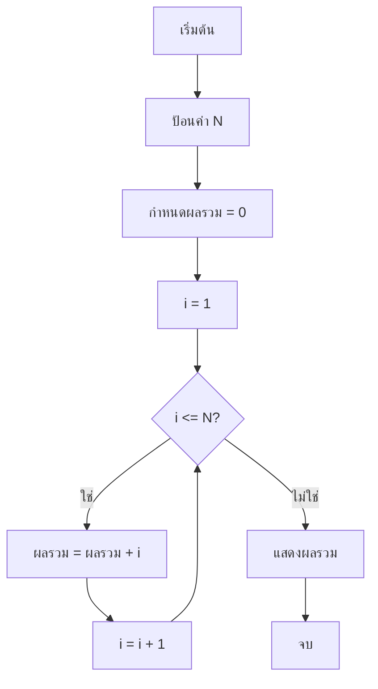
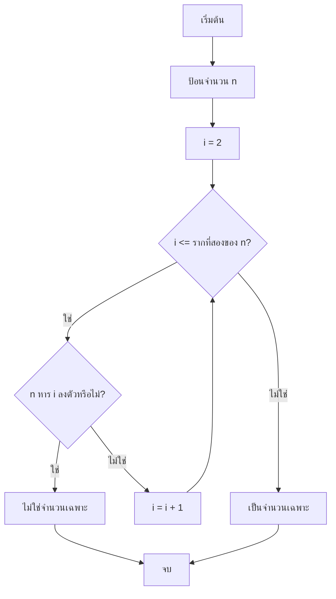

# บทที่ 1 บทนำการออกแบบและวิเคราะห์อัลกอริทึม

## วัตถุประสงค์การเรียนรู้
เมื่อเรียนจบบทนี้ นักศึกษาจะสามารถ
1. อธิบายความหมายและความสำคัญของอัลกอริทึมและโครงสร้างข้อมูล
2. อธิบายคุณสมบัติของอัลกอริทึมที่ดี
3. แยกแยะปัญหาเชิงนามธรรมกับการแก้ปัญหาเชิงโปรแกรม
4. ออกแบบอัลกอริทึมเบื้องต้นโดยใช้ภาษาเทียม (Pseudocode)
5. อธิบายขั้นตอนการแก้ปัญหาด้วยการออกแบบอัลกอริทึม

## การประเมิน
| รายการ | น้ำหนัก | หมายเหตุ |
|:---|:---:|:---|
| การเข้าร่วมกิจกรรมในชั้นเรียน | 10% | เก็บคะแนนจากการเข้าร่วมและทำกิจกรรม |
| แบบทดสอบก่อนเรียนและหลังเรียน | 15% | Pre-test / Post-test |
| การนำเสนอแนวทางแก้ปัญหาเบื้องต้น | 10% | นำเสนอเป็นกลุ่มหรือรายบุคคล |

---

## 1.1 อัลกอริทึมคืออะไร

**อัลกอริทึม (Algorithm)** คือ ชุดคำสั่งที่เป็นระบบ มีขั้นตอนชัดเจน ใช้แก้ปัญหาหรือทำงานให้บรรลุเป้าหมายภายในเวลาที่จำกัด

อัลกอริทึมคล้ายกับสูตรทำอาหาร เช่น สูตรทำไข่เจียว มีวัตถุดิบ (อินพุต) ขั้นตอนการทำ (กระบวนการ) และผลลัพธ์ (เอาต์พุต) คือไข่เจียวที่สุกแล้ว

### ความสำคัญของอัลกอริทึม
- เป็นพื้นฐานของการเขียนโปรแกรมทุกภาษา
- ช่วยให้แก้ปัญหาได้อย่างมีประสิทธิภาพ
- เป็นภาษากลางที่นักโปรแกรมเมอร์ใช้สื่อสารกัน

---

## 1.2 คุณสมบัติของอัลกอริทึมที่ดี

อัลกอริทึมที่ดีต้องมีคุณสมบัติดังต่อไปนี้:

| คุณสมบัติ | คำอธิบาย |
|:---|:---|
| **มีอินพุต (Input)** | มีข้อมูลเข้า 0 รายการขึ้นไป |
| **มีเอาต์พุต (Output)** | ให้ผลลัพธ์อย่างน้อย 1 รายการ |
| **ความชัดเจน (Definiteness)** | แต่ละขั้นตอนต้องชัดเจน ไม่คลุมเครือ |
| **มีความจำกัด (Finiteness)** | จบการทำงานภายในจำนวนขั้นตอนจำกัด |
| **มีประสิทธิภาพ (Effectiveness)** | แต่ละขั้นตอนต้องทำได้จริงและง่าย |

### ตัวอย่างอัลกอริทึมที่ไม่ดี (ขาดคุณสมบัติ)
```
ขั้นตอนที่ 1: ทำซ้ำไปเรื่อยๆ
ขั้นตอนที่ 2: ไปยังขั้นตอนที่ 1
```
ข้อผิดพลาด: ไม่มีเงื่อนไขหยุด จึงไม่มีคุณสมบัติ "มีความจำกัด"

---

## 1.3 ความแตกต่างระหว่างอัลกอริทึมกับโปรแกรม

| ด้าน | อัลกอริทึม | โปรแกรม |
|:---|:---|:---|
| **นิยาม** | แผนการแก้ปัญหาเชิงนามธรรม | คำสั่งที่คอมพิวเตอร์รันได้จริง |
| **ภาษา** | ภาษาเทียม ภาษาธรรมชาติ ผังงาน | ภาษาโปรแกรม (C, Python, Java ฯลฯ) |
| **การรัน** | คนอ่านและเข้าใจได้ | คอมพิวเตอร์แปลและรันได้ |
| **ตัวอย่าง** | ภาษาเทียมหาค่ามากที่สุด | โค้ดภาษา C ที่คอมไพล์แล้วรันได้ |

---

## 1.4 ภาษาเทียม (Pseudocode) และผังงาน (Flowchart)

### ภาษาเทียม (Pseudocode)
เป็นภาษากึ่งโปรแกรม กึ่งภาษาธรรมชาติ ใช้เขียนอัลกอริทึมโดยไม่ผูกกับภาษาโปรแกรมใดภาษาหนึ่ง

**ตัวอย่าง: หาผลรวมจำนวนเต็ม 1 ถึง N**
```
อัลกอริทึม ผลรวม1ถึงN
อินพุต: N (จำนวนเต็มบวก)
เอาต์พุต: ผลรวม

ขั้นตอน:
1. กำหนดผลรวม = 0
2. สำหรับ i ตั้งแต่ 1 ถึง N ทำ
3.     ผลรวม = ผลรวม + i
4. สิ้นสุดลูป
5. ส่งคืนผลรวม
```

### ผังงาน (Flowchart)
ผังงานคือแผนภาพแสดงขั้นตอนของอัลกอริทึมโดยใช้สัญลักษณ์มาตรฐาน



### สัญลักษณ์ผังงานสำคัญ

| สัญลักษณ์ | ความหมาย | รูปทรง |
|:---|:---|:---|
| oval | เริ่มต้น / จบ | รีแคปทรงไข่ |
| rectangle | การดำเนินการ / กระบวนการ | สี่เหลี่ยมผืนผ้า |
| diamond | การตัดสินใจ (เงื่อนไข) | รูปเพชร |
| parallelogram | การป้อนข้อมูล / แสดงผล | สี่เหลี่ยมขนมเปียกปูน |
| arrow | ทิศทางการไหล | ลูกศร |

---

## 1.5 ขั้นตอนการแก้ปัญหาโดยใช้อัลกอริทึม

1. **ทำความเข้าใจปัญหา** – อ่านโจทย์ ระบุอินพุตและเอาต์พุตที่ต้องการ
2. **ออกแบบอัลกอริทึม** – เขียนภาษาเทียมหรือผังงาน
3. **ตรวจสอบความถูกต้อง** – ทดสอบเดินผ่านด้วยตัวอย่างจริง (Desk Check)
4. **แปลงเป็นโปรแกรม** – เขียนโค้ดด้วยภาษาโปรแกรมที่เลือก
5. **ทดสอบและแก้ไข** – รันโปรแกรมกับข้อมูลทดสอบหลายชุด

---

## 1.6 ตัวอย่างอัลกอริทึมเบื้องต้น: หาค่ามากที่สุดในอาเรย์

### ปัญหา
ให้อาเรย์ของจำนวนเต็ม จงหาค่าที่มากที่สุด

### ภาษาเทียม
```
อัลกอริทึม หาค่ามากที่สุด
อินพุต: A[1..N] อาเรย์จำนวนเต็ม
เอาต์พุต: max ค่ามากที่สุดใน A

ขั้นตอน:
1. กำหนด max = A[1]
2. สำหรับ i ตั้งแต่ 2 ถึง N ทำ
3.     ถ้า A[i] > max แล้ว
4.         max = A[i]
5.     สิ้นสุดถ้า
6. สิ้นสุดลูป
7. ส่งคืน max
```

### ตัวอย่างโค้ดภาษา Python
```python
def find_max(arr):
    if not arr:
        return None
    max_val = arr[0]
    for i in range(1, len(arr)):
        if arr[i] > max_val:
            max_val = arr[i]
    return max_val

# ทดสอบ
data = [3, 7, 2, 9, 1, 5]
print("ค่ามากที่สุด:", find_max(data))  # Output: 9
```

### ตัวอย่างโค้ดภาษา C
```c
#include <stdio.h>

int find_max(int arr[], int n) {
    int max = arr[0];
    for (int i = 1; i < n; i++) {
        if (arr[i] > max) {
            max = arr[i];
        }
    }
    return max;
}

int main() {
    int data[] = {3, 7, 2, 9, 1, 5};
    int n = sizeof(data) / sizeof(data[0]);
    printf("ค่ามากที่สุด: %d\n", find_max(data, n));
    return 0;
}
```

### ตัวอย่างโค้ดภาษา Java
```java
public class FindMax {
    public static int findMax(int[] arr) {
        int max = arr[0];
        for (int i = 1; i < arr.length; i++) {
            if (arr[i] > max) {
                max = arr[i];
            }
        }
        return max;
    }
    
    public static void main(String[] args) {
        int[] data = {3, 7, 2, 9, 1, 5};
        System.out.println("ค่ามากที่สุด: " + findMax(data));
    }
}
```

### การเดินผ่านอัลกอริทึม (Desk Check)
ให้ `A = [3, 7, 2, 9, 1, 5]`

| i | A[i] | max (ก่อนเปรียบเทียบ) | เงื่อนไข A[i] > max | max (หลังทำขั้นตอน) |
|:---|:---|:---|:---|:---|
| - | - | 3 (กำหนดเริ่มต้น) | - | 3 |
| 2 | 7 | 3 | จริง | 7 |
| 3 | 2 | 7 | เท็จ | 7 |
| 4 | 9 | 7 | จริง | 9 |
| 5 | 1 | 9 | เท็จ | 9 |
| 6 | 5 | 9 | เท็จ | 9 |

ผลลัพธ์: **max = 9**

---

## แบบฝึกหัด

### ข้อที่ 1
จงเขียนอัลกอริทึมโดยใช้ภาษาเทียมเพื่อหาผลรวมของจำนวนเต็ม 1 ถึง N

**แนวทางคำตอบ:**
```
อัลกอริทึม ผลรวม1ถึงN
อินพุต: N
เอาต์พุต: sum

1. sum = 0
2. สำหรับ i = 1 ถึง N ทำ
3.     sum = sum + i
4. สิ้นสุดลูป
5. ส่งคืน sum
```

### ข้อที่ 2
จงแยกแยะว่าสิ่งใดคืออัลกอริทึม และสิ่งใดไม่ใช่อัลกอริทึม พร้อมอธิบายเหตุผล

| รายการ | เป็นอัลกอริทึมหรือไม่ | เหตุผล |
|:---|:---|:---|
| สูตรคำนวณพื้นที่วงกลม | ใช่ | มีขั้นตอนชัดเจน ให้ผลลัพธ์ จบการทำงาน |
| เรื่องเล่าก่อนนอน | ไม่ใช่ | ไม่มีขั้นตอนชัดเจน ไม่ให้เอาต์พุตที่แน่นอน |
| คำสั่ง "ทำซ้ำไปเรื่อยๆ" | ไม่ใช่ | ไม่มีเงื่อนไขหยุด ขาดคุณสมบัติความจำกัด |

### ข้อที่ 3
จงวาดผังงานสำหรับการตรวจสอบว่าจำนวนหนึ่งเป็นจำนวนเฉพาะหรือไม่

**แนวทาง:**


---

## แบบปฏิบัติการข้อสอบ

### ข้อควบคุมเลือกตอบ (จำนวน 5 ข้อ)

**ข้อ 1.** ข้อใดไม่ใช่คุณสมบัติของอัลกอริทึม
- ก. มีอินพุต
- ข. มีเอาต์พุต
- ค. ทำงานไม่สิ้นสุด
- ง. มีความชัดเจน

**ตอบ: ค** (อัลกอริทึมต้องจบการทำงานภายในขั้นตอนจำกัด)

**ข้อ 2.** อัลกอริทึมแตกต่างจากโปรแกรมตรงที่
- ก. อัลกอริทึมรันบนคอมพิวเตอร์ได้ โปรแกรมรันไม่ได้
- ข. อัลกอริทึมเขียนด้วยภาษาโปรแกรม โปรแกรมเขียนด้วยภาษาธรรมชาติ
- ค. อัลกอริทึมเป็นแผนการแก้ปัญหาเชิงนามธรรม โปรแกรมเป็นคำสั่งที่คอมพิวเตอร์รันได้
- ง. ไม่มีข้อใดถูก

**ตอบ: ค**

**ข้อ 3.** ข้อใดคือสัญลักษณ์สำหรับการตัดสินใจในผังงาน
- ก. รูปไข่
- ข. รูปสี่เหลี่ยมผืนผ้า
- ค. รูปเพชร
- ง. รูปลูกศร

**ตอบ: ค**

**ข้อ 4.** ขั้นตอนใดเป็นขั้นตอนแรกในการแก้ปัญหาโดยใช้อัลกอริทึม
- ก. เขียนโค้ด
- ข. ทดสอบโปรแกรม
- ค. ทำความเข้าใจปัญหา
- ง. แปลงเป็นโปรแกรม

**ตอบ: ค**

**ข้อ 5.** จากตัวอย่างอาเรย์ [3, 7, 2, 9, 1, 5] ค่ามากที่สุดคือเท่าใด
- ก. 7
- ข. 9
- ค. 5
- ง. 3

**ตอบ: ข**

### ข้ออัตนัย (จำนวน 2 ข้อ)

**ข้อ 6.** จงเขียนอัลกอริทึมโดยใช้ภาษาเทียมเพื่อหาค่าน้อยที่สุดในอาเรย์ของจำนวนเต็ม พร้อมอธิบายขั้นตอนการทำงาน

**ข้อ 7.** จงวาดผังงานสำหรับการคำนวณค่า factorial ของจำนวน n (n! = n × (n-1) × ... × 1)

---

## ภาคผนก

### ภาคผนก 1.1 คำศัพท์ technischen เบื้องต้น

| คำศัพท์ | ความหมาย |
|:---|:---|
| อัลกอริทึม (Algorithm) | ชุดขั้นตอนแก้ปัญหาอย่างเป็นระบบ |
| อินพุต (Input) | ข้อมูลที่ป้อนเข้าสู่กระบวนการ |
| เอาต์พุต (Output) | ผลลัพธ์ที่ได้จากกระบวนการ |
| ภาษาเทียม (Pseudocode) | ภาษากึ่งโปรแกรมใช้เขียนอัลกอริทึม |
| ผังงาน (Flowchart) | แผนภาพแสดงขั้นตอนอัลกอริทึม |
| Desk Check | การทดสอบอัลกอริทึมด้วยตนเองบนกระดาษ |

### ภาคผนก 1.2 เทมเพลตภาษาเทียมสำหรับนักศึกษา

```
อัลกอริทึม <ชื่ออัลกอริทึม>
อินพุต: <รายการข้อมูลเข้า>
เอาต์พุต: <รายการผลลัพธ์>

ตัวแปร:
<ประกาศตัวแปรที่ใช้>

ขั้นตอน:
1. <ขั้นตอนแรก>
2. <ขั้นตอนที่สอง>
...
n. ส่งคืน <ผลลัพธ์>
```

---

## อ้างอิง

- Cormen, T. H., et al. *Introduction to Algorithms*. MIT Press.
- รวมเล่มเอกสารประกอบการสอน รายวิชาโครงสร้างข้อมูลและอัลกอริทึม
