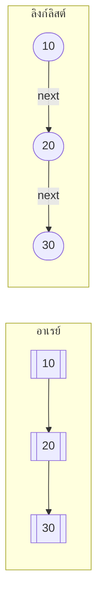

# บทที่ 3 อาเรย์และลิสต์เชิงเส้น (Array and Linear List)

## วัตถุประสงค์การเรียนรู้
เมื่อเรียนจบบทนี้ นักศึกษาจะสามารถ
1. อธิบายโครงสร้างและการทำงานของอาเรย์แบบหนึ่งมิติและสองมิติ
2. อธิบายลิสต์เชิงเส้นและการดำเนินการพื้นฐาน (แทรก ลบ ค้นหา ทบทวน)
3. เปรียบเทียบอาเรย์กับลิสต์เชิงเส้นในด้านข้อดีข้อเสีย
4. เลือกใช้โครงสร้างข้อมูลที่เหมาะสมกับปัญหาที่กำหนด
5. เขียนโปรแกรมจัดการอาเรย์และลิสต์เชิงเส้นได้อย่างถูกต้อง

## การประเมิน
| รายการ | น้ำหนัก | หมายเหตุ |
|:---|:---:|:---|
| งานเขียนโปรแกรมจัดการอาเรย์และลิสต์ | 15% | โค้ดภาษา C/Python/Java |
| แบบทดสอบท้ายบท | 10% | ข้อควบคุมเลือกตอบและปฏิบัติการ |
| การปฏิบัติงานในห้องปฏิบัติการคอมพิวเตอร์ | 10% | ฝึกเขียนโค้ดจริงในห้องแล็บ |

---

## 3.1 อาเรย์แบบหนึ่งมิติและสองมิติ

### อาเรย์แบบหนึ่งมิติ (1D Array)
อาเรย์คือกลุ่มข้อมูลชนิดเดียวกันที่จัดเก็บในตำแหน่งหน่วยความจำติดต่อกัน แต่ละตัวมีดัชนี (index) เริ่มจาก 0

```
อาเรย์:  [10] [20] [30] [40] [50]
ดัชนี:   0    1    2    3    4
```

**คุณสมบัติ:**
- ขนาดคงที่เมื่อประกาศแล้ว (ในภาษา C/Java)
- เข้าถึงสมาชิกได้โดยตรงผ่านดัชนี O(1)
- องค์ประกอบทุกตัวต้องเป็นชนิดข้อมูลเดียวกัน

### อาเรย์แบบสองมิติ (2D Array)
เปรียบเสมือนตาราง แถวและคอลัมน์

```
        คอลัมน์ 0   1   2
แถว 0  [10]  [20]  [30]
แถว 1  [40]  [50]  [60]
แถว 2  [70]  [80]  [90]
```

การเข้าถึง: `matrix[แถว][คอลัมน์]` เช่น `matrix[1][2] = 60`

---

## 3.2 การจัดเก็บอาเรย์ในหน่วยความจำ

อาเรย์ถูกจัดเก็บแบบ **ติดต่อกัน (contiguous)** ในหน่วยความจำ

### การคำนวณที่อยู่หน่วยความจำ
สำหรับอาเรย์หนึ่งมิติ:
```
ที่อยู่ของ A[i] = ที่อยู่_base + (i × ขนาดของแต่ละองค์ประกอบ)
```

ตัวอย่าง: int ขนาด 4 ไบต์, base address = 1000
- A[0] อยู่ที่ 1000
- A[1] อยู่ที่ 1004
- A[2] อยู่ที่ 1008
- A[5] อยู่ที่ 1020

### ภาพประกอบหน่วยความจำ

```
ที่อยู่:  1000   1004   1008   1012   1016
ค่า:     [10]   [20]   [30]   [40]   [50]
ดัชนี:    0      1      2      3      4
```

---

## 3.3 การดำเนินการกับอาเรย์

### การอ่าน (Access)
เข้าถึงสมาชิกโดยตรงผ่านดัชนี → **O(1)**

### การค้นหา (Search)
ค้นหาโดยไม่รู้ดัชนี ต้องไล่ตั้งแต่ตัวแรก → **O(n)**

### การแทรก (Insert)
ถ้าแทรกท้ายและมีที่ว่าง → O(1)
ถ้าแทรกกลางหรือต้นต้องขยับสมาชิก → **O(n)**

### การลบ (Delete)
ลบท้าย → O(1)
ลบกลางหรือต้นต้องขยับสมาชิกมาทับ → **O(n)**

### ตัวอย่างโค้ดภาษา Python
```python
# การสร้างและเข้าถึงอาเรย์
arr = [10, 20, 30, 40, 50]

# อ่าน
print(arr[2])  # 30

# แทรกท้าย
arr.append(60)  # [10, 20, 30, 40, 50, 60]

# แทรกกลาง (ตำแหน่งที่ 2)
arr.insert(2, 25)  # [10, 20, 25, 30, 40, 50, 60]

# ลบสมาชิก
arr.remove(30)  # [10, 20, 25, 40, 50, 60]

# ลบโดยดัชนี
arr.pop(0)  # [20, 25, 40, 50, 60]
```

### ตัวอย่างโค้ดภาษา C
```c
#include <stdio.h>

void print_array(int arr[], int n) {
    for (int i = 0; i < n; i++) {
        printf("%d ", arr[i]);
    }
    printf("\n");
}

// แทรกสมาชิกที่ตำแหน่ง pos (ต้องมีที่ว่างในอาเรย์)
void insert(int arr[], int *n, int value, int pos) {
    // ขยับสมาชิกจากด้านท้ายมาหน้า
    for (int i = *n; i > pos; i--) {
        arr[i] = arr[i - 1];
    }
    arr[pos] = value;
    (*n)++;
}

// ลบสมาชิกที่ตำแหน่ง pos
void delete(int arr[], int *n, int pos) {
    for (int i = pos; i < *n - 1; i++) {
        arr[i] = arr[i + 1];
    }
    (*n)--;
}

int main() {
    int arr[10] = {10, 20, 30, 40, 50};
    int n = 5;
    
    printf("ก่อนแทรก: ");
    print_array(arr, n);
    
    insert(arr, &n, 25, 2);
    printf("หลังแทรก 25 ที่ตำแหน่ง 2: ");
    print_array(arr, n);
    
    delete(arr, &n, 3);
    printf("หลังลบตำแหน่ง 3: ");
    print_array(arr, n);
    
    return 0;
}
```

---

## 3.4 ลิสต์เชิงเส้น (Linear List)

ลิสต์เชิงเส้นคือกลุ่มสมาชิกที่จัดเรียงเป็นลำดับ โดยสมาชิกแต่ละตัว (ยกเว้นตัวแรกและตัวสุดท้าย) มีสมาชิกก่อนและหลัง exatamente หนึ่งตัว

### การแทนลิสต์เชิงเส้น
1. **โดยใช้อาเรย์** – จัดเก็บติดต่อกันในหน่วยความจำ
2. **โดยใช้การเชื่อมโยง (Linked List)** – แต่ละตัวชี้ไปยังตัวถัดไป

---

## 3.5 การดำเนินการกับลิสต์เชิงเส้น

| การดำเนินการ | คำอธิบาย |
|:---|:---|
| สร้าง (Create) | สร้างลิสต์ว่าง |
| แทรก (Insert) | เพิ่มสมาชิกใหม่เข้าไปในลิสต์ |
| ลบ (Delete) | นำสมาชิกออกจากลิสต์ |
| ค้นหา (Search) | หาตำแหน่งของสมาชิก |
| ทบทวน (Traverse) | ไล่ดูสมาชิกทุกตัวตั้งแต่ต้นถึงท้าย |
| แก้ไข (Update) | เปลี่ยนค่าของสมาชิก |

---

## 3.6 ความแตกต่างระหว่างอาเรย์กับลิสต์เชิงเส้น

| ด้าน | อาเรย์ (Array) | ลิสต์เชิงเส้น (Linear List/Linked List) |
|:---|:---|:---|
| การจัดเก็บ | ติดต่อกันในหน่วยความจำ | อาจกระจาย ตัวละชี้ไปตัวถัดไป |
| การเข้าถึง | โดยตรงผ่านดัชนี O(1) | ต้องไล่จากหัว O(n) |
| การแทรก/ลบ | ช้าเมื่อแทรกกลาง ต้องขยับสมาชิก | เร็ว แค่เปลี่ยนตัวชี้ |
| ขนาด | คงที่ (บางภาษา) | ยืดหยุ่น เพิ่มลดได้ตลอด |
| หน่วยความจำ | ประหยัด (ไม่มีตัวชี้เพิ่ม) | เปลืองกว่า (ต้องเก็บตัวชี้) |



---

## 3.7 การประยุกต์ใช้งานจริง

- รายชื่อนักศึกษาในชั้นเรียน
- รายการสินค้าในตะกร้าสินค้า
- 播放รายการเพลง (playlist)
- ประวัติการท่องเว็บ (browser history)

---

## แบบฝึกหัด

### ข้อที่ 1
จงเขียนอัลกอริทึมแทรกสมาชิกลงในอาเรย์ที่เรียงลำดับแล้ว โดยยังคงเรียงลำดับไว้

**แนวทางคำตอบ (ภาษาเทียม):**
```
อัลกอริทึม แทรกในอาเรย์เรียงลำดับ
อินพุต: A[1..N] (เรียงลำดับแล้ว), x (ค่าที่จะแทรก)
เอาต์พุต: A ที่แทรก x แล้วยังเรียงลำดับอยู่

1. หาตำแหน่ง pos ที่ x ควรแทรก (ตัวแรกที่มากกว่า x)
2. ขยับสมาชิกจากตำแหน่ง N ถึง pos มาหน้าหนึ่งตำแหน่ง
3. แทรก x ที่ตำแหน่ง pos
4. N = N + 1
```

### ข้อที่ 2
จงเขียนอัลกอริทึมลบสมาชิกออกจากลิสต์เชิงเส้น

**แนวทางคำตอบ:**
```
อัลกอริทึม ลบสมาชิกลิสต์เชิงเส้น
อินพุต: ลิสต์ L, ค่า x ที่ต้องการลบ
เอาต์พุต: ลิสต์ L ที่ลบ x แล้ว

1. ค้นหาตำแหน่ง pos ของ x ในลิสต์
2. ถ้าไม่พบ x ให้จบการทำงาน
3. ขยับสมาชิกหลัง pos มาหน้าหนึ่งตำแหน่ง
4. ลดขนาดลิสต์ลง 1
```

### ข้อที่ 3
จงเปรียบเทียบเวลาการเข้าถึงสมาชิกของอาเรย์กับลิสต์เชิงเส้น

**คำตอบ:**
- อาเรย์: เข้าถึงโดยตรงผ่านดัชนี → **O(1)**
- ลิสต์เชิงเส้น (เชิงเดียว): ต้องไล่จากหัวลิสต์จนกว่าจะถึงตำแหน่ง → **O(n)**

---

## แบบปฏิบัติการข้อสอบ

### ข้อควบคุมเลือกตอบ (จำนวน 8 ข้อ)

**ข้อ 1.** อาเรย์เข้าถึงสมาชิกโดยใช้สิ่งใด
- ก. ตัวชี้
- ข. ดัชนี (index)
- ค. คีย์ (key)
- ง. ค่าคงที่

**ตอบ: ข**

**ข้อ 2.** การแทรกสมาชิกกลางอาเรย์มีความซับซ้อนเท่าใด
- ก. O(1)
- ข. O(n)
- ค. O(log n)
- ง. O(n log n)

**ตอบ: ข**

**ข้อ 3.** ข้อใดไม่ใช่คุณสมบัติของอาเรย์
- ก. องค์ประกอบชนิดเดียวกัน
- ข. จัดเก็บติดต่อกันในหน่วยความจำ
- ค. ขนาดเปลี่ยนแปลงได้ตลอดเวลา
- ง. เข้าถึงโดยตรงผ่านดัชนี

**ตอบ: ค**

**ข้อ 4.** การลบสมาชิกท้ายอาเรย์มีความซับซ้อนเท่าใด
- ก. O(1)
- ข. O(n)
- ค. O(log n)
- ง. O(n²)

**ตอบ: ก**

**ข้อ 5.** ลิสต์เชิงเส้นแตกต่างจากอาเรย์ตรงที่
- ก. ลิสต์เข้าถึงโดยตรงเร็วกว่า
- ข. ลิสต์ต้องจัดเก็บติดต่อกัน
- ค. ลิสต์แทรกลบง่ายกว่าเมื่ออยู่กลาง
- ง. ลิสต์ขนาดคงที่

**ตอบ: ค**

**ข้อ 6.** อาเรย์สองมิติเปรียบเสมือนสิ่งใด
- ก. รายชื่อเส้นตรง
- ข. ตารางแถวและคอลัมน์
- ค. ต้นไม้
- ง. กราฟ

**ตอบ: ข**

**ข้อ 7.** การทบทวนสมาชิกทุกตัวในลิสต์เชิงเส้นเรียกว่า
- ก. การค้นหา
- ข. การแทรก
- ค. การทบทวน (traverse)
- ง. การลบ

**ตอบ: ค**

**ข้อ 8.** อาเรย์ที่มีสมาชิก 100 ตัว ดัชนีตัวสุดท้ายคือเท่าใด (เริ่มนับจาก 0)
- ก. 100
- ข. 99
- ค. 101
- ง. 98

**ตอบ: ข**

### ข้อปฏิบัติการ (จำนวน 2 ข้อ)

**ข้อ 9.** จงเขียนโค้ดภาษา C หรือ Python จัดการอาเรย์ ประกอบด้วยการสร้าง อ่าน แทรก ลบ และค้นหาสมาชิก

**ข้อ 10.** จงเขียนโค้ดจัดการลิสต์เชิงเส้นโดยใช้โครงสร้างลิงก์ลิสต์ รองรับการแทรกและลบสมาชิก

---

## ภาคผนก

### ภาคผนก 3.1 ตัวอย่างโค้ดอาเรย์และลิสต์เชิงเส้นภาษา C / Python / Java

**ภาษา Java – คลาสจัดการอาเรย์:**
```java
public class ArrayManager {
    private int[] arr;
    private int size;
    
    public ArrayManager(int capacity) {
        arr = new int[capacity];
        size = 0;
    }
    
    public void insert(int value, int pos) {
        for (int i = size; i > pos; i--) {
            arr[i] = arr[i - 1];
        }
        arr[pos] = value;
        size++;
    }
    
    public void delete(int pos) {
        for (int i = pos; i < size - 1; i++) {
            arr[i] = arr[i + 1];
        }
        size--;
    }
    
    public int get(int pos) {
        return arr[pos];
    }
}
```

### ภาคผนก 3.2 แบบฝึกหัดเขียนโปรแกรมเพิ่มเติม

1. เขียนโปรแกรมหาค่ามากที่สุดและน้อยที่สุดในอาเรย์
2. เขียนโปรแกรมย้อนกลับอาเรย์ (reverse array)
3. เขียนโปรแกรมลบค่าซ้ำออกจากอาเรย์
4. เขียนโปรแกรมรวมอาเรย์สองอันที่เรียงลำดับแล้วให้ยังเรียงลำดับอยู่

---

## อ้างอิง

- คู่มือการใช้ภาษาโปรแกรมประกอบการสอน รายวิชาโครงสร้างข้อมูล
- เอกสารประกอบการสอน บทที่ 3 อาเรย์และลิสต์เชิงเส้น
