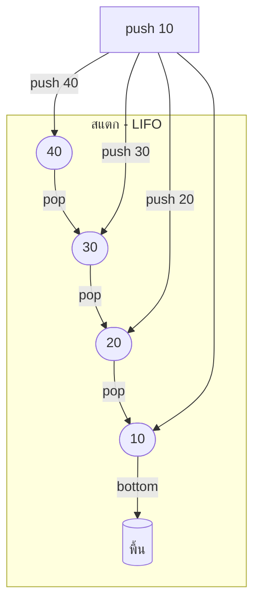
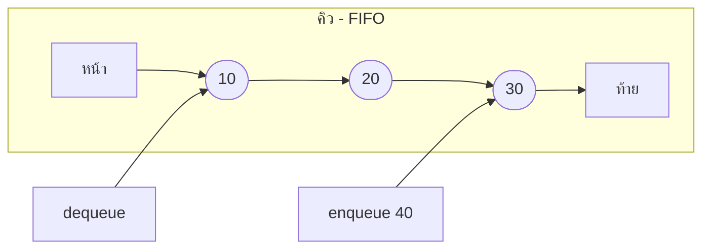
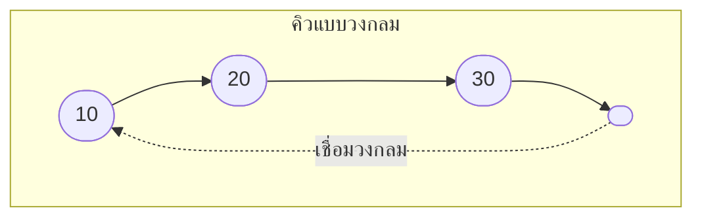
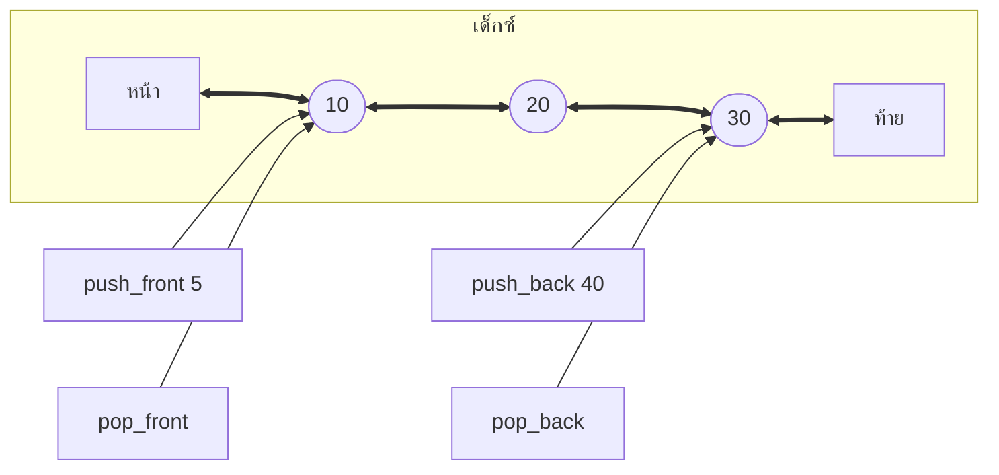

# บทที่ 4 สแตกและคิว (Stack and Queue)

## วัตถุประสงค์การเรียนรู้
เมื่อเรียนจบบทนี้ นักศึกษาจะสามารถ
1. อธิบายหลักการ LIFO (Last-In, First-Out) ของสแตก
2. อธิบายหลักการ FIFO (First-In, First-Out) ของคิว
3. อธิบายการดำเนินการพื้นฐานของสแตกและคิว (push, pop, enqueue, dequeue)
4. ประยุกต์ใช้สแตกและคิวในการแก้ปัญหาเบื้องต้น
5. แยกแยะสแตกธรรมดา คิวธรรมดา คิวแบบวงกลม และเด็กซ์ (Deque)

## การประเมิน
| รายการ | น้ำหนัก | หมายเหตุ |
|:---|:---:|:---|
| งานเขียนโปรแกรมจำลองสแตกและคิว | 15% | โค้ดภาษา C/Python/Java |
| แบบทดสอบท้ายบท | 10% | ข้อควบคุมเลือกตอบและอัตนัย |
| การเข้าร่วมกิจกรรมจำลองสถานการณ์ใช้สแตกและคิว | 5% | กิจกรรมกลุ่ม |

---

## 4.1 สแตก (Stack) และหลักการ LIFO

สแตกคือโครงสร้างข้อมูลที่การเพิ่มและลบเกิดขึ้นที่ด้านเดียวเรียกว่า **ยอดสแตก (top)** 

หลักการ **LIFO (Last-In, First-Out)** คือ ตัวที่เข้าไปทีหลังจะออกมาก่อน เปรียบเสมือนกองจาน หรือกล่องทับกัน



### การดำเนินการกับสแตก

| การดำเนินการ | คำอธิบาย | ความซับซ้อน |
|:---|:---|:---|
| **push(x)** | ใส่ x ที่ยอดสแตก | O(1) |
| **pop()** | เอาตัวที่ยอดออกและคืนค่า | O(1) |
| **peek()** | ดูค่าที่ยอดโดยไม่เอาออก | O(1) |
| **isEmpty()** | ตรวจสอบว่าสแตกว่างหรือไม่ | O(1) |
| **isFull()** | ตรวจสอบว่าสแตกเต็มหรือไม่ (ถ้าใช้อาเรย์คงที่) | O(1) |

### ภาวะผิดปกติของสแตก
- **Stack Overflow**: การ push เมื่อสแตกเต็มแล้ว
- **Stack Underflow**: การ pop หรือ peek เมื่อสแตกว่าง

---

## 4.2 ตัวอย่างโค้ดสแตก

### ภาษา Python
```python
class Stack:
    def __init__(self):
        self.items = []
    
    def push(self, item):
        self.items.append(item)
    
    def pop(self):
        if self.is_empty():
            raise IndexError("Stack Underflow")
        return self.items.pop()
    
    def peek(self):
        if self.is_empty():
            raise IndexError("Stack is empty")
        return self.items[-1]
    
    def is_empty(self):
        return len(self.items) == 0
    
    def size(self):
        return len(self.items)


# การใช้งาน
s = Stack()
s.push(10)
s.push(20)
s.push(30)
print(s.pop())   # 30 (ตัวสุดท้ายที่เข้า ออกก่อน)
print(s.peek())  # 20
print(s.pop())   # 20
print(s.pop())   # 10
```

### ภาษา C
```c
#include <stdio.h>
#define MAX 100

typedef struct {
    int items[MAX];
    int top;
} Stack;

void init(Stack *s) {
    s->top = -1;
}

int is_empty(Stack *s) {
    return s->top == -1;
}

int is_full(Stack *s) {
    return s->top == MAX - 1;
}

void push(Stack *s, int value) {
    if (is_full(s)) {
        printf("Stack Overflow\n");
        return;
    }
    s->items[++s->top] = value;
}

int pop(Stack *s) {
    if (is_empty(s)) {
        printf("Stack Underflow\n");
        return -1;
    }
    return s->items[s->top--];
}

int peek(Stack *s) {
    if (is_empty(s)) {
        printf("Stack is empty\n");
        return -1;
    }
    return s->items[s->top];
}

int main() {
    Stack s;
    init(&s);
    push(&s, 10);
    push(&s, 20);
    push(&s, 30);
    printf("%d\n", pop(&s));  // 30
    return 0;
}
```

---

## 4.3 คิว (Queue) และหลักการ FIFO

คิวคือโครงสร้างข้อมูลที่การเพิ่มเกิดขึ้นที่ด้านท้าย (rear) และการลบเกิดขึ้นที่ด้านหน้า (front)

หลักการ **FIFO (First-In, First-Out)** คือ ตัวที่เข้ามาก่อนจะออกก่อน เปรียบเสมือนคนต่อแถวซื้อตั๋ว



### การดำเนินการกับคิว

| การดำเนินการ | คำอธิบาย | ความซับซ้อน |
|:---|:---|:---|
| **enqueue(x)** | ใส่ x ที่ด้านท้าย | O(1) |
| **dequeue()** | เอาตัวที่ด้านหน้าออกและคืนค่า | O(1) |
| **front()** | ดูค่าที่ด้านหน้าโดยไม่เอาออก | O(1) |
| **rear()** | ดูค่าที่ด้านท้ายโดยไม่เอาออก | O(1) |
| **isEmpty()** | ตรวจสอบว่าคิวว่างหรือไม่ | O(1) |

---

## 4.4 ตัวอย่างโค้ดคิว

### ภาษา Python
```python
from collections import deque

class Queue:
    def __init__(self):
        self.items = deque()
    
    def enqueue(self, item):
        self.items.append(item)
    
    def dequeue(self):
        if self.is_empty():
            raise IndexError("Queue Underflow")
        return self.items.popleft()
    
    def front(self):
        if self.is_empty():
            raise IndexError("Queue is empty")
        return self.items[0]
    
    def is_empty(self):
        return len(self.items) == 0
    
    def size(self):
        return len(self.items)


# การใช้งาน
q = Queue()
q.enqueue(10)
q.enqueue(20)
q.enqueue(30)
print(q.dequeue())  # 10 (ตัวแรกที่เข้า ออกก่อน)
print(q.front())    # 20
print(q.dequeue())  # 20
```

---

## 4.5 คิวแบบวงกลม (Circular Queue)

คิวธรรมดาเมื่อ dequeue แล้วพื้นที่ด้านหน้าจะเสียเปล่าไป คิวแบบวงกลมแก้ไขโดยให้ด้านท้ายเชื่อมกลับไปด้านหน้าเมื่อถึงขอบเขต



### ตัวอย่างโค้ดคิวแบบวงกลม (ภาษา C)
```c
#include <stdio.h>
#define MAX 5

typedef struct {
    int items[MAX];
    int front, rear;
} CircularQueue;

void init(CircularQueue *q) {
    q->front = -1;
    q->rear = -1;
}

int is_empty(CircularQueue *q) {
    return q->front == -1;
}

int is_full(CircularQueue *q) {
    return (q->rear + 1) % MAX == q->front;
}

void enqueue(CircularQueue *q, int value) {
    if (is_full(q)) {
        printf("Queue Overflow\n");
        return;
    }
    if (is_empty(q)) {
        q->front = 0;
    }
    q->rear = (q->rear + 1) % MAX;
    q->items[q->rear] = value;
}

int dequeue(CircularQueue *q) {
    if (is_empty(q)) {
        printf("Queue Underflow\n");
        return -1;
    }
    int value = q->items[q->front];
    if (q->front == q->rear) {
        q->front = -1;
        q->rear = -1;
    } else {
        q->front = (q->front + 1) % MAX;
    }
    return value;
}
```

---

## 4.6 เด็กซ์ (Deque)

เด็กซ์ย่อมาจาก **Double-Ended Queue** คือคิวที่สามารถเพิ่มและลบได้ทั้งสองด้าน (หน้าและท้าย)



---

## 4.7 การประยุกต์ใช้

| โครงสร้าง | การประยุกต์ใช้ |
|:---|:---|
| สแตก | ฟีเจอร์ยกเลิก (undo) ในโปรแกรมแก้ไขข้อความ, ตรวจสอบวงเล็บคู่กัน, แปลงนิพจน์อินฟิกซ์เป็นโพสฟิกซ์, เรียกฟังก์ชันในคอมพิวเตอร์ (call stack) |
| คิว | ระบบคิวบริการ (ธนาคาร ร้านอาหาร), การจัดลำดับงานพิมพ์ (print spooler), การทำงานแบบ BFS ในกราฟ, เครือข่ายคอมพิวเตอร์ |
| คิวแบบวงกลม | เบฟเฟอร์แบบวงกลม (circular buffer) ในระบบฝังตัว |
| เด็กซ์ | แอปดูรูปภาพก่อนหน้า/ถัดไป, การจัดตารางงานแบบขั้นตอน |

---

## แบบฝึกหัด

### ข้อที่ 1
จงเขียนอัลกอริทึมตรวจสอบวงเล็บในนิพจน์ว่าคู่กันหรือไม่ โดยใช้สแตก

**แนวทางคำตอบ:**
```
อัลกอริทึม ตรวจสอบวงเล็บ
อินพุต: นิพจน์เป็นสตริง
เอาต์พุต: วงเล็บคู่กันหรือไม่

1. สร้างสแตกว่าง S
2. สำหรับแต่ละตัวอักษร c ในนิพจน์ ทำ
3.     ถ้า c เป็นวงเล็บเปิด (, {, [ ให้ push(c) ลงสแตก
4.     ถ้า c เป็นวงเล็บปิด ), }, ] แล้ว
5.         ถ้าสแตกว่าง ให้คืนค่า "ไม่คู่กัน"
6.         pop ตัวออกจากสแตก แล้วตรวจสอบว่าคู่กับ c หรือไม่
7.         ถ้าไม่คู่กัน ให้คืนค่า "ไม่คู่กัน"
8. สิ้นสุดลูป
9. ถ้าสแตกว่าง ให้คืนค่า "คู่กัน" มิฉะนั้น "ไม่คู่กัน"
```

### ข้อที่ 2
จงเขียนอัลกอริทึมแปลงนิพจน์อินฟิกซ์เป็นโพสฟิกซ์โดยใช้สแตก

**ตัวอย่าง:**
- อินฟิกซ์: `A + B * C`
- โพสฟิกซ์: `A B C * +`

### ข้อที่ 3
จงอธิบายสถานการณ์ที่เหมาะกับการใช้คิวแบบวงกลมมากกว่าคิวธรรมดา

**คำตอบ:** คิวแบบวงกลมเหมาะเมื่อมีการเพิ่มและลบสมาชิกซ้ำๆ หลายครั้ง โดยไม่อยากให้พื้นที่ด้านหน้าของอาเรย์เสียเปล่าหลังจาก dequeue แล้ว เหมาะสำหรับระบบที่มีหน่วยความจำจำกัด เช่น ระบบฝังตัว

---

## แบบปฏิบัติการข้อสอบ

### ข้อควบคุมเลือกตอบ (จำนวน 6 ข้อ)

**ข้อ 1.** สแตกใช้หลักการใด
- ก. FIFO
- ข. LIFO
- ค. ทั้งสองอย่าง
- ง. ไม่ใช้หลักการใด

**ตอบ: ข**

**ข้อ 2.** คิวใช้หลักการใด
- ก. FIFO
- ข. LIFO
- ค. ทั้งสองอย่าง
- ง. ไม่ใช้หลักการใด

**ตอบ: ก**

**ข้อ 3.** การเอาสมาชิกออกจากสแตกเรียกว่า
- ก. push
- ข. pop
- ค. enqueue
- ง. dequeue

**ตอบ: ข**

**ข้อ 4.** การใส่สมาชิกเข้าไปในคิวเรียกว่า
- ก. push
- ข. pop
- ค. enqueue
- ง. dequeue

**ตอบ: ค**

**ข้อ 5.** ภาวะที่เกิดเมื่อ pop จากสแตกที่ว่างเรียกว่า
- ก. Stack Overflow
- ข. Stack Underflow
- ค. Queue Overflow
- ง. Queue Underflow

**ตอบ: ข**

**ข้อ 6.** คิวแบบวงกลมแก้ปัญหาอะไรของคิวธรรมดา
- ก. พื้นที่ด้านหน้าเสียเปล่าหลัง dequeue
- ข. คิวเต็มเร็วเกินไป
- ค. การ enqueue ช้า
- ง. การ dequeue ช้า

**ตอบ: ก**

### ข้ออัตนัย (จำนวน 2 ข้อ)

**ข้อ 7.** จงเขียนโค้ดภาษา C หรือ Python จำลองสแตกที่รองรับ push, pop, peek และ isEmpty

**ข้อ 8.** จงเขียนโค้ดจำลองคิวแบบวงกลมในภาษา C ที่รองรับ enqueue และ dequeue โดยไม่ให้พื้นที่เสียเปล่า

---

## ภาคผนก

### ภาคผนก 4.1 โค้ดตัวอย่างสแตกและคิวภาษา C / Python / Java

**ภาษา Java – คลาส Stack:**
```java
import java.util.EmptyStackException;

public class MyStack<T> {
    private java.util.ArrayList<T> items = new java.util.ArrayList<>();
    
    public void push(T item) {
        items.add(item);
    }
    
    public T pop() {
        if (isEmpty()) throw new EmptyStackException();
        return items.remove(items.size() - 1);
    }
    
    public T peek() {
        if (isEmpty()) throw new EmptyStackException();
        return items.get(items.size() - 1);
    }
    
    public boolean isEmpty() {
        return items.isEmpty();
    }
}
```

### ภาคผนก 4.2 ตัวอย่างกรณีศึกษาการใช้สแตกในเครื่องมือพัฒนาซอฟต์แวร์

เครื่องมือแก้ไขข้อความส่วนใหญ่ใช้สแตกเก็บประวัติการแก้ไขเพื่อฟีเจอร์ **undo** ทุกครั้งที่ผู้ใช้แก้ไขข้อความ จะ push การกระทำนั้นเข้าไปในสแตก เมื่อกด undo จะ pop การกระทุล่าสุดออกแล้วย้อนกลับ

---

## อ้างอิง

- เอกสารประกอบการสอน บทที่ 4 สแตกและคิว
- หนังสืออ้างอิงโครงสร้างข้อมูลฉบับภาษาไทย
