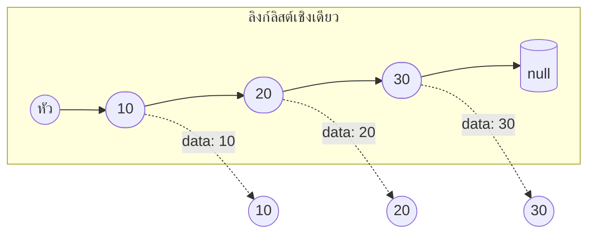
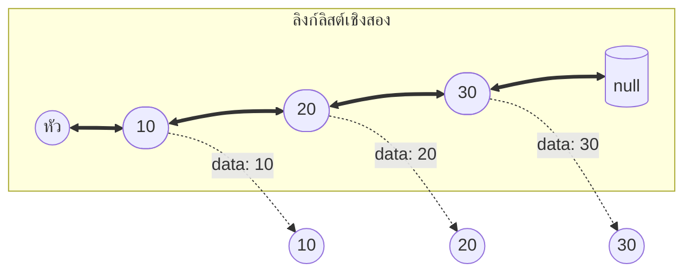
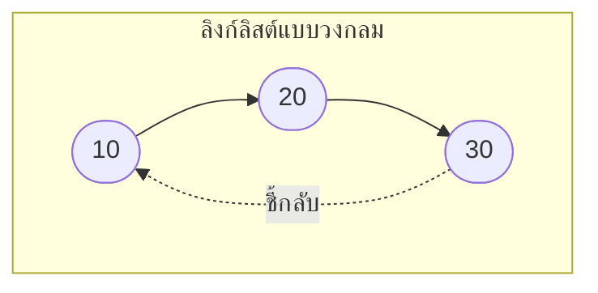

# บทที่ 5 ลิงก์ลิสต์ (Linked List)

## วัตถุประสงค์การเรียนรู้
เมื่อเรียนจบบทนี้ นักศึกษาจะสามารถ
1. อธิบายโครงสร้างของโหนด (Node) และลิงก์ลิสต์
2. อธิบายความแตกต่างของลิงก์ลิสต์เชิงเดียว เชิงสอง และแบบวงกลม
3. อธิบายการดำเนินการพื้นฐาน (แทรก ลบ ค้นหา ทบทวน) ของลิงก์ลิสต์
4. เปรียบเทียบลิงก์ลิสต์กับอาเรย์ในด้านประสิทธิภาพและหน่วยความจำ
5. เขียนโปรแกรมจัดการลิงก์ลิสต์ได้อย่างถูกต้อง

## การประเมิน
| รายการ | น้ำหนัก | หมายเหตุ |
|:---|:---:|:---|
| งานเขียนโปรแกรมจัดการลิงก์ลิสต์ | 20% | โค้ดภาษา C/Python/Java |
| แบบทดสอบท้ายบท | 10% | ข้อควบคุมเลือกตอบและปฏิบัติการ |
| การนำเสนอผลงานปฏิบัติการ | 10% | นำเสนอโค้ดและอธิบายการทำงาน |

---

## 5.1 โหนด (Node) และตัวชี้ (Pointer)

### โหนดคืออะไร
โหนดคือหน่วยพื้นฐานของลิงก์ลิสต์ ประกอบด้วยสองส่วน:
1. **ข้อมูล (data)** – ค่าที่เก็บในโหนด
2. **ตัวชี้ (pointer/next)** – ชี้ไปยังโหนดถัดไปในลิสต์

```mermaid
graph LR
    subgraph Node[โหนด (Node)]
        direction LR
        Data([ข้อมูล]) --> Next[ตัวชี้next]
    end
```

### ตัวอย่างโหนดในภาษา C
```c
struct Node {
    int data;          // ส่วนข้อมูล
    struct Node* next; // ตัวชี้ไปยังโหนดถัดไป
};
```

**ภาษา Python:**
```python
class Node:
    def __init__(self, data):
        self.data = data
        self.next = None
```

**ภาษา Java:**
```java
class Node {
    int data;
    Node next;
    
    Node(int data) {
        this.data = data;
        this.next = null;
    }
}
```

---

## 5.2 ลิงก์ลิสต์เชิงเดียว (Singly Linked List)

ลิงก์ลิสต์เชิงเดียว แต่ละโหนดมีตัวชี้ไปยังโหนดถัดไปเพียงตัวเดียว และโหนดสุดท้ายจะชี้ไปยัง null



### คุณสมบัติ
- เข้าถึงได้เฉพาะจากหัวลิสต์เท่านั้น
- ไม่สามารถย้อนกลับได้ (ไม่มีตัวชี้กลับ)
- การแทรกลบที่หัวทำได้เร็ว O(1)

---

## 5.3 ลิงก์ลิสต์เชิงสอง (Doubly Linked List)

ลิงก์ลิสต์เชิงสอง แต่ละโหนดมีตัวชี้สองตัว คือ ชี้ไปข้างหน้าและชี้ย้อนกลับ



### โหนดเชิงสองในภาษา C
```c
struct DNode {
    int data;
    struct DNode* prev;
    struct DNode* next;
};
```

---

## 5.4 ลิงก์ลิสต์แบบวงกลม (Circular Linked List)

ลิงก์ลิสต์แบบวงกลม โหนดสุดท้ายจะชี้กลับไปยังหัวลิสต์ ทำให้เป็นวงกลมไม่มีจุดจบ



---

## 5.5 การดำเนินการกับลิงก์ลิสต์

### การทบทวน (Traverse)
ไล่ตั้งแต่หัวจนถึงท้าย

```python
def traverse(head):
    current = head
    while current is not None:
        print(current.data)
        current = current.next
```
ความซับซ้อน: **O(n)**

### การค้นหา (Search)
ไล่ตั้งแต่หัวจนกว่าจะพบค่าที่ต้องการ

```python
def search(head, key):
    current = head
    while current is not None:
        if current.data == key:
            return True
        current = current.next
    return False
```
ความซับซ้อน: **O(n)**

### การแทรก (Insert)
- ที่หัว: สร้างโหนดใหม่ ชี้ไปยังหัวเดิม แล้วกำหนดให้โหนดใหม่เป็นหัว → **O(1)**
- ที่ท้าย: ต้องไล่ไปหาโหนดสุดท้ายก่อน → **O(n)**
- ที่ตำแหน่งกลาง: ต้องไล่หาตำแหน่งก่อนแทรก → **O(n)**

```python
def insert_at_head(head, data):
    new_node = Node(data)
    new_node.next = head
    return new_node
```

### การลบ (Delete)
- ลบหัว: ย้ายหัวไปยังตัวถัดไป → **O(1)**
- ลบกลางหรือท้าย: ต้องหาโหนดก่อนหน้าแล้วเปลี่ยนตัวชี้ → **O(n)**

```python
def delete(head, key):
    if head is None:
        return head
    
    # ลบที่หัว
    if head.data == key:
        return head.next
    
    # ค้นหาโหนดก่อนหน้าโหนดที่ต้องการลบ
    current = head
    while current.next is not None and current.next.data != key:
        current = current.next
    
    if current.next is not None:
        current.next = current.next.next
    
    return head
```

---

## 5.6 ความแตกต่างระหว่างลิงก์ลิสต์กับอาเรย์

| ด้าน | อาเรย์ (Array) | ลิงก์ลิสต์ (Linked List) |
|:---|:---|:---|
| การจัดเก็บ | ติดต่อกันในหน่วยความจำ | กระจายไปเรื่อยๆ แต่ละโหนดชี้ไปถัดไป |
| การเข้าถึงสมาชิก | โดยตรงผ่านดัชนี O(1) | ต้องไล่จากหัว O(n) |
| การแทรกที่ต้น/กลาง | ช้า ต้องขยับสมาชิก O(n) | เร็ว แค่เปลี่ยนตัวชี้ O(1) (ถ้ารู้ตำแหน่ง) |
| การลบที่ต้น/กลาง | ช้า ต้องขยับสมาชิก O(n) | เร็ว แค่เปลี่ยนตัวชี้ O(1) |
| ขนาด | คงที่ (บางภาษา) | ยืดหยุ่น เพิ่มได้เรื่อยๆ |
| หน่วยความจำต่อสมาชิก | ประหยัด (เก็บแค่ข้อมูล) | เปลืองกว่า (เก็บข้อมูล + ตัวชี้) |
| การเข้าถึงแบบสุ่ม | ทำได้ดี | ทำไม่ได้ ต้องไล่จากต้น |

---

## 5.7 การประยุกต์ใช้งานจริง

- เพลย์ลิสต์เพลง (เพลงถัดไป เพลงก่อนหน้า)
- ประวัติการท่องเว็บ (หน้าถัดไป หน้าก่อนหน้า)
- การจัดการหน่วยความจำในระบบปฏิบัติการ
- การใช้เป็นโครงสร้างพื้นฐานของสแตกและคิว

---

## แบบฝึกหัด

### ข้อที่ 1
จงเขียนอัลกอริทึมแทรกโหนดใหม่ในลิงก์ลิสต์เชิงเดียวที่ตำแหน่งที่กำหนด

**แนวทางคำตอบ (ภาษาเทียม):**
```
อัลกอริทึม แทรกโหนดที่ตำแหน่ง
อินพุต: หัวลิสต์ head, ค่า data, ตำแหน่ง pos
เอาต์พุต: หัวลิสต์ใหม่

1. สร้างโหนดใหม่ newNode เก็บค่า data
2. ถ้า pos = 0 แล้ว
3.     newNode.next = head
4.     ส่งคืน newNode เป็นหัวใหม่
5. ตัวแปร current = head, นับ i = 0
6. วนลูป	while current ไม่เป็น null และ i < pos - 1 ทำ
7.     current = current.next
8.     i = i + 1
9. สิ้นสุดลูป
10. newNode.next = current.next
11. current.next = newNode
12. ส่งคืน head
```

### ข้อที่ 2
จงเขียนอัลกอริทึมลบโหนดที่มีค่าตามที่กำหนดออกจากลิงก์ลิสต์

**แนวทางคำตอบ:**
```
อัลกอริทึม ลบโหนดที่มีค่า key
อินพุต: หัวลิสต์ head, ค่า key
เอาต์พุต: หัวลิสต์ใหม่

1. ถ้า head = null ให้ส่งคืน null
2. ถ้า head.data = key ให้ส่งคืน head.next (ลบหัว)
3. current = head
4. วนลูป	while current.next ≠ null และ current.next.data ≠ key ทำ
5.     current = current.next
6. สิ้นสุดลูป
7. ถ้า current.next ≠ null แล้ว
8.     current.next = current.next.next
9. ส่งคืน head
```

### ข้อที่ 3
จงอธิบายข้อดีข้อเสียของลิงก์ลิสต์เชิงสองเมื่อเทียบกับเชิงเดียว

**คำตอบ:**

**ข้อดีของเชิงสอง:**
- สามารถทบทวนได้ทั้งทิศทางไปข้างหน้าและย้อนกลับ
- การลบโหนดทำได้ง่ายกว่า เพราะมีตัวชี้ prev ชี้ไปยังโหนดก่อนหน้าโดยไม่ต้องไล่จากหัว

**ข้อเสียของเชิงสอง:**
- ใช้หน่วยความจำมากกว่า (ต้องเก็บตัวชี้ prev เพิ่ม)
- การแทรกลบซับซ้อนกว่าเล็กน้อย (ต้องจัดการตัวชี้สองตัว)

---

## แบบปฏิบัติการข้อสอบ

### ข้อควบคุมเลือกตอบ (จำนวน 8 ข้อ)

**ข้อ 1.** โหนดในลิงก์ลิสต์ประกอบด้วยส่วนใดบ้าง
- ก. ข้อมูลเพียงอย่างเดียว
- ข. ตัวชี้เพียงอย่างเดียว
- ค. ข้อมูลและตัวชี้
- ง. ดัชนีและค่า

**ตอบ: ค**

**ข้อ 2.** ในลิงก์ลิสต์เชิงเดียว โหนดสุดท้ายชี้ไปยังอะไร
- ก. โหนดแรก
- ข. null
- ค. โหนดตัวเอง
- ง. ไม่ชี้ไปที่ใด

**ตอบ: ข**

**ข้อ 3.** การแทรกโหนดที่หัวลิสต์เชิงเดียวมีความซับซ้อนเท่าใด
- ก. O(1)
- ข. O(n)
- ค. O(log n)
- ง. O(n²)

**ตอบ: ก**

**ข้อ 4.** การค้นหาสมาชิกในลิงก์ลิสต์มีความซับซ้อนเท่าใด
- ก. O(1)
- ข. O(n)
- ค. O(log n)
- ง. O(n log n)

**ตอบ: ข**

**ข้อ 5.** ข้อใดไม่ใช่ชนิดของลิงก์ลิสต์
- ก. ลิงก์ลิสต์เชิงเดียว
- ข. ลิงก์ลิสต์เชิงสอง
- ค. ลิงก์ลิสต์แบบวงกลม
- ง. ลิงก์ลิสต์แบบสี่มิติ

**ตอบ: ง**

**ข้อ 6.** ลิงก์ลิสต์เชิงสองแตกต่างจากเชิงเดียวตรงที่
- ก. มีตัวชี้ next เพียงตัวเดียว
- ข. มีทั้งตัวชี้ next และ prev
- ค. เป็นวงกลมเสมอ
- ง. เข้าถึงสมาชิกโดยตรงได้

**ตอบ: ข**

**ข้อ 7.** การทบทวนสมาชิกทุกตัวในลิงก์ลิสต์เรียกว่า
- ก. การค้นหา
- ข. การแทรก
- ค. การทบทวน (traverse)
- ง. การลบ

**ตอบ: ค**

**ข้อ 8.** ข้อใดเป็นข้อเสียของลิงก์ลิสต์เมื่อเทียบกับอาเรย์
- ก. การเข้าถึงสมาชิกโดยดัชนีช้ากว่า
- ข. การแทรกสมาชิกช้ากว่า
- ค. ใช้หน่วยความจำน้อยกว่า
- ง. ขนาดคงที่

**ตอบ: ก**

### ข้อปฏิบัติการ (จำนวน 2 ข้อ)

**ข้อ 9.** จงเขียนโค้ดภาษา C หรือ Python จัดการลิงก์ลิสต์เชิงเดียว รองรับการแทรกที่หัว แทรกที่ท้าย ลบ และทบทวน

**ข้อ 10.** จงเขียนโค้ดจัดการลิงก์ลิสต์เชิงสอง รองรับการแทรกและลบทั้งที่หัวและท้าย

---

## ภาคผนก

### ภาคผนก 5.1 โค้ดตัวอย่างลิงก์ลิสต์ทุกชนิดภาษา C / Python / Java

**ภาษา Python – ลิงก์ลิสต์เชิงเดียวครบถ้วน:**
```python
class Node:
    def __init__(self, data):
        self.data = data
        self.next = None

class SinglyLinkedList:
    def __init__(self):
        self.head = None
    
    def insert_at_head(self, data):
        new_node = Node(data)
        new_node.next = self.head
        self.head = new_node
    
    def insert_at_tail(self, data):
        new_node = Node(data)
        if self.head is None:
            self.head = new_node
            return
        current = self.head
        while current.next is not None:
            current = current.next
        current.next = new_node
    
    def delete(self, key):
        if self.head is None:
            return
        if self.head.data == key:
            self.head = self.head.next
            return
        current = self.head
        while current.next is not None and current.next.data != key:
            current = current.next
        if current.next is not None:
            current.next = current.next.next
    
    def traverse(self):
        current = self.head
        while current is not None:
            print(current.data, end=" -> ")
            current = current.next
        print("None")


# การใช้งาน
ll = SinglyLinkedList()
ll.insert_at_head(30)
ll.insert_at_head(20)
ll.insert_at_tail(40)
ll.traverse()  # 20 -> 30 -> 40 -> None
ll.delete(30)
ll.traverse()  # 20 -> 40 -> None
```

### ภาคผนก 5.2 แบบฝึกหัดเขียนโปรแกรมลิงก์ลิสต์ขั้นสูง

1. เขียนฟังก์ชันย้อนกลับลิงก์ลิสต์ (reverse linked list)
2. เขียนฟังก์ชันตรวจสอบว่าลิงก์ลิสต์มีวงจรหรือไม่ (cycle detection)
3. เขียนฟังก์ชันรวมลิงก์ลิสต์สองอันที่เรียงลำดับแล้วให้ยังเรียงลำดับอยู่
4. เขียนฟังก์ชันหาโหนดกึ่งกลางของลิงก์ลิสต์

---

## อ้างอิง

- เอกสารประกอบการสอน บทที่ 5 ลิงก์ลิสต์
- คู่มือโครงสร้างข้อมูลเชิงเส้นและไม่เชิงเส้น
