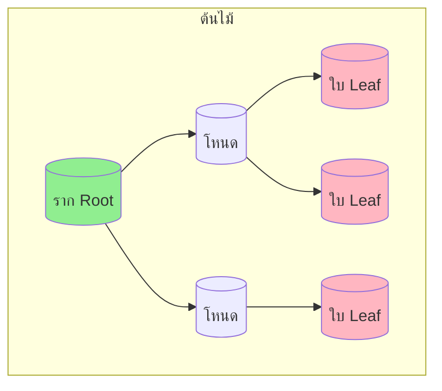
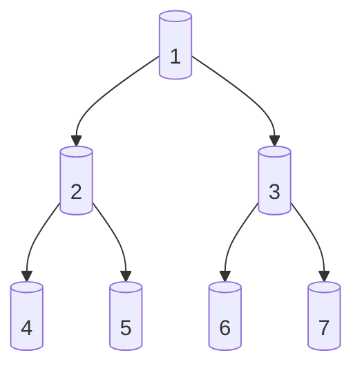
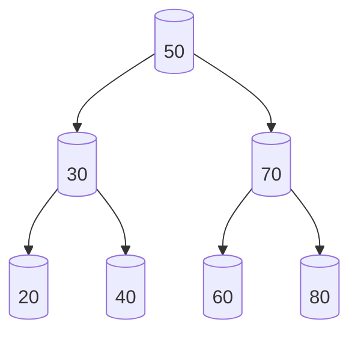
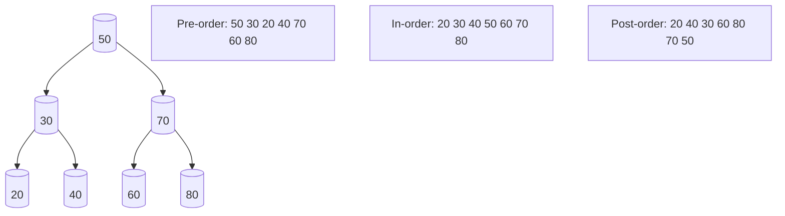

# บทที่ 6 ต้นไม้และไบนารีเซิร์ชทรี (Tree and Binary Search Tree)

## วัตถุประสงค์การเรียนรู้
เมื่อเรียนจบบทนี้ นักศึกษาจะสามารถ
1. อธิบายคำศัพท์พื้นฐานของต้นไม้ (ราก โหนด ขอบ เส้นทาง ระดับ ความสูง)
2. อธิบายไบนารีทรีและไบนารีเซิร์ชทรี (BST)
3. อธิบายการดำเนินการกับ BST (แทรก ลบ ค้นหา ทบทวนทุกแบบ)
4. เปรียบเทียบการทบทวนต้นไม้แบบก่อนกลางหลัง (Pre-order, In-order, Post-order)
5. เขียนโปรแกรมจัดการไบนารีเซิร์ชทรีได้อย่างถูกต้อง

## การประเมิน
| รายการ | น้ำหนัก | หมายเหตุ |
|:---|:---:|:---|
| งานเขียนโปรแกรมจัดการไบนารีเซิร์ชทรี | 20% | โค้ดภาษา C/Python/Java |
| แบบทดสอบท้ายบท | 10% | ข้อควบคุมเลือกตอบและปฏิบัติการ |
| การปฏิบัติงานในห้องปฏิบัติการคอมพิวเตอร์ | 10% | ฝึกสร้างและทบทวนต้นไม้ |

---

## 6.1 คำศัพท์พื้นฐานของต้นไม้



| คำศัพท์ | ความหมาย |
|:---|:---|
| **ราก (Root)** | โหนดบนสุดของต้นไม้ ไม่มีโหนดพ่อ |
| **โหนด (Node)** | หน่วยย่อยของต้นไม้ เก็บข้อมูลและตัวชี้ไปยังลูก |
| **ขอบ (Edge)** | เส้นเชื่อมระหว่างโหนดสองตัว |
| **โหนดลูก (Child)** | โหนดที่อยู่ใต้โหนดพ่อ |
| **โหนดพ่อ (Parent)** | โหนดที่อยู่เหนือโหนดลูก |
| **พี่น้อง (Sibling)** | โหนดที่มีโหนดพ่อเดียวกัน |
| **ใบ (Leaf)** | โหนดที่ไม่มีโหนดลูก |
| **เส้นทาง (Path)** | ลำดับของขอบจากโหนดหนึ่งไปยังอีกโหนดหนึ่ง |
| **ระดับ (Level)** | ระยะห่างจากราก รากอยู่ระดับ 0 |
| **ความสูง (Height)** | ระดับสูงสุดของต้นไม้ (ระยะจากรากถึงใบที่ลึกที่สุด) |
| **ต้นย่อย (Subtree)** | ต้นไม้ที่เกิดจากโหนดใดโหนดหนึ่งลงมา |

### ตัวอย่างต้นไม้

```
        ราก (A)
       /      \
      B        C
     / \      /
    D   E    F
```

- ราก: A
- ใบ: D, E, F
- โหนดพ่อของ D และ E คือ B
- ระดับของ A คือ 0, B และ C คือ 1, D E F คือ 2
- ความสูงของต้นไม้คือ 2

---

## 6.2 ไบนารีทรี (Binary Tree)

ไบนารีทรีคือต้นไม้ที่แต่ละโหนดมีลูกสูงสุดสองตัว (ลูกซ้ายและลูกขวา)



---

## 6.3 ไบนารีเซิร์ชทรี (BST)

ไบนารีเซิร์ชทรีคือไบนารีทรีที่มีคุณสมบัติพิเศษ:
- ค่าในทุกโหนดของต้นย่อยซ้าย ต้องน้อยกว่าค่าของโหนดปัจจุบัน
- ค่าในทุกโหนดของต้นย่อยขวา ต้องมากกว่าค่าของโหนดปัจจุบัน
- ไม่มีค่าซ้ำกัน



### การสร้าง BST จากค่า: 50, 30, 70, 20, 40, 60, 80

ขั้นตอนการแทรก:
1. 50 → เป็นราก
2. 30 → น้อยกว่า 50 ไปซ้ายของ 50
3. 70 → มากกว่า 50 ไปขวาของ 50
4. 20 → น้อยกว่า 50 ไปซ้าย, น้อยกว่า 30 ไปซ้ายของ 30
5. 40 → น้อยกว่า 50 ไปซ้าย, มากกว่า 30 ไปขวาของ 30
6. 60 → มากกว่า 50 ไปขวา, น้อยกว่า 70 ไปซ้ายของ 70
7. 80 → มากกว่า 50 ไปขวา, มากกว่า 70 ไปขวาของ 70

ผลลัพธ์ (ตามภาพด้านบน)

---

## 6.4 การดำเนินการกับ BST

### การค้นหา (Search)
เปรียบเทียบค่าที่ต้องการกับโหนดปัจจุบัน ถ้าน้อยกว่าไปซ้าย มากกว่าไปขวา เท่ากันพบแล้ว

```python
def search(root, key):
    if root is None or root.data == key:
        return root
    if key < root.data:
        return search(root.left, key)
    return search(root.right, key)
```
ความซับซ้อน: O(h) โดย h คือความสูงของต้นไม้ (กรณีแย่ที่สุด O(n) ถ้าต้นไม้เกลี่ยเป็นเส้นตรง)

### การแทรก (Insert)
ค้นหาตำแหน่งที่เหมาะสมเหมือนการค้นหา แล้วแทรกเป็นใบใหม่

```python
def insert(root, key):
    if root is None:
        return Node(key)
    if key < root.data:
        root.left = insert(root.left, key)
    else:
        root.right = insert(root.right, key)
    return root
```

### การลบ (Delete)
มีสามกรณี:
1. โหนดที่ลบเป็นใบ → ลบทิ้งเลย
2. โหนดที่ลบมีลูกหนึ่งตัว → เชื่อมลูกนั้นแทนที่โหนดที่ลบ
3. โหนดที่ลบมีลูกสองตัว → หาค่าตัวสืบตำแหน่ง (in-order successor) คือค่าน้อยที่สุดในต้นย่อยขวา แล้วแทนที่

```python
def delete_node(root, key):
    if root is None:
        return root
    
    if key < root.data:
        root.left = delete_node(root.left, key)
    elif key > root.data:
        root.right = delete_node(root.right, key)
    else:
        # กรณีโหนดมีลูกไม่เกินหนึ่งตัว
        if root.left is None:
            return root.right
        elif root.right is None:
            return root.left
        
        # กรณีมีลูกสองตัว หาค่าน้อยที่สุดในต้นย่อยขวา
        temp = min_value_node(root.right)
        root.data = temp.data
        root.right = delete_node(root.right, temp.data)
    
    return root
```

---

## 6.5 การทบทวนต้นไม้ (Tree Traversal)

มีสี่แบบหลัก:

### 1. Pre-order (ก่อน-กลาง-หลัง)
เยี่ยมราก → ต้นย่อยซ้าย → ต้นย่อยขวา

### 2. In-order (กลาง)
ต้นย่อยซ้าย → ราก → ต้นย่อยขวา (สำหรับ BST จะได้ค่าเรียงจากน้อยไปมาก)

### 3. Post-order (หลัง)
ต้นย่อยซ้าย → ต้นย่อยขวา → ราก

### 4. Level-order (ระดับ)
เยี่ยมทีละระดับจากบนลงล่าง ซ้ายไปขวา (ใช้คิว)



### ตัวอย่างโค้ดการทบทวน (ภาษา Python)
```python
class Node:
    def __init__(self, data):
        self.data = data
        self.left = None
        self.right = None

def pre_order(root):
    if root:
        print(root.data, end=" ")
        pre_order(root.left)
        pre_order(root.right)

def in_order(root):
    if root:
        in_order(root.left)
        print(root.data, end=" ")
        in_order(root.right)

def post_order(root):
    if root:
        post_order(root.left)
        post_order(root.right)
        print(root.data, end=" ")
```

### ตัวอย่างผลลัพธ์จากต้นไม้ด้านบน

| แบบ | ผลลัพธ์ |
|:---|:---|
| Pre-order | 50 30 20 40 70 60 80 |
| In-order | 20 30 40 50 60 70 80 (เรียงลำดับ!) |
| Post-order | 20 40 30 60 80 70 50 |
| Level-order | 50 30 70 20 40 60 80 |

---

## 6.6 ต้นไม้ที่สมบูรณ์และต้นไม้ที่สมดุล

- **ต้นไม้สมบูรณ์ (Full Binary Tree):** ทุกโหนดมีลูก 0 หรือ 2 ตัว
- **ต้นไม้ที่สมดุล (Balanced Tree):** ความสูงของต้นย่อยซ้ายและขวาแตกต่างกันไม่เกิน 1 ทุกโหนด
- **ต้นไม้ที่สมบูรณ์แบบ (Perfect Binary Tree):** ทุกระดับเต็มทุกโหนด

---

## 6.7 การประยุกต์ใช้

- โครงสร้างไดเรกทอรีและไฟล์ในระบบปฏิบัติการ
- แสดงข้อมูลเชิงลำดับชั้น (องค์กร ครอบครัว)
- ต้นไม้คำตัดขาดสิน (Decision Tree)
- การแสดงนิพจน์คณิตศาสตร์ (Expression Tree)

---

## แบบฝึกหัด

### ข้อที่ 1
จงวาดไบนารีเซิร์ชทรีจากการแทรกค่า 50, 30, 70, 20, 40, 60, 80 ทีละตัว

**คำตอบ:** ดูภาพประกอบในหัวข้อ 6.3

### ข้อที่ 2
จงเขียนอัลกอริทึมค้นหาค่าในไบนารีเซิร์ชทรี

**คำตอบ:** ดูโค้ดในหัวข้อ 6.4 ฟังก์ชัน `search`

### ข้อที่ 3
จงเปรียบเทียบผลลัพธ์การทบทวนต้นไม้แบบก่อนกลางและหลังจากต้นไม้เดียวกัน

**คำตอบ:** ดูตารางในหัวข้อ 6.5

---

## แบบปฏิบัติการข้อสอบ

### ข้อควบคุมเลือกตอบ (จำนวน 8 ข้อ)

**ข้อ 1.** โหนดบนสุดของต้นไม้เรียกว่า
- ก. ใบ
- ข. ราก
- ค. โหนดลูก
- ง. โหนดพี่น้อง

**ตอบ: ข**

**ข้อ 2.** ไบนารีทรีคือต้นไม้ที่แต่ละโหนดมีลูกสูงสุดกี่ตัว
- ก. 1
- ข. 2
- ค. 3
- ง. ไม่จำกัด

**ตอบ: ข**

**ข้อ 3.** ในไบนารีเซิร์ชทรี ค่าที่อยู่ในต้นย่อยซ้ายต้อง
- ก. มากกว่าโหนดปัจจุบัน
- ข. น้อยกว่าโหนดปัจจุบัน
- ค. เท่ากับโหนดปัจจุบัน
- ง. เป็นจำนวนคู่

**ตอบ: ข**

**ข้อ 4.** การทบทวนแบบใดของ BST จะได้ค่าเรียงจากน้อยไปมาก
- ก. Pre-order
- ข. In-order
- ค. Post-order
- ง. Level-order

**ตอบ: ข**

**ข้อ 5.** ความซับซ้อนการค้นหาใน BST กรณีแย่ที่สุดคือ
- ก. O(1)
- ข. O(log n)
- ค. O(n)
- ง. O(n log n)

**ตอบ: ค** (เกิดเมื่อต้นไม้เกลี่ยเป็นเส้นตรง)

**ข้อ 6.** โหนดที่ไม่มีลูกเรียกว่า
- ก. ราก
- ข. โหนดภายใน
- ค. ใบ (Leaf)
- ง. โหนดพ่อ

**ตอบ: ค**

**ข้อ 7.** การลบโหนดที่มีลูกสองตัวใน BST ต้องทำอย่างไร
- ก. ลบทิ้งเลย
- ข. หาค่าตัวสืบตำแหน่งมาแทนที่
- ค. ย้ายลูกซ้ายขึ้นแทนที่
- ง. ไม่สามารถลบได้

**ตอบ: ข**

**ข้อ 8.** ข้อใดไม่ใช่การทบทวนต้นไม้
- ก. Pre-order
- ข. In-order
- ค. Post-order
- ง. Random-order

**ตอบ: ง**

### ข้อปฏิบัติการ (จำนวน 2 ข้อ)

**ข้อ 9.** จงเขียนโค้ดภาษา C หรือ Python จัดการไบนารีเซิร์ชทรี รองรับการแทรก ลบ ค้นหา และทบทวนทุกแบบ

**ข้อ 10.** จงเขียนโค้ดแสดงผลการทบทวนต้นไม้แบบ Level-order โดยใช้คิว

---

## ภาคผนก

### ภาคผนก 6.1 โค้ดตัวอย่างไบนารีเซิร์ชทรีภาษา C / Python / Java

**ภาษา Java – คลาส BST ครบถ้วน:**
```java
class Node {
    int data;
    Node left, right;
    
    Node(int data) {
        this.data = data;
        this.left = this.right = null;
    }
}

class BinarySearchTree {
    Node root;
    
    void insert(int data) {
        root = insertRec(root, data);
    }
    
    Node insertRec(Node root, int data) {
        if (root == null) {
            root = new Node(data);
            return root;
        }
        if (data < root.data)
            root.left = insertRec(root.left, data);
        else if (data > root.data)
            root.right = insertRec(root.right, data);
        return root;
    }
    
    void inorder() {
        inorderRec(root);
    }
    
    void inorderRec(Node root) {
        if (root != null) {
            inorderRec(root.left);
            System.out.print(root.data + " ");
            inorderRec(root.right);
        }
    }
}
```

### ภาคผนก 6.2 แบบฝึกหัดสร้างต้นไม้จากโจทย์ต่างๆ

1. สร้าง BST จากค่า: 15, 10, 20, 8, 12, 17, 25 แล้วเขียนผลการทบทวนทุกแบบ
2. ลบค่า 10 จากต้นไม้ในข้อ 1 แสดงขั้นตอนการลบ
3. หาความสูงของต้นไม้จากข้อ 1

---

## อ้างอิง

- เอกสารประกอบการสอน บทที่ 6 ต้นไม้และไบนารีเซิร์ชทรี
- หนังสืออ้างอิงโครงสร้างข้อมูลไม่เชิงเส้น
