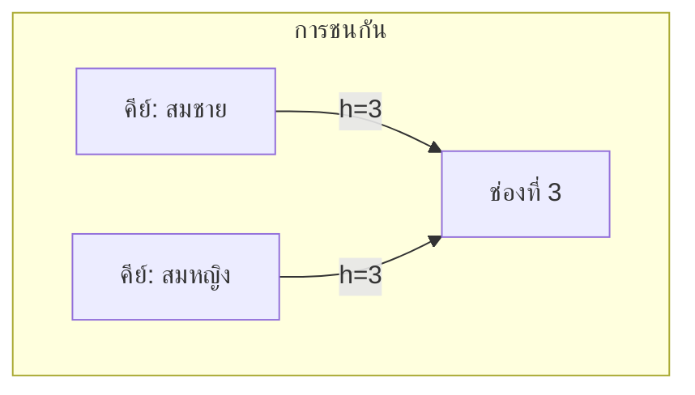
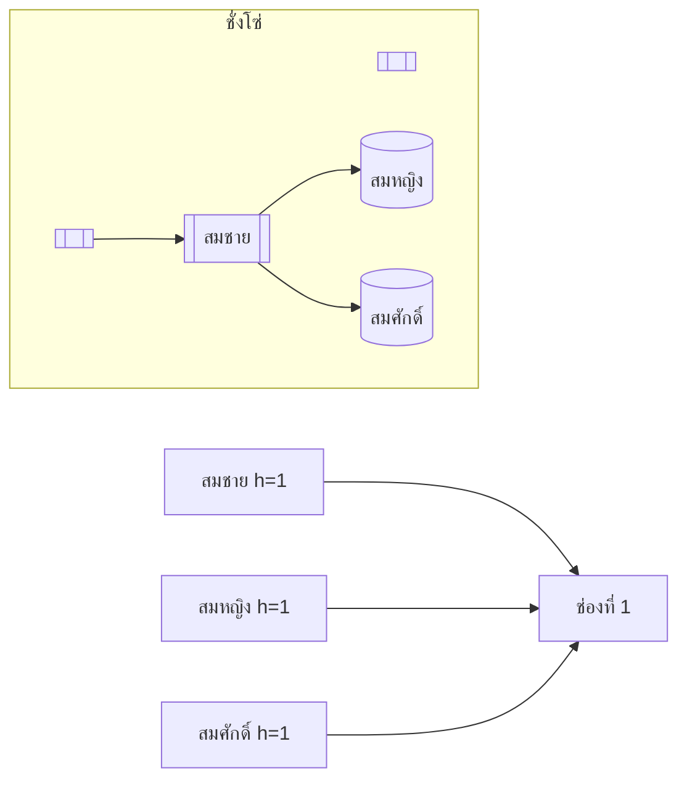
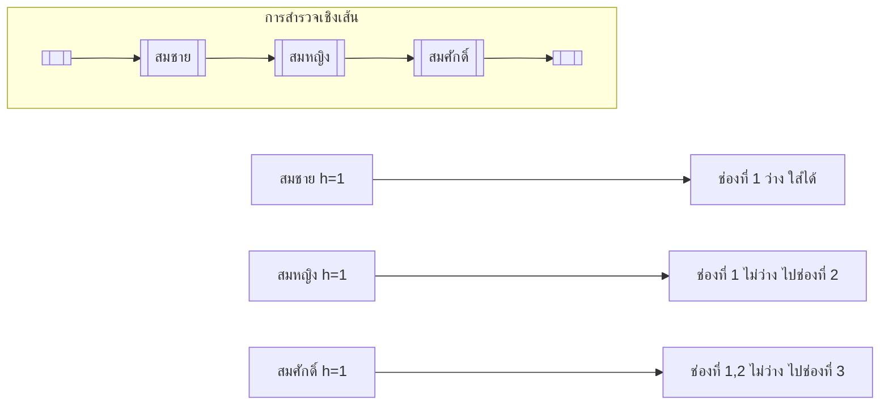
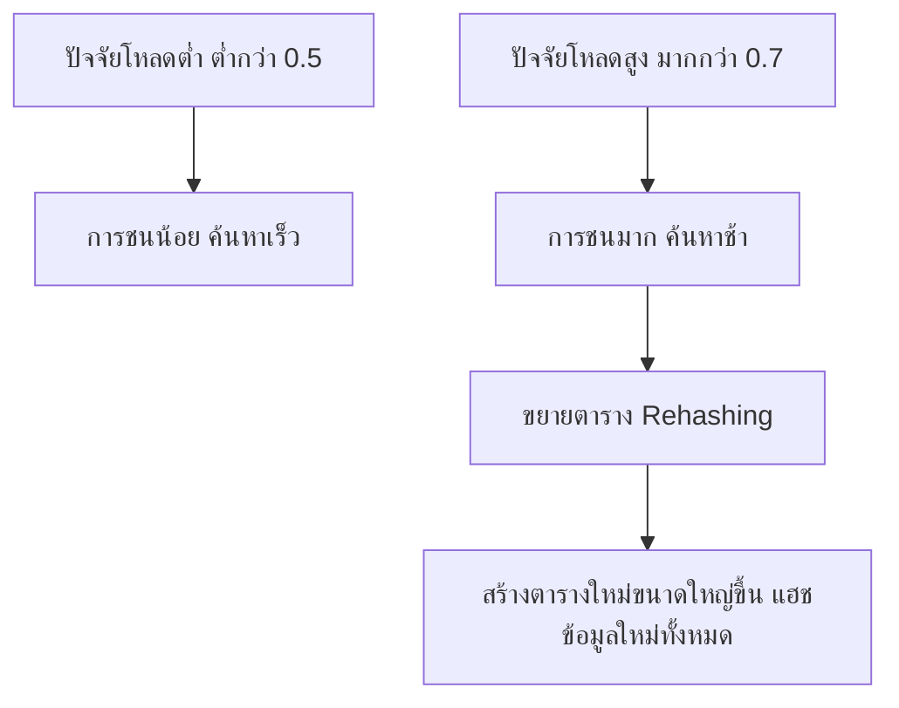

# บทที่ 7 ตารางแฮช (Hash Table)

## วัตถุประสงค์การเรียนรู้
เมื่อเรียนจบบทนี้ นักศึกษาจะสามารถ
1. อธิบายหลักการทำงานของตารางแฮชและฟังก์ชันแฮช
2. อธิบายการชนกัน (Collision) และวิธีแก้ไข (ชั่งโซ่ การสำรวจเชิงเส้น)
3. อธิบายปัจจัยโหลด (Load Factor) และการขยายตาราง (Rehashing)
4. เปรียบเทียบประสิทธิภาพการแทรก ลบ ค้นหาในตารางแฮช
5. เขียนโปรแกรมใช้ตารางแฮชในการแก้ปัญหาเบื้องต้น

## การประเมิน
| รายการ | น้ำหนัก | หมายเหตุ |
|:---|:---:|:---|
| งานเขียนโปรแกรมตารางแฮช | 15% | โค้ดภาษา C/Python/Java |
| แบบทดสอบท้ายบท | 10% | ข้อควบคุมเลือกตอบและอัตนัย |
| การเข้าร่วมกิจกรรมออกแบบฟังก์ชันแฮช | 5% | กิจกรรมกลุ่ม |

---

## 7.1 ตารางแฮชคืออะไร

ตารางแฮชคือโครงสร้างข้อมูลที่เก็บข้อมูลแบบคู่ คีย์-ค่า (key-value) โดยใช้ฟังก์ชันแฮชแปลงคีย์ให้เป็นดัชนีในตาราง ทำให้การค้นหา แทรก และลบทำได้ในเวลาเฉลี่ย O(1)

```mermaid
graph LR
    subgraph HashTable[ตารางแฮช ขนาด 10]
        direction LR
        0[[ ]] --> 1[[ "] ]
        1[[ "สมชาย"]] --> 2[[ ]]
        2[[ ]] --> 3[[ "สมหญิง"]]
        3[[ "สมหญิง"]] --> 4[[ ]]
        4[[ ]] --> 5[[ ]]
        5[[ ]] --> 6[[ ]]
        6[[ ]] --> 7[[ ]]
        7[[ ]] --> 8[[ ]]
        8[[ ]] --> 9[[ ]]
    end
    
    Key[คีย์ "สมชาย"] -->|hash()| Index[ดัชนี 1]
```

---

## 7.2 ฟังก์ชันแฮชและคุณสมบัติของฟังก์ชันแฮชที่ดี

### ฟังก์ชันแฮชที่พบบ่อย

**1. การหารเหลือ (Division Method)**
```
h(k) = k mod m
```
เมื่อ m คือขนาดของตารางแฮช

ตัวอย่าง: k = 25, m = 10 → h(25) = 25 mod 10 = 5

**2. การคูณ (Multiplication Method)**
```
h(k) = floor(m · (kA mod 1))
```
เมื่อ A เป็นค่าคงที่ระหว่าง 0 และ 1 (มักใช้ 0.618...)

**3. การแฮชสตริง**
รวมค่าตัวอักษรทุกตัวแล้วหาเศษเหลือ

```python
def hash_string(s, m):
    total = 0
    for ch in s:
        total += ord(ch)
    return total % m
```

### คุณสมบัติของฟังก์ชันแฮชที่ดี
1. คำนวณได้ง่ายและรวดเร็ว
2. แจกแจงคีย์อย่างสม่ำเสมอทั่วตาราง (ลดการชนกัน)
3. คีย์เดียวกันต้องให้ค่าแฮชเดียวกันเสมอ (deterministic)

---

## 7.3 การชนกัน (Collision)

การชนกันเกิดขึ้นเมื่อคีย์สองค่าต่างกันให้ค่าแฮชเท่ากัน เช่น คีย์ "สมชาย" และ "สมหญิง" อาจแฮชได้ดัชนีเดียวกัน



---

## 7.4 วิธีแก้ไขการชนกัน

### วิธีที่ 1: ชั่งโซ่ (Chaining)

แต่ละช่องในตารางแฮชเป็นลิงก์ลิสต์ เมื่อเกิดการชนกัน ให้ต่อท้ายลิงก์ลิสต์ที่ช่องนั้น



**ข้อดี:** ทำง่าย รองรับจำนวนสมาชิกไม่จำกัด  
**ข้อเสีย:** การค้นหาช้าลงเมื่อโซ่ยาว

### วิธีที่ 2: การสำรวจเชิงเส้น (Linear Probing)

เมื่อเกิดการชนกัน ให้หาช่องว่างถัดไปโดยเลื่อนไปเรื่อยๆ



**ข้อดี:** ไม่ต้องใช้โครงสร้างเพิ่ม  
**ข้อเสีย:** เกิดภาวะชุมชน (clustering) ทำให้ค้นหาช้า

---

## 7.5 ปัจจัยโหลด (Load Factor) และการขยายตาราง (Rehashing)

**ปัจจัยโหลด** = จำนวนสมาชิก / ขนาดตารางแฮช



เมื่อปัจจัยโหลดเกินเกณฑ์ (มักใช้ 0.7) จะทำ **Rehashing**:
1. สร้างตารางแฮชใหม่ขนาดใหญ่เป็นสองเท่า
2. แฮชข้อมูลทุกตัวใหม่ใส่ตารางใหม่
3. ลบตารางเก่า

---

## 7.6 การดำเนินการกับตารางแฮช

| การดำเนินการ | ความซับซ้อนเฉลี่ย | ความซับซ้อนแย่ที่สุด |
|:---|:---:|:---:|
| แทรก (Insert) | O(1) | O(n) |
| ค้นหา (Search) | O(1) | O(n) |
| ลบ (Delete) | O(1) | O(n) |

---

## 7.7 การประยุกต์ใช้

- แคช (Cache) ในเบราว์เซอร์และระบบปฏิบัติการ
- ตารางสัญลักษณ์ (Symbol Table) ในคอมไพเลอร์
- ตรวจสอบคำซ้ำในข้อมูลขนาดใหญ่
- นับความถี่ของคำในเอกสาร
- เก็บข้อมูลเซสชันผู้ใช้ในเว็บเซิร์ฟเวอร์

---

## แบบฝึกหัด

### ข้อที่ 1
จงออกแบบฟังก์ชันแฮชสำหรับเก็บข้อมูลนักศึกษารหัส 6 หลัก

**คำตอบ:**
```python
def hash_student_id(student_id, table_size):
    # student_id เป็นสตริง 6 หลัก เช่น "601234"
    total = 0
    for ch in student_id:
        total = total * 10 + int(ch)
    return total % table_size

# หรือใช้วิธีหารเหลือโดยตรง
def hash_student_id_simple(student_id, table_size):
    return int(student_id) % table_size
```

### ข้อที่ 2
จงอธิบายความแตกต่างของชั่งโซ่กับการสำรวจเชิงเส้นเมื่อเกิดการชนกัน

**คำตอบ:**
- **ชั่งโซ่:** แต่ละช่องเป็นลิงก์ลิสต์ เมื่อชนกันให้ต่อท้ายลิสต์ ไม่จำกัดจำนวนสมาชิกต่อช่อง แต่ใช้หน่วยความจำมากกว่า (ต้องเก็บโหนดลิงก์ลิสต์)
- **การสำรวจเชิงเส้น:** เก็บทั้งหมดในตารางเดียว เมื่อชนกันให้หาช่องว่างถัดไป ประหยัดหน่วยความจำ แต่เกิดภาวะชุมชน ทำให้ค้นหาช้าเมื่อตารางเต็ม

### ข้อที่ 3
จงคำนวณปัจจัยโหลดเมื่อตารางแฮชมีขนาด 10 และเก็บข้อมูล 7 รายการ

**คำตอบ:**
```
ปัจจัยโหลด = จำนวนสมาชิก / ขนาดตาราง = 7 / 10 = 0.7
```

---

## แบบปฏิบัติการข้อสอบ

### ข้อควบคุมเลือกตอบ (จำนวน 6 ข้อ)

**ข้อ 1.** ตารางแฮชใช้อะไรแปลงคีย์ให้เป็นดัชนี
- ก. ตัวชี้
- ข. ฟังก์ชันแฮช
- ค. ลูป
- ง. คิว

**ตอบ: ข**

**ข้อ 2.** การชนกันในตารางแฮชหมายถึง
- ก. คีย์สองค่าให้ค่าแฮชต่างกัน
- ข. คีย์สองค่าให้ค่าแฮชเท่ากัน
- ค. ตารางเต็มแล้ว
- ง. ฟังก์ชันแฮชทำงานผิดพลาด

**ตอบ: ข**

**ข้อ 3.** ชั่งโซ่แก้ปัญหาการชนกันโดย
- ก. หาช่องว่างถัดไป
- ข. ใช้ลิงก์ลิสต์ที่แต่ละช่อง
- ค. ขยายตารางทันที
- ง. ลบค่าที่ชนกัน

**ตอบ: ข**

**ข้อ 4.** ปัจจัยโหลดคืออะไร
- ก. จำนวนสมาชิกหารด้วยขนาดตาราง
- ข. ขนาดตารางหารด้วยจำนวนสมาชิก
- ค. จำนวนครั้งที่ชนกัน
- ง. เวลาที่ใช้ในการค้นหา

**ตอบ: ก**

**ข้อ 5.** การสำรวจเชิงเส้นเมื่อเกิดการชนกันจะ
- ก. หยุดทำงานทันที
- ข. หาช่องว่างถัดไปในตาราง
- ค. ย้ายข้อมูลทั้งหมดไปตารางใหม่
- ง. ลบค่าเดิมออก

**ตอบ: ข**

**ข้อ 6.** ความซับซ้อนเฉลี่ยของการค้นหาในตารางแฮชคือ
- ก. O(1)
- ข. O(n)
- ค. O(log n)
- ง. O(n²)

**ตอบ: ก**

### ข้ออัตนัย (จำนวน 2 ข้อ)

**ข้อ 7.** จงเขียนโค้ดภาษา C หรือ Python ตารางแฮชที่ใช้วิธีชั่งโซ่ในการแก้ปัญหาการชนกัน

**ข้อ 8.** จงเขียนโค้ดตารางแฮชที่ใช้การสำรวจเชิงเส้น และแสดงผลลัพธ์เมื่อแทรกค่า 15, 25, 35 ลงในตารางขนาด 10

---

## ภาคผนก

### ภาคผนก 7.1 โค้ดตัวอย่างตารางแฮชทุกวิธีแก้ปัญหาการชนกัน

**ภาษา Python – ตารางแฮชแบบชั่งโซ่:**
```python
class HashTableChaining:
    def __init__(self, size):
        self.size = size
        self.table = [[] for _ in range(size)]
    
    def _hash(self, key):
        return hash(key) % self.size
    
    def insert(self, key, value):
        index = self._hash(key)
        for pair in self.table[index]:
            if pair[0] == key:
                pair[1] = value
                return
        self.table[index].append([key, value])
    
    def search(self, key):
        index = self._hash(key)
        for pair in self.table[index]:
            if pair[0] == key:
                return pair[1]
        return None
    
    def delete(self, key):
        index = self._hash(key)
        for i, pair in enumerate(self.table[index]):
            if pair[0] == key:
                self.table[index].pop(i)
                return


# การใช้งาน
ht = HashTableChaining(10)
ht.insert("สมชาย", 20)
ht.insert("สมหญิง", 25)
print(ht.search("สมชาย"))  # 20
```

**ภาษา Python – ตารางแฮชแบบการสำรวจเชิงเส้น:**
```python
class HashTableLinearProbing:
    def __init__(self, size):
        self.size = size
        self.keys = [None] * size
        self.values = [None] * size
    
    def _hash(self, key):
        return hash(key) % self.size
    
    def insert(self, key, value):
        index = self._hash(key)
        while self.keys[index] is not None:
            if self.keys[index] == key:
                self.values[index] = value
                return
            index = (index + 1) % self.size
        self.keys[index] = key
        self.values[index] = value
    
    def search(self, key):
        index = self._hash(key)
        while self.keys[index] is not None:
            if self.keys[index] == key:
                return self.values[index]
            index = (index + 1) % self.size
        return None
```

### ภาคผนก 7.2 ตัวอย่างการประยุกต์ใช้ตารางแฮชในระบบจริง

ระบบนับจำนวนครั้งที่คำปรากฏในเอกสาร:
```python
def count_words(text):
    word_count = {}
    for word in text.split():
        word = word.lower()
        word_count[word] = word_count.get(word, 0) + 1
    return word_count

text = "แมว วิ่ง แมว นอน แมว กิน ปลา"
print(count_words(text))
# {'แมว': 3, 'วิ่ง': 1, 'นอน': 1, 'กิน': 1, 'ปลา': 1}
```

---

## อ้างอิง

- เอกสารประกอบการสอน บทที่ 7 ตารางแฮช
- คู่มือการออกแบบฟังก์ชันแฮชสำหรับนักศึกษา
