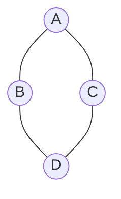
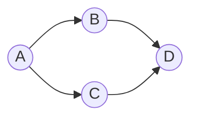
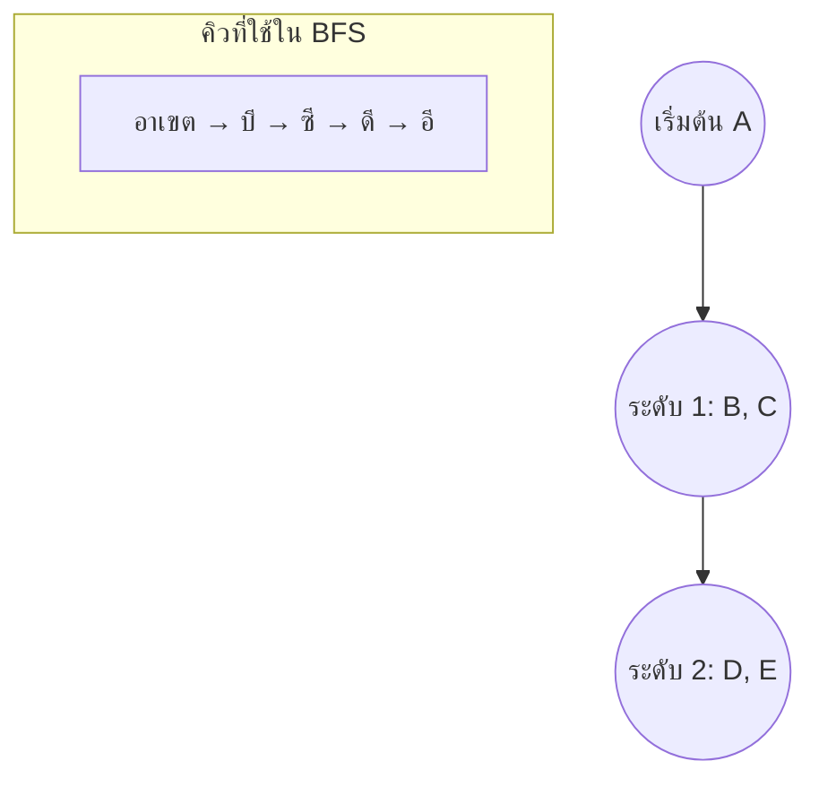
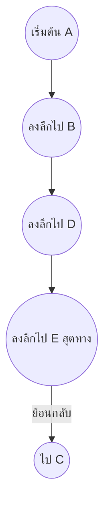

# บทที่ 8 กราฟ (Graph)

## วัตถุประสงค์การเรียนรู้
เมื่อเรียนจบบทนี้ นักศึกษาจะสามารถ
1. อธิบายคำศัพท์พื้นฐานของกราฟ (vertex, edge, path, cycle, connected graph)
2. อธิบายความแตกต่างของกราฟทิศทางและกราฟไม่มีทิศทาง
3. อธิบายการแทนกราฟด้วยเมทริกซ์ต่อเนื่องและลิสต์การเชื่อมต่อ
4. อธิบายอัลกอริทึมค้นหากราฟแบบกว้าง (BFS) และลึก (DFS)
5. เขียนโปรแกรมค้นหาและตัดเส้นทางในกราฟได้อย่างถูกต้อง

## การประเมิน
| รายการ | น้ำหนัก | หมายเหตุ |
|:---|:---:|:---|
| งานเขียนโปรแกรมค้นหาเส้นทางในกราฟ | 20% | โค้ดภาษา C/Python/Java |
| แบบทดสอบท้ายบท | 10% | ข้อควบคุมเลือกตอบและปฏิบัติการ |
| การนำเสนอกราฟจากสถานการณ์จริง | 10% | นำเสนอกราฟที่สร้างจากสถานการณ์จริง |

---

## 8.1 คำศัพท์พื้นฐานของกราฟ

| คำศัพท์ | ความหมาย |
|:---|:---|
| **Vertex (จุดยอด)** | จุดหรือโหนดในกราฟ |
| **Edge (ขอบ)** | เส้นเชื่อมระหว่างจุดยอดสองจุด |
| **Path (เส้นทาง)** | ลำดับของขอบที่เชื่อมจุดยอดสองจุด |
| **Cycle (วัฏจักร)** | เส้นทางที่เริ่มต้นและสิ้นสุดที่จุดเดียวกัน |
| **Connected Graph (กราฟเชื่อมต่อ)** | กราฟที่ทุกจุดยอดเชื่อมถึงกันทั้งหมด |
| **Degree (ดีกรี)** | จำนวนขอบที่เชื่อมกับจุดยอดนั้น |
| **Weight (น้ำหนัก)** | ค่าที่กำหนดให้กับขอบ เช่น ระยะทาง เวลา |

### ตัวอย่างกราฟไม่มีทิศทาง

```
      A —— B
     / \    \
    C —— D —— E
```

- จุดยอด: A, B, C, D, E (5 จุด)
- ขอบ: (A,B), (A,C), (A,D), (B,D), (B,E), (C,D), (D,E) (7 เส้น)
- ดีกรีของ A = 3 (เชื่อมกับ B, C, D)

---

## 8.2 กราฟทิศทางและกราฟไม่มีทิศทาง

### กราฟไม่มีทิศทาง (Undirected Graph)
ขอบไม่มีทิศทาง สามารถเดินไปมาได้ทั้งสองทาง เปรียบเสมือนถนนสองเลน



### กราฟทิศทาง (Directed Graph)
ขอบมีทิศทาง ระบุด้วยลูกศร เปรียบเสมือนถนนทางเดียว



---

## 8.3 การแทนกราฟ

### วิธีที่ 1: เมทริกซ์ต่อเนื่อง (Adjacency Matrix)

ใช้ตารางสองมิติขนาด V×V (V คือจำนวนจุดยอด) ถ้ามีขอบระหว่าง i และ j ให้ใส่ 1 ถ้าไม่มีใส่ 0

```
    A B C D E
A   0 1 1 1 0
B   1 0 0 1 1
C   1 0 0 1 0
D   1 1 1 0 1
E   0 1 0 1 0
```

**ข้อดี:** ตรวจสอบว่ามีขอบหรือไม่ทำได้ O(1)  
**ข้อเสีย:** ใช้พื้นที่ O(V²) เปลืองเมื่อกราฟมีขอบน้อย (sparse graph)

### วิธีที่ 2: ลิสต์การเชื่อมต่อ (Adjacency List)

แต่ละจุดยอดมีลิสต์ของจุดยอดที่เชื่อมต่อ

```
A: B, C, D
B: A, D, E
C: A, D
D: A, B, C, E
E: B, D
```

**ข้อดี:** ประหยัดพื้นที่ O(V + E) เหมาะกับกราฟที่มีขอบน้อย  
**ข้อเสีย:** ตรวจสอบว่ามีขอบหรือไม่ต้องไล่ลิสต์ O(ดีกรี)

---

## 8.4 การค้นหาแบบกว้าง (Breadth-First Search, BFS)

BFS สำรวจกราฟทีละระดับ เริ่มจากจุดเริ่มต้นแล้วไปยังจุดที่อยู่ห่างหนึ่งขอบ สองขอบ เป็นลำดับ ใช้ **คิว (Queue)** ในการเก็บจุดที่รอการสำรวจ



### ตัวอย่างโค้ด BFS (ภาษา Python)
```python
from collections import deque

def bfs(graph, start):
    visited = set()
    queue = deque([start])
    visited.add(start)
    
    while queue:
        vertex = queue.popleft()
        print(vertex, end=" ")
        
        for neighbor in graph[vertex]:
            if neighbor not in visited:
                visited.add(neighbor)
                queue.append(neighbor)


# กราฟตัวอย่าง
graph = {
    'A': ['B', 'C', 'D'],
    'B': ['A', 'D', 'E'],
    'C': ['A', 'D'],
    'D': ['A', 'B', 'C', 'E'],
    'E': ['B', 'D']
}

print("BFS เริ่มจาก A:")
bfs(graph, 'A')  # A B C D E
```

---

## 8.5 การค้นหาแบบลึก (Depth-First Search, DFS)

DFS สำรวจลึกเข้าไปในเส้นทางหนึ่งจนสุดแล้วค่อยย้อนกลับ ใช้ **สแตก (Stack)** หรือการเรียกซ้ำ (recursion)



### ตัวอย่างโค้ด DFS (ภาษา Python)
```python
def dfs(graph, start, visited=None):
    if visited is None:
        visited = set()
    
    visited.add(start)
    print(start, end=" ")
    
    for neighbor in graph[start]:
        if neighbor not in visited:
            dfs(graph, neighbor, visited)


# การใช้งาน
print("DFS เริ่มจาก A:")
dfs(graph, 'A')  # ผลลัพธ์อาจเป็น A B D E C
```

---

## 8.6 การประยุกต์ใช้

| การประยุกต์ใช้ | คำอธิบาย |
|:---|:---|
| เครือข่ายสังคม | คนเป็นจุดยอด ความสัมพันธ์เป็นขอบ |
| เส้นทางเดินรถ | สถานีเป็นจุdyอด เส้นทางเป็นขอบ มีน้ำหนักเป็นระยะทาง |
| ระบบแนะนำ | แนะนำเพื่อนหรือสินค้าจากกราฟความสัมพันธ์ |
| เว็บเพจและลิงก์ | เว็บเพจเป็นจุดยอด ลิงก์เป็นขอบ ใช้ใน search engine |
| เส้นทางที่สั้นที่สุด | หาเส้นทางที่เร็วที่สุดระหว่างสองจุด (อัลกอริทึมไดจ์สตรา) |

---

## แบบฝึกหัด

### ข้อที่ 1
จงวาดกราฟไม่มีทิศทางจากจุดคงที่ 5 จุดและขอบ 7 เส้น

**คำตอบ:** ตัวอย่างกราฟด้านบนในหัวข้อ 8.1

### ข้อที่ 2
จงเขียนอัลกอริทึมค้นหาแบบกว้าง (BFS) บนกราฟที่กำหนด

**คำตอบ:** ดูโค้ดในหัวข้อ 8.4 ฟังก์ชัน `bfs`

### ข้อที่ 3
จงเปรียบเทียบการแทนกราฟแบบเมทริกซ์กับลิสต์การเชื่อมต่อในด้านพื้นที่

**คำตอบ:**

| ด้าน | เมทริกซ์ต่อเนื่อง | ลิสต์การเชื่อมต่อ |
|:---|:---|:---|
| พื้นที่ที่ใช้ | O(V²) | O(V + E) |
| เหมาะกับกราฟ | หนา (dense) มีขอบเยอะ | โปร่ง (sparse) มีขอบน้อย |
| ตรวจสอบขอบ | O(1) | O(ดีกรี) |

---

## แบบปฏิบัติการข้อสอบ

### ข้อควบคุมเลือกตอบ (จำนวน 8 ข้อ)

**ข้อ 1.** จุดยอดในกราฟหมายถึงอะไร
- ก. เส้นเชื่อมระหว่างสองจุด
- ข. จุดหรือโหนดในกราฟ
- ค. เส้นทางจากจุดหนึ่งไปอีกจุดหนึ่ง
- ง. วัฏจักรในกราฟ

**ตอบ: ข**

**ข้อ 2.** กราฟทิศทางแตกต่างจากกราฟไม่มีทิศทางตรงที่
- ก. ขอบมีทิศทางระบุด้วยลูกศร
- ข. มีจุดยอดมากกว่า
- ค. มีขอบน้อยกว่า
- ง. ไม่มีวัฏจักร

**ตอบ: ก**

**ข้อ 3.** เมทริกซ์ต่อเนื่องใช้พื้นที่เท่าใดเมื่อมีจุดยอด V จุด
- ก. O(V)
- ข. O(V²)
- ค. O(log V)
- ง. O(V log V)

**ตอบ: ข**

**ข้อ 4.** BFS ใช้โครงสร้างข้อมูลใดเป็นหลัก
- ก. สแตก
- ข. คิว
- ค. ลิงก์ลิสต์
- ง. ตารางแฮช

**ตอบ: ข**

**ข้อ 5.** DFS ใช้โครงสร้างข้อมูลใดเป็นหลัก (เมื่อใช้แบบเรียกซ้ำ)
- ก. สแตก (ระบบจัดการการเรียกซ้ำ)
- ข. คิว
- ค. ลิงก์ลิสต์
- ง. ตารางแฮช

**ตอบ: ก**

**ข้อ 6.** ลิสต์การเชื่อมต่อเหมาะกับกราฟประเภทใด
- ก. กราฟหนา (มีขอบเยอะ)
- ข. กราฟโปร่ง (มีขอบน้อย)
- ค. ทุกกราฟ
- ง. กราฟที่มีน้ำหนักเท่านั้น

**ตอบ: ข**

**ข้อ 7.** วัฏจักรในกราฟคือ
- ก. เส้นทางที่เริ่มและจบที่จุดเดียวกัน
- ข. จุดที่ไม่มีขอบเชื่อม
- ค. เส้นทางที่ยาวที่สุด
- ง. เส้นทางที่สั้นที่สุด

**ตอบ: ก**

**ข้อ 8.** ความแตกต่างหลักระหว่าง BFS และ DFS คือ
- ก. BFS สำรวจทีละระดับ DFS สำรวจลึกไปทีละเส้นทาง
- ข. BFS ใช้สแตก DFS ใช้คิว
- ค. BFS หาเส้นทางสั้นที่สุดเสมอ DFS ไม่เคยหาได้
- ง. ไม่มีความแตกต่าง

**ตอบ: ก**

### ข้อปฏิบัติการ (จำนวน 2 ข้อ)

**ข้อ 9.** จงเขียนโค้ดภาษา C หรือ Python ค้นหาเส้นทางในกราฟโดยใช้ BFS และ DFS

**ข้อ 10.** จงเขียนโค้ดสร้างกราฟจากอินพุตของผู้ใช้แล้วแสดงผลการทบทวนด้วย BFS

---

## ภาคผนก

### ภาคผนก 8.1 โค้ดตัวอย่าง BFS และ DFS ภาษา C / Python / Java

**ภาษา Java – BFS และ DFS:**
```java
import java.util.*;

public class GraphTraversal {
    private Map<String, List<String>> graph = new HashMap<>();
    
    void addEdge(String u, String v) {
        graph.computeIfAbsent(u, k -> new ArrayList<>()).add(v);
        graph.computeIfAbsent(v, k -> new ArrayList<>()).add(u);
    }
    
    void bfs(String start) {
        Set<String> visited = new HashSet<>();
        Queue<String> queue = new LinkedList<>();
        visited.add(start);
        queue.offer(start);
        
        while (!queue.isEmpty()) {
            String vertex = queue.poll();
            System.out.print(vertex + " ");
            for (String neighbor : graph.getOrDefault(vertex, new ArrayList<>())) {
                if (!visited.contains(neighbor)) {
                    visited.add(neighbor);
                    queue.offer(neighbor);
                }
            }
        }
    }
    
    void dfs(String start, Set<String> visited) {
        if (visited == null) visited = new HashSet<>();
        visited.add(start);
        System.out.print(start + " ");
        for (String neighbor : graph.getOrDefault(start, new ArrayList<>())) {
            if (!visited.contains(neighbor)) {
                dfs(neighbor, visited);
            }
        }
    }
}
```

### ภาคผนก 8.2 ตัวอย่างกราฟจากสถานการณ์จริงหลายกรณี

1. **เครือข่ายรถไฟฟ้า:** สถานีเป็นจุดยอด เส้นทางรถไฟเป็นขอบ
2. **เครือข่ายคอมพิวเตอร์:** เครื่องคอมพิวเตอร์เป็นจุดยอด สายแลนเป็นขอบ
3. **แผนที่การเดินทาง:** จังหวัดเป็นจุดยอด ถนนเป็นขอบ มีน้ำหนักเป็นระยะทางกิโลเมตร

---

## อ้างอิง

- เอกสารประกอบการสอน บทที่ 8 กราฟ
- หนังสืออ้างอิงทฤษฎีกราฟและอัลกอริทึม
