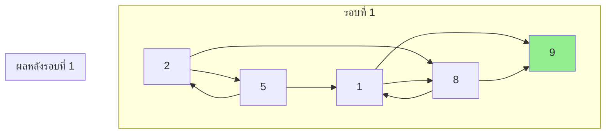
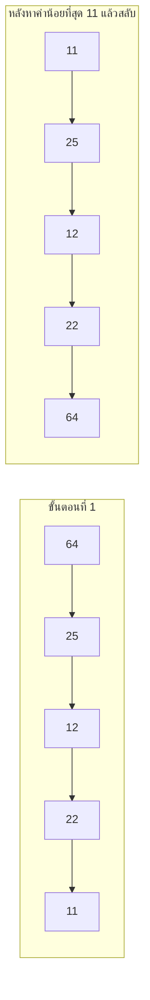
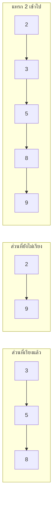
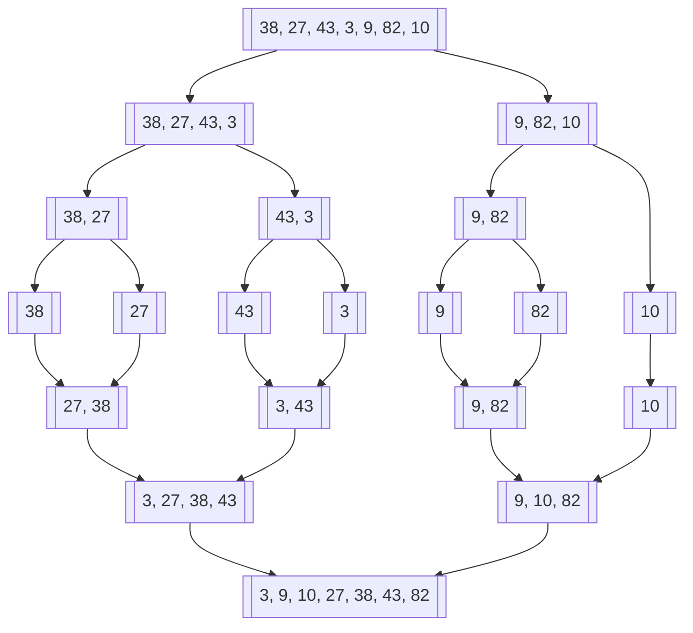
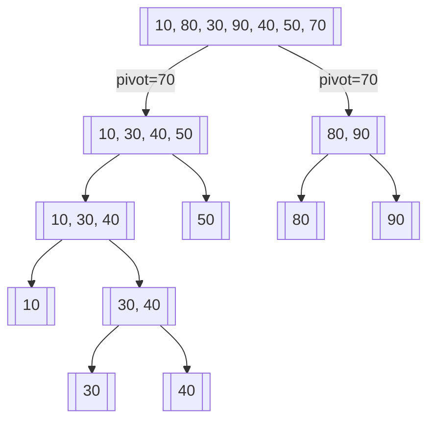

# บทที่ 9 การเรียงลำดับ (Sorting)

## วัตถุประสงค์การเรียนรู้
เมื่อเรียนจบบทนี้ นักศึกษาจะสามารถ
1. อธิบายหลักการของอัลกอริทึมเรียงลำดับพื้นฐาน (บับเบิล ซิลレクชัน อินเซิร์ชชัน)
2. อธิบายอัลกอริทึมเรียงลำดับขั้นสูง (เมอร์จ์ ควิก ฮีป)
3. เปรียบเทียบความซับซ้อนเชิงเวลาของอัลกอริทึมเรียงลำดับแต่ละชนิด
4. อธิบายความหมายของการเรียงลำดับที่คงที่ (Stable Sort)
5. เขียนโปรแกรมเรียงลำดับข้อมูลได้อย่างถูกต้องและเหมาะสม

## การประเมิน
| รายการ | น้ำหนัก | หมายเหตุ |
|:---|:---:|:---|
| งานเขียนโปรแกรมเรียงลำดับเปรียบเทียบหลายชนิด | 20% | โค้ดภาษา C/Python/Java |
| แบบทดสอบท้ายบท | 10% | ข้อควบคุมเลือกตอบและปฏิบัติการ |
| การปฏิบัติงานวัดเวลาการทำงานของแต่ละอัลกอริทึม | 10% | วัดและเปรียบเทียบประสิทธิภาพจริง |

---

## 9.1 บับเบิลซอร์ต (Bubble Sort)

### แนวคิด
เปรียบเทียบสมาชิกคู่ที่ติดกัน ถ้าเรียงผิดสลับกันให้สลับตำแหน่ง ทำซ้ำจนกว่าจะไม่มีการสลับอีก ตัวที่มากที่สุดจะ "ลอยขึ้น" ไปอยู่ท้ายสุดเหมือนฟองอากาศ



### ตัวอย่างโค้ด (ภาษา Python)
```python
def bubble_sort(arr):
    n = len(arr)
    for i in range(n):
        swapped = False
        for j in range(0, n - i - 1):
            if arr[j] > arr[j + 1]:
                arr[j], arr[j + 1] = arr[j + 1], arr[j]
                swapped = True
        if not swapped:
            break
    return arr


# การใช้งาน
data = [64, 34, 25, 12, 22, 11, 90]
print(bubble_sort(data))  # [11, 12, 22, 25, 34, 64, 90]
```

### การเดินผ่านขั้นตอน
อาเรย์: [5, 2, 8, 1, 9]

| รอบ | การเปรียบเทียบและสลับ | อาเรย์หลังจบรอบ |
|:---|:---|:---|
| 1 | (5,2)สลับ (5,8)ไม่ (5,1)สลับ (5,9)ไม่ | [2, 1, 5, 8, 9] |
| 2 | (2,1)สลับ (2,5)ไม่ (5,8)ไม่ | [1, 2, 5, 8, 9] |
| 3 | (1,2)ไม่ (2,5)ไม่ | [1, 2, 5, 8, 9] (ไม่มีการสลับ จบ) |

ความซับซ้อน: Best O(n), Average O(n²), Worst O(n²)  
เสถียร: ใช่

---

## 9.2 ซิลレクชันซอร์ต (Selection Sort)

### แนวคิด
หาค่าน้อยที่สุดจากอาเรย์ทั้งหมดแล้วสลับมาวางที่ตำแหน่งแรก แล้วหาค่าน้อยที่สุดจากที่เหลือมาวางตำแหน่งที่สอง ทำซ้ำเรื่อยๆ



### ตัวอย่างโค้ด (ภาษา Python)
```python
def selection_sort(arr):
    n = len(arr)
    for i in range(n):
        min_idx = i
        for j in range(i + 1, n):
            if arr[j] < arr[min_idx]:
                min_idx = j
        arr[i], arr[min_idx] = arr[min_idx], arr[i]
    return arr


# การใช้งาน
data = [64, 25, 12, 22, 11]
print(selection_sort(data))  # [11, 12, 22, 25, 64]
```

ความซับซ้อน: Best O(n²), Average O(n²), Worst O(n²)  
เสถียร: ไม่ใช่ (การสลับอาจทำให้สมาชิกที่ค่าเท่ากันสลับลำดับกัน)

---

## 9.3 อินเซิร์ชชันซอร์ต (Insertion Sort)

### แนวคิด
เหมือนการเรียงไพ่ในมือ หยิบไพ่ทีละใบแล้วแทรกไว้ในตำแหน่งที่เหมาะสมในส่วนที่เรียงแล้ว



### ตัวอย่างโค้ด (ภาษา Python)
```python
def insertion_sort(arr):
    for i in range(1, len(arr)):
        key = arr[i]
        j = i - 1
        while j >= 0 and arr[j] > key:
            arr[j + 1] = arr[j]
            j -= 1
        arr[j + 1] = key
    return arr


# การใช้งาน
data = [12, 11, 13, 5, 6]
print(insertion_sort(data))  # [5, 6, 11, 12, 13]
```

ความซับซ้อน: Best O(n), Average O(n²), Worst O(n²)  
เสถียร: ใช่

---

## 9.4 เมอร์จ์ซอร์ต (Merge Sort)

### แนวคิด
ใช้หลักการแบ่งและพิชิต แบ่งอาเรย์ออกเป็นสองส่วน เรียงแต่ละส่วนแล้วควบรวมกลับเข้าด้วยกัน



### ตัวอย่างโค้ด (ภาษา Python)
```python
def merge_sort(arr):
    if len(arr) <= 1:
        return arr
    
    mid = len(arr) // 2
    left = merge_sort(arr[:mid])
    right = merge_sort(arr[mid:])
    
    return merge(left, right)

def merge(left, right):
    result = []
    i = j = 0
    
    while i < len(left) and j < len(right):
        if left[i] <= right[j]:
            result.append(left[i])
            i += 1
        else:
            result.append(right[j])
            j += 1
    
    result.extend(left[i:])
    result.extend(right[j:])
    return result


# การใช้งาน
data = [38, 27, 43, 3, 9, 82, 10]
print(merge_sort(data))  # [3, 9, 10, 27, 38, 43, 82]
```

ความซับซ้อน: Best O(n log n), Average O(n log n), Worst O(n log n)  
เสถียร: ใช่  
พื้นที่เพิ่มเติม: O(n)

---

## 9.5 ควิกซอร์ต (Quick Sort)

### แนวคิด
เลือกค่าตัวแบ่ง (pivot) แบ่งอาเรย์ออกเป็นสองส่วน คือส่วนที่น้อยกว่าปิโวตและมากกว่าปิโวต แล้วเรียงซ้ำในแต่ละส่วน



### ตัวอย่างโค้ด (ภาษา Python)
```python
def quick_sort(arr):
    if len(arr) <= 1:
        return arr
    
    pivot = arr[len(arr) // 2]
    left = [x for x in arr if x < pivot]
    middle = [x for x in arr if x == pivot]
    right = [x for x in arr if x > pivot]
    
    return quick_sort(left) + middle + quick_sort(right)


# การใช้งาน
data = [10, 80, 30, 90, 40, 50, 70]
print(quick_sort(data))  # [10, 30, 40, 50, 70, 80, 90]
```

ความซับซ้อน: Best O(n log n), Average O(n log n), Worst O(n²)  
เสถียร: ไม่ใช่  
พื้นที่เพิ่มเติม: O(log n) (สแตกเรียกซ้ำ)

---

## 9.6 ฮีปซอร์ต (Heap Sort)

### แนวคิด
สร้างฮีปสุดขีด (max-heap) จากอาเรย์ แล้วค่อยๆ นำราก (ค่ามากที่สุด) ออกไปวางท้ายสุด ทำซ้ำจนครบทุกตัว

ความซับซ้อน: Best O(n log n), Average O(n log n), Worst O(n log n)  
เสถียร: ไม่ใช่  
พื้นที่เพิ่มเติม: O(1)

---

## 9.7 การเปรียบเทียบความซับซ้อนและความคงที่

| อัลกอริทึม | Best | Average | Worst | พื้นที่เพิ่มเติม | เสถียร |
|:---|:---:|:---:|:---:|:---:|:---:|
| บับเบิลซอร์ต | O(n) | O(n²) | O(n²) | O(1) | ใช่ |
| ซิลレクชันซอร์ต | O(n²) | O(n²) | O(n²) | O(1) | ไม่ใช่ |
| อินเซิร์ชชันซอร์ต | O(n) | O(n²) | O(n²) | O(1) | ใช่ |
| เมอร์จ์ซอร์ต | O(n log n) | O(n log n) | O(n log n) | O(n) | ใช่ |
| ควิกซอร์ต | O(n log n) | O(n log n) | O(n²) | O(log n) | ไม่ใช่ |
| ฮีปซอร์ต | O(n log n) | O(n log n) | O(n log n) | O(1) | ไม่ใช่ |

---

## 9.8 การเลือกใช้อัลกอริทึมเรียงลำดับที่เหมาะสม

| สถานการณ์ | อัลกอริทึมที่แนะนำ | เหตุผล |
|:---|:---|:---|
| ข้อมูลน้อย หรือเกือบเรียงแล้ว | อินเซิร์ชชันซอร์ต | ทำงานเร็วเมื่อข้อมูลน้อยหรือเกือบเรียงแล้ว |
| ต้องการเสถียร เรียงข้อมูลขนาดกลาง | เมอร์จ์ซอร์ต | เสถียร คงที่ O(n log n) ทุกกรณี |
| ต้องการความเร็วเฉลี่ย ประหยัดพื้นที่ | ควิกซอร์ต | เร็วในทางปฏิบัติ พื้นที่ O(log n) |
| ข้อมูลขนาดใหญ่ ต้องการคงที่ O(n log n) | ฮีปซอร์ต | ไม่มีกรณีแย่ที่สุด O(n²) ประหยัดพื้นที่ |

---

## แบบฝึกหัด

### ข้อที่ 1
จงแสดงขั้นตอนการเรียงลำดับอาเรย์ [5, 2, 8, 1, 9] โดยใช้บับเบิลซอร์ตทีละรอบ

**คำตอบ:**
```
เริ่มต้น: [5, 2, 8, 1, 9]

รอบที่ 1:
- เปรียบเทียบ 5, 2 → สลับ → [2, 5, 8, 1, 9]
- เปรียบเทียบ 5, 8 → ไม่สลับ → [2, 5, 8, 1, 9]
- เปรียบเทียบ 8, 1 → สลับ → [2, 5, 1, 8, 9]
- เปรียบเทียบ 8, 9 → ไม่สลับ → [2, 5, 1, 8, 9]
ผล: [2, 5, 1, 8, 9] (ตัวมากที่สุด 9 ไปอยู่ท้ายแล้ว)

รอบที่ 2:
- เปรียบเทียบ 2, 5 → ไม่สลับ → [2, 5, 1, 8, 9]
- เปรียบเทียบ 5, 1 → สลับ → [2, 1, 5, 8, 9]
- เปรียบเทียบ 5, 8 → ไม่สลับ → [2, 1, 5, 8, 9]
ผล: [2, 1, 5, 8, 9]

รอบที่ 3:
- เปรียบเทียบ 2, 1 → สลับ → [1, 2, 5, 8, 9]
- เปรียบเทียบ 2, 5 → ไม่สลับ → [1, 2, 5, 8, 9]
ผล: [1, 2, 5, 8, 9]

รอบที่ 4:
- เปรียบเทียบ 1, 2 → ไม่สลับ → [1, 2, 5, 8, 9]
ไม่มีการสลับ → จบการทำงาน

ผลลัพธ์สุดท้าย: [1, 2, 5, 8, 9]
```

### ข้อที่ 2
จงเปรียบเทียบควิกซอร์ตกับเมอร์จ์ซอร์ตในด้านกรณีแย่ที่สุด

**คำตอบ:**
- ควิกซอร์ต: กรณีแย่ที่สุด O(n²) เกิดเมื่อเลือกปิโวตไม่ดี เช่น ข้อมูลเรียงแล้วและเลือกตัวแรกหรือตัวสุดท้ายเป็นปิโวต
- เมอร์จ์ซอร์ต: กรณีแย่ที่สุด O(n log n) คงที่เสมอ ไม่ขึ้นกับลำดับข้อมูลเริ่มต้น

### ข้อที่ 3
จงอธิบายว่าทำไมเมอร์จ์ซอร์ตถึงเป็นการเรียงลำดับที่คงที่

**คำตอบ:** ในขั้นตอนการควบรวม (merge) เมื่อเจอค่าที่เท่ากันในฝั่งซ้ายและขวา เมอร์จ์ซอร์ตจะหยิบตัวจากฝั่งซ้ายก่อน ทำให้สมาชิกที่ค่าเท่ากันคงลำดับเดิมไว้ จึงเรียกว่าการเรียงลำดับที่คงที่ (stable sort)

---

## แบบปฏิบัติการข้อสอบ

### ข้อควบคุมเลือกตอบ (จำนวน 10 ข้อ)

**ข้อ 1.** บับเบิลซอร์ตในกรณีแย่ที่สุดมีความซับซ้อนเท่าใด
- ก. O(n)
- ข. O(n²)
- ค. O(n log n)
- ง. O(log n)

**ตอบ: ข**

**ข้อ 2.** อัลกอริทึมใดมีความซับซ้อน O(n log n) ในทุกกรณี
- ก. บับเบิลซอร์ต
- ข. ควิกซอร์ต
- ค. เมอร์จ์ซอร์ต
- ง. ซิลレクชันซอร์ต

**ตอบ: ค**

**ข้อ 3.** การเรียงลำดับที่คงที่ (stable sort) หมายถึง
- ก. เรียงเร็วเสมอ
- ข. สมาชิกที่ค่าเท่ากันคงลำดับสัมพัทธ์เดิมไว้
- ค. ใช้พื้นที่น้อย
- ง. ไม่มีกรณีแย่ที่สุด

**ตอบ: ข**

**ข้อ 4.** ควิกซอร์ตใช้แนวคิดหลักใด
- ก. แทรกสมาชิกทีละตัว
- ข. เลือกค่าน้อยที่สุดมาวางหน้า
- ค. แบ่งและพิชิต (divide and conquer)
- ง. เปรียบเทียบคู่ที่ติดกัน

**ตอบ: ค**

**ข้อ 5.** อินเซิร์ชชันซอร์ตเหมาะกับสถานการณ์ใด
- ก. ข้อมูลขนาดใหญ่มาก
- ข. ข้อมูลน้อย หรือเกือบเรียงลำดับแล้ว
- ค. ต้องการความเร็วสูงสุดเสมอ
- ง. ข้อมูลมีค่าซ้ำจำนวนมาก

**ตอบ: ข**

**ข้อ 6.** ฮีปซอร์ตใช้โครงสร้างข้อมูลใดเป็นหลัก
- ก. สแตก
- ข. คิว
- ค. ฮีป (heap)
- ง. ตารางแฮช

**ตอบ: ค**

**ข้อ 7.** เมอร์จ์ซอร์ตต้องการพื้นที่เพิ่มเติมเท่าใด
- ก. O(1)
- ข. O(n)
- ค. O(log n)
- ง. O(n²)

**ตอบ: ข**

**ข้อ 8.** ซิลレクชันซอร์ตในกรณีที่ดีที่สุดมีความซับซ้อนเท่าใด
- ก. O(n)
- ข. O(n²)
- ค. O(n log n)
- ง. O(log n)

**ตอบ: ข** (ซิลレクชันซอร์ตต้องไล่หาค่าน้อยที่สุดเสมอ แม้ข้อมูลเรียงแล้ว)

**ข้อ 9.** ข้อใดไม่ใช่การเรียงลำดับที่คงที่
- ก. เมอร์จ์ซอร์ต
- ข. บับเบิลซอร์ต
- ค. อินเซิร์ชชันซอร์ต
- ง. ควิกซอร์ต

**ตอบ: ง**

**ข้อ 10.** การเรียงลำดับอาเรย์ [3, 1, 2] โดยใช้บับเบิลซอร์ต หลังจบรอบแรกจะได้
- ก. [1, 2, 3]
- ข. [1, 3, 2]
- ค. [2, 1, 3]
- ง. [3, 1, 2]

**ตอบ: ข** (หลังรอบแรกตัวมากที่สุด 3 จะไปอยู่ท้ายสุด → [1, 3, 2] ... แก้ไข: เปรียบเทียบ 3,1 สลับ → [1,3,2]; 3,2 สลับ → [1,2,3] ดังนั้นหลังรอบแรกคือ [1,2,3] ตอบ ก)

แก้ไข: หลังรอบแรกของบับเบิลซอร์ต [3,1,2]:
- เปรียบเทียบ 3,1 → สลับ → [1,3,2]
- เปรียบเทียบ 3,2 → สลับ → [1,2,3]
ตัวมากที่สุด 3 ไปอยู่ท้ายแล้ว → **ตอบ ก**

### ข้อปฏิบัติการ (จำนวน 3 ข้อ)

**ข้อ 11.** จงเขียนโค้ดภาษา C หรือ Python เรียงลำดับอาเรย์โดยใช้บับเบิลซอร์ต ซิลレクชันซอร์ต และอินเซิร์ชชันซอร์ต แล้ววัดเวลาการทำงานเปรียบเทียบกัน

**ข้อ 12.** จงเขียนโค้ดเมอร์จ์ซอร์ตและควิกซอร์ต แล้วเปรียบเทียบจำนวนครั้งที่เปรียบเทียบสมาชิกกับข้อมูลขนาดต่างๆ

**ข้อ 13.** จงเขียนโปรแกรมเรียงลำดับรายชื่อนักศึกษาตามคะแนนจากมากไปน้อย โดยใช้การเรียงลำดับที่คงที่

---

## ภาคผนก

### ภาคผนก 9.1 โค้ดตัวอย่างอัลกอริทึมเรียงลำดับทุกชนิด

**ภาษา C – ควิกซอร์ตแบบ inplace:**
```c
void swap(int* a, int* b) {
    int t = *a; *a = *b; *b = t;
}

int partition(int arr[], int low, int high) {
    int pivot = arr[high];
    int i = low - 1;
    for (int j = low; j < high; j++) {
        if (arr[j] < pivot) {
            i++;
            swap(&arr[i], &arr[j]);
        }
    }
    swap(&arr[i + 1], &arr[high]);
    return i + 1;
}

void quick_sort(int arr[], int low, int high) {
    if (low < high) {
        int pi = partition(arr, low, high);
        quick_sort(arr, low, pi - 1);
        quick_sort(arr, pi + 1, high);
    }
}
```

### ภาคผนก 9.2 แบบฝึกหัดวัดเวลาการทำงานจริงของการเรียงลำดับ

ใช้ Python วัดเวลา:
```python
import time
import random

def measure_time(sort_func, arr):
    start = time.time()
    sort_func(arr.copy())
    end = time.time()
    return end - arr and (end - start) or 0

sizes = [100, 1000, 5000]
for n in sizes:
    data = [random.randint(0, 10000) for _ in range(n)]
    t = measure_time(bubble_sort, data)
    print(f"ขนาด {n}: บับเบิลซอร์ต {t:.4f} วินาที")
```

---

## อ้างอิง

- เอกสารประกอบการสอน บทที่ 9 การเรียงลำดับ
- Cormen, T. H., et al. *Introduction to Algorithms*. Chapters on Sorting, MIT Press.
