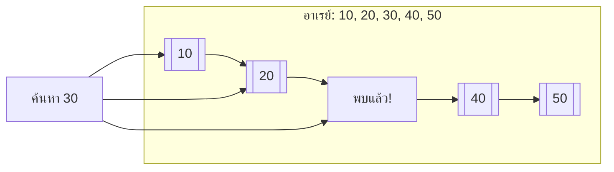
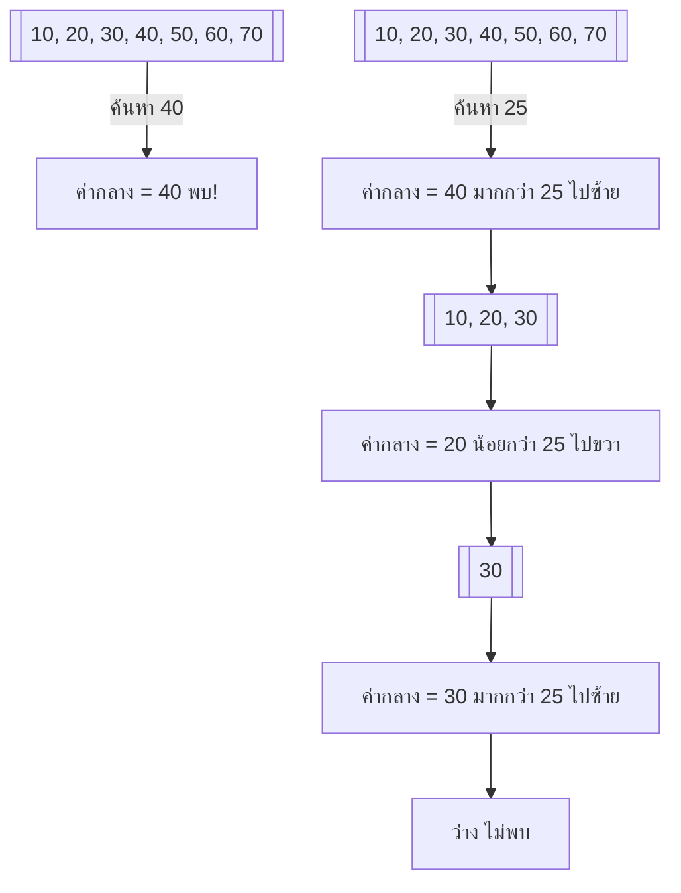

# บทที่ 10 การค้นหา (Searching)

## วัตถุประสงค์การเรียนรู้
เมื่อเรียนจบบทนี้ นักศึกษาจะสามารถ
1. อธิบายหลักการค้นหาเชิงเส้น (Linear Search)
2. อธิบายหลักการค้นหาแบบไบนารี (Binary Search) และเงื่อนไขการใช้งาน
3. เปรียบเทียบประสิทธิภาพของการค้นหาเชิงเส้นกับแบบไบนารี
4. อธิบายอัลกอริทึมค้นหาขั้นสูง เช่น ค้นหาแบบลำดับ Fibonacci
5. เขียนโปรแกรมค้นหาข้อมูลจากโครงสร้างข้อมูลต่างๆ ได้อย่างถูกต้อง

## การประเมิน
| รายการ | น้ำหนัก | หมายเหตุ |
|:---|:---:|:---|
| งานเขียนโปรแกรมค้นหาข้อมูล | 15% | โค้ดภาษา C/Python/Java |
| แบบทดสอบท้ายบท | 10% | ข้อควบคุมเลือกตอบและอัตนัย |
| การเข้าร่วมกิจกรรมเปรียบเทียบความเร็วการค้นหา | 5% | กิจกรรมกลุ่ม |

---

## 10.1 การค้นหาเชิงเส้น (Linear Search)

### แนวคิด
ไล่ตรวจสอบสมาชิกในอาเรย์ทีละตัวตั้งแต่ตัวแรกจนกว่าจะพบค่าที่ต้องการ หรือครบทุกตัวแล้วไม่พบ



### ตัวอย่างโค้ด (ภาษา Python)
```python
def linear_search(arr, target):
    for i in range(len(arr)):
        if arr[i] == target:
            return i  # คืนค่าดัชนีที่พบ
    return -1  # ไม่พบ


# การใช้งาน
data = [10, 20, 30, 40, 50]
print(linear_search(data, 30))  # 2 (ดัชนีของ 30)
print(linear_search(data, 60))  # -1 (ไม่พบ)
```

### ตัวอย่างโค้ด (ภาษา C)
```c
int linear_search(int arr[], int n, int target) {
    for (int i = 0; i < n; i++) {
        if (arr[i] == target) {
            return i;
        }
    }
    return -1;
}
```

ความซับซ้อน: Best O(1), Average O(n), Worst O(n)  
เงื่อนไข: ไม่จำเป็นต้องเรียงลำดับอาเรย์ก่อน

---

## 10.2 การค้นหาแบบไบนารี (Binary Search)

### แนวคิด
แบ่งอาเรย์ที่เรียงลำดับแล้วออกเป็นสองส่วน เปรียบเทียบค่ากลางกับค่าที่ค้นหา ถ้าน้อยกว่าให้ค้นในครึ่งซ้าย มากกว่าให้ค้นในครึ่งขวา ทำซ้ำจนกว่าจะพบหรือหมดช่วง



### เงื่อนไขการใช้งาน
- อาเรย์ต้องเรียงลำดับแล้ว (ถ้ายังไม่เรียงต้องเรียงก่อน ซึ่งมีค่าใช้จ่าย)

### ตัวอย่างโค้ดแบบวนซ้ำ (ภาษา Python)
```python
def binary_search(arr, target):
    left = 0
    right = len(arr) - 1
    
    while left <= right:
        mid = (left + right) // 2
        if arr[mid] == target:
            return mid
        elif arr[mid] < target:
            left = mid + 1
        else:
            right = mid - 1
    
    return -1


# การใช้งาน
data = [10, 20, 30, 40, 50, 60, 70]
print(binary_search(data, 40))  # 3
print(binary_search(data, 25))  # -1
```

### ตัวอย่างโค้ดแบบเรียกซ้ำ (ภาษา Python)
```python
def binary_search_recursive(arr, target, left, right):
    if left > right:
        return -1
    
    mid = (left + right) // 2
    if arr[mid] == target:
        return mid
    elif arr[mid] < target:
        return binary_search_recursive(arr, target, mid + 1, right)
    else:
        return binary_search_recursive(arr, target, left, mid - 1)


# การใช้งาน
data = [10, 20, 30, 40, 50, 60, 70]
print(binary_search_recursive(data, 40, 0, len(data) - 1))  # 3
```

### ตัวอย่างโค้ด (ภาษา C)
```c
int binary_search(int arr[], int n, int target) {
    int left = 0;
    int right = n - 1;
    
    while (left <= right) {
        int mid = left + (right - left) / 2;
        
        if (arr[mid] == target)
            return mid;
        if (arr[mid] < target)
            left = mid + 1;
        else
            right = mid - 1;
    }
    
    return -1;
}
```

ความซับซ้อน: Best O(1), Average O(log n), Worst O(log n)

---

## 10.3 การเดินผ่านขั้นตอนการค้นหาแบบไบนารี

ค้นหาค่า 25 ในอาเรย์ [10, 20, 30, 40, 50, 60, 70]

| รอบ | left | right | mid | arr[mid] | เปรียบเทียบ | การกระทำ |
|:---|:---|:---|:---|:---|:---|:---|
| 1 | 0 | 6 | 3 | 40 | 40 > 25 | right = 2 |
| 2 | 0 | 2 | 1 | 20 | 20 < 25 | left = 2 |
| 3 | 2 | 2 | 2 | 30 | 30 > 25 | right = 1 |
| 4 | 2 | 1 | - | - | left > right | ไม่พบ คืนค่า -1 |

---

## 10.4 การค้นหาแบบลำดับ Fibonacci (Fibonacci Search)

การค้นหาแบบฟีโบนักชีใช้จำนวนฟีโบนักชีในการแบ่งอาเรย์ แทนที่จะแบ่งครึ่งเหมือนไบนารีเซิร์ช เหมาะเมื่อการเข้าถึงหน่วยความจำไม่สม่ำเสมอ (เช่น ข้อมูลอยู่ในแฟลชเมมโมรี)

หลักการ:
- ใช้จำนวนฟีโบนักชี F(k) มากที่สุดที่ F(k) ≥ n
- แบ่งอาเรย์ที่ตำแหน่ง F(k-1)
- ถ้าค่าที่ต้องการน้อยกว่าค่าที่ตำแหน่งนั้น ค้นในส่วนซ้าย มากกว่าค้นในส่วนขวา

ความซับซ้อน: O(log n) เช่นเดียวกับไบนารีเซิร์ช

---

## 10.5 การค้นหาในโครงสร้างข้อมูลอื่น

| โครงสร้างข้อมูล | วิธีค้นหา | ความซับซ้อนเฉลี่ย |
|:---|:---|:---:|
| อาเรย์ที่เรียงแล้ว | ไบนารีเซิร์ช | O(log n) |
| อาเรย์ที่ไม่เรียง | ลินเนียร์เซิร์ช | O(n) |
| ไบนารีเซิร์ชทรี | เปรียบเทียบแล้วไปซ้าย/ขวา | O(h) h = ความสูง |
| ตารางแฮช | ฟังก์ชันแฮช | O(1) |
| ลิงก์ลิสต์ | ลินเนียร์เซิร์ช | O(n) |

---

## 10.6 การเปรียบเทียบประสิทธิภาพการค้นหาแต่ละวิธี

| วิธีค้นหา | เงื่อนไข | Best | Average | Worst |
|:---|:---|:---:|:---:|:---:|
| ค้นหาเชิงเส้น | ไม่ต้องเรียง | O(1) | O(n) | O(n) |
| ค้นหาแบบไบนารี | ต้องเรียงแล้ว | O(1) | O(log n) | O(log n) |
| ฟีโบนักชีเซิร์ช | ต้องเรียงแล้ว | O(1) | O(log n) | O(log n) |
| ตารางแฮช | มีฟังก์ชันแฮช | O(1) | O(1) | O(n) |

---

## แบบฝึกหัด

### ข้อที่ 1
จงเขียนอัลกอริทึมค้นหาเชิงเส้นเพื่อหาตำแหน่งของค่าในอาเรย์

**คำตอบ:** ดูโค้ดในหัวข้อ 10.1 ฟังก์ชัน `linear_search`

### ข้อที่ 2
จงเขียนอัลกอริทึมค้นหาแบบไบนารีทั้งแบบวนซ้ำและแบบเรียกซ้ำ

**คำตอบ:** ดูโค้ดในหัวข้อ 10.2 ฟังก์ชัน `binary_search` (วนซ้ำ) และ `binary_search_recursive` (เรียกซ้ำ)

### ข้อที่ 3
จงคำนวณจำนวนครั้งสูงสุดที่ค้นหาแบบไบนารีต้องทำเมื่อมีข้อมูล 1,000 รายการ

**คำตอบ:**
```
จำนวนครั้งสูงสุด = ⌈log₂(1000)⌉ = ⌈9.97⌉ = 10 ครั้ง
```

หมายเหตุ: log₂(1000) ≈ 9.97 ปัดขึ้นเป็น 10 ครั้ง

---

## แบบปฏิบัติการข้อสอบ

### ข้อควบคุมเลือกตอบ (จำนวน 6 ข้อ)

**ข้อ 1.** การค้นหาเชิงเส้นจำเป็นต้องมีอาเรย์เรียงลำดับหรือไม่
- ก. จำเป็น
- ข. ไม่จำเป็น
- ค. ขึ้นอยู่กับข้อมูล
- ง. ต้องเรียงเฉพาะข้อมูลขนาดใหญ่

**ตอบ: ข**

**ข้อ 2.** การค้นหาแบบไบนารีจำเป็นต้องมีอาเรย์เรียงลำดับหรือไม่
- ก. จำเป็น
- ข. ไม่จำเป็น
- ค. ขึ้นอยู่กับข้อมูล
- ง. ต้องเรียงเฉพาะข้อมูลขนาดใหญ่

**ตอบ: ก**

**ข้อ 3.** ความซับซ้อนการค้นหาแบบไบนารีในกรณีแย่ที่สุดคือ
- ก. O(1)
- ข. O(n)
- ค. O(log n)
- ง. O(n²)

**ตอบ: ค**

**ข้อ 4.** ค้นหาค่า 40 ในอาเรย์ [10, 20, 30, 40, 50] โดยใช้ไบนารีเซิร์ช ค่ากลางรอบแรกคือ
- ก. 10
- ข. 20
- ค. 30
- ง. 50

**ตอบ: ค** (ดัชนีกลางของ 5 ตัวคือตำแหน่งที่ 2 = ค่า 30)

**ข้อ 5.** ข้อใดเร็วที่สุดเมื่อข้อมูลมีจำนวนมากและเรียงลำดับแล้ว
- ก. ค้นหาเชิงเส้น
- ข. ค้นหาแบบไบนารี
- ค. ทั้งสองเร็วเท่ากัน
- ง. ไม่สามารถค้นหาได้

**ตอบ: ข**

**ข้อ 6.** การค้นหาแบบไบนารีแบ่งอาเรย์ออกเป็นกี่ส่วนในแต่ละรอบ
- ก. 1 ส่วน
- ข. 2 ส่วน
- ค. 3 ส่วน
- ง. 4 ส่วน

**ตอบ: ข**

### ข้ออัตนัย (จำนวน 2 ข้อ)

**ข้อ 7.** จงเขียนโค้ดภาษา C หรือ Python ค้นหาข้อมูลจากอาเรย์โดยใช้ทั้งค้นหาเชิงเส้นและไบนารีเซิร์ช แล้วเปรียบเทียบจำนวนครั้งที่เปรียบเทียบ

**ข้อ 8.** จงเขียนโปรแกรมค้นหาชื่อนักศึกษาในรายชื่อที่เรียงตามตัวอักษร โดยใช้ไบนารีเซิร์ช

---

## ภาคผนก

### ภาคผนก 10.1 โค้ดตัวอย่างการค้นหาทุกวิธีภาษา C / Python / Java

**ภาษา Java – ค้นหาเชิงเส้นและไบนารี:**
```java
public class Searching {
    static int linearSearch(int[] arr, int target) {
        for (int i = 0; i < arr.length; i++) {
            if (arr[i] == target) return i;
        }
        return -1;
    }
    
    static int binarySearch(int[] arr, int target) {
        int left = 0, right = arr.length - 1;
        while (left <= right) {
            int mid = left + (right - left) / 2;
            if (arr[mid] == target) return mid;
            if (arr[mid] < target) left = mid + 1;
            else right = mid - 1;
        }
        return -1;
    }
}
```

### ภาคผนก 10.2 แบบฝึกหัดค้นหาข้อมูลในสถานการณ์จริง

1. ค้นหาหมายเลขโทรศัพท์ในสมุดโทรศัพท์ (ที่เรียงตามตัวอักษร)
2. ค้นหาสินค้าในคลังสินค้าตามรหัสสินค้า
3. ค้นหาคำในพจนานุกรมอิเล็กทรอนิกส์

---

## อ้างอิง

- เอกสารประกอบการสอน บทที่ 10 การค้นหา
- คู่มืออัลกอริทึมการค้นหาสำหรับนักศึกษา
