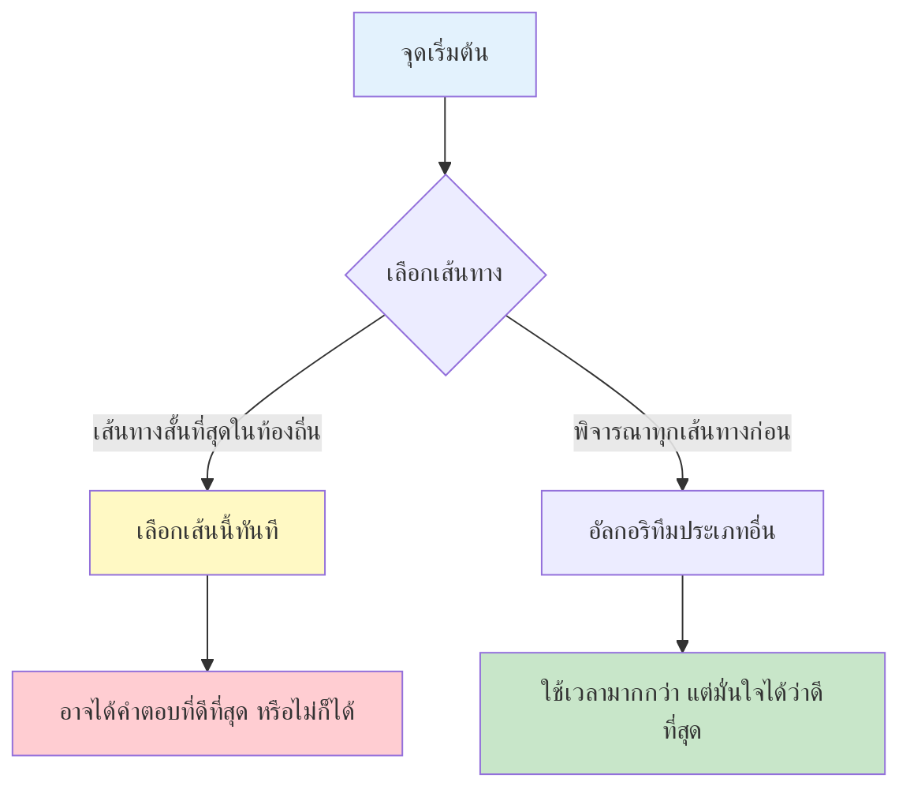
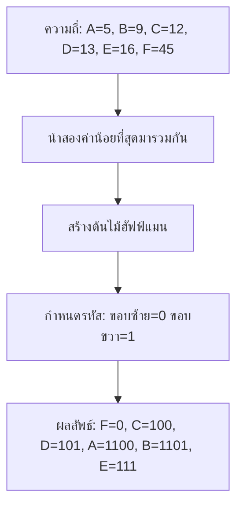

# บทที่ 11 อัลกอริทึมเชิงละม่วน (Greedy Algorithm)

## วัตถุประสงค์การเรียนรู้
เมื่อเรียนจบบทนี้ นักศึกษาจะสามารถ
1. อธิบายแนวคิดอัลกอริทึมเชิงละม่วนและคุณสมบัติการเลือกอย่างเหมาะสมในท้องถิ่น
2. อธิบายอัลกอริทึมเชิงละม่วนตัวอย่าง เช่น ฮัฟฟ์แมน โครสคัล ปริมส์
3. วิเคราะห์ว่าเมื่อใดที่อัลกอริทึมเชิงละม่วนให้คำตอบที่ถูกต้องที่สุด
4. แยกแยะอัลกอริทึมเชิงละม่วนกับอัลกอริทึมประเภทอื่น
5. เขียนโปรแกรมแก้ปัญหาด้วยอัลกอริทึมเชิงละม่วนได้อย่างถูกต้อง

## การประเมิน
| รายการ | น้ำหนัก | หมายเหตุ |
|:---|:---:|:---|
| งานเขียนโปรแกรมแก้ปัญหาด้วยอัลกอริทึมเชิงละม่วน | 20% | โค้ดภาษา C/Python/Java |
| แบบทดสอบท้ายบท | 10% | ข้อควบคุมเลือกตอบและปฏิบัติการ |
| การนำเสนอกรณีศึกษาการใช้งานจริง | 10% | นำเสนอกรณีศึกษาจากชีวิตจริง |

---

## 11.1 แนวคิดอัลกอริทึมเชิงละม่วน

อัลกอริทึมเชิงละม่วน (Greedy Algorithm) คืออัลกอริทึมที่ในแต่ละขั้นตอนจะเลือกทางเลือกที่ดูดีที่สุดในขณะนั้น (ท้องถิ่น) โดยหวังว่าจะนำไปสู่คำตอบที่ดีที่สุดโดยรวม (ส่วนรวม)

### เปรียบเทียบเชิงภาพ



### คุณสมบัติที่จำเป็นสำหรับอัลกอริทึมเชิงละม่วน

1. **คุณสมบัติการเลือกอย่างเหมาะสมในท้องถิ่น (Greedy Choice Property)** – การเลือกทางเลือกที่ดีที่สุดในท้องถิ่นนำไปสู่คำตอบที่ดีที่สุดโดยรวม
2. **โครงสร้างทบทวนที่เหมาะสมที่สุด (Optimal Substructure)** – คำตอบที่ดีที่สุดของปัญหาเกิดจากคำตอบที่ดีที่สุดของปัญหาย่อย

---

## 11.2 ตัวอย่างอัลกอริทึมเชิงละม่วน

### 1. อัลกอริทึมฮัฟฟ์แมน (Huffman Coding)

ใช้สำหรับการบีบอัดข้อมูล กำหนดรหัสบิตสั้นให้กับตัวอักษรที่ปรากฏบ่อย และรหัสบิตยาวให้กับตัวอักษรที่ปรากฏน้อย



### ตัวอย่างโค้ดฮัฟฟ์แมน (ภาษา Python)
```python
import heapq
from collections import defaultdict

def huffman_codes(freq):
    heap = [[weight, [char, ""]] for char, weight in freq.items()]
    heapq.heapify(heap)
    
    while len(heap) > 1:
        lo = heapq.heappop(heap)
        hi = heapq.heappop(heap)
        for pair in lo[1:]:
            pair[1] = '0' + pair[1]
        for pair in hi[1:]:
            pair[1] = '1' + pair[1]
        heapq.heappush(heap, [lo[0] + hi[0]] + lo[1:] + hi[1:])
    
    return sorted(heapq.heappop(heap)[1:], key=lambda p: (len(p[-1]), p))


# การใช้งาน
freq = {'A': 5, 'B': 9, 'C': 12, 'D': 13, 'E': 16, 'F': 45}
codes = huffman_codes(freq)
print("ตัวอักษร ความถี่ รหัสฮัฟฟ์แมน")
for char, code in codes:
    print(f"{char} {freq[char]} {code}")
```

**ผลลัพธ์ตัวอย่าง:**
```
F: 0
C: 100
D: 101
A: 1100
B: 1101
E: 111
```

---

### 2. อัลกอริทึมโครสคัล (Kruskal's Algorithm)

หาต้นไม้ครอบคลุมน้ำหนักน้อยที่สุด (Minimum Spanning Tree, MST) ของกราฟที่มีน้ำหนัก

**ขั้นตอน:**
1. เรียงขอบทั้งหมดตามน้ำหนักจากน้อยไปมาก
2. เลือกขอบทีละเส้น ถ้าไม่สร้างวงจรให้เลือกไว้
3. ทำซ้ำจนมีขอบ V-1 เส้น (V คือจำนวนจุดยอด)

ใช้ **Union-Find (Disjoint Set)** ในการตรวจสอบวงจร

### ตัวอย่างโค้ดโครสคัล (ภาษา Python)
```python
class UnionFind:
    def __init__(self, n):
        self.parent = list(range(n))
    
    def find(self, x):
        if self.parent[x] != x:
            self.parent[x] = self.find(self.parent[x])
        return self.parent[x]
    
    def union(self, x, y):
        px, py = self.find(x), self.find(y)
        if px == py:
            return False
        self.parent[px] = py
        return True


def kruskal(n, edges):
    # edges: [(weight, u, v), ...]
    edges.sort()
    uf = UnionFind(n)
    mst = []
    total_weight = 0
    
    for weight, u, v in edges:
        if uf.union(u, v):
            mst.append((u, v, weight))
            total_weight += weight
    
    return mst, total_weight


# การใช้งาน
edges = [
    (1, 0, 1), (4, 0, 2), (3, 1, 2),
    (2, 1, 3), (5, 2, 3)
]
mst, total = kruskal(4, edges)
print("MST:", mst)
print("น้ำหนักรวม:", total)
```

---

### 3. อัลกอริทึมปริมส์ (Prim's Algorithm)

หา MST เช่นเดียวกับโครสคัล แต่เริ่มจากจุดยอดใดจุดยอดหนึ่งแล้วค่อยๆ ขยายต้นไม้โดยเลือกขอบที่มีน้ำหนักน้อยที่สุดที่เชื่อมจุดในต้นไม้กับจุดนอกต้นไม้

**ความแตกต่างจากโครสคัล:**
- โครสคัล: เรียงขอบทั้งหมดก่อน แล้วเลือกทีละเส้น
- ปริมส์: เริ่มจากจุดเดียว ขยายออกเรื่อยๆ

---

### 4. ปัญหากระเป๋าเดินทางแบบทศนิยม (Fractional Knapsack)

สามารถหยิบสิ่งของได้บางส่วน (เช่น ทองคำ ผงซักฟอก) อัลกอริทึมเชิงละม่วนเลือกสิ่งของที่มีค่าต่อน้ำหนักสูงสุดก่อน

**ตัวอย่าง:**
- กระเป๋ารับน้ำหนักได้ 50 กก.
- สิ่งของ A: 60 บาท 10 กก. (ค่า/กก. = 6)
- สิ่งของ B: 100 บาท 20 กก. (ค่า/กก. = 5)
- สิ่งของ C: 120 บาท 30 กก. (ค่า/กก. = 4)

เลือก A ก่อน (เต็ม 10 กก. เหลือ 40 กก.)
เลือก B ต่อ (เต็ม 20 กก. เหลือ 20 กก.)
เลือก C บางส่วน (20 กก. จาก 30 กก.)

ค่ารวม = 60 + 100 + (20/30 × 120) = 60 + 100 + 80 = 240 บาท

---

## 11.3 ข้อจำกัดของอัลกอริทึมเชิงละม่วน

อัลกอริทึมเชิงละม่วน **ไม่ได้ให้คำตอบที่ดีที่สุดเสมอไป**

### ตัวอย่างที่ล้มเหลว: ปัญหากระเป๋าเดินทางแบบ 0/1
ไม่สามารถหยิบของบางส่วนได้ ต้องหยิบทั้งชิ้นหรือไม่หยิบเลย

- กระเป๋ารับน้ำหนักได้ 50 กก.
- สิ่งของ A: 60 บาท 10 กก.
- สิ่งของ B: 100 บาท 20 กก.
- สิ่งของ C: 120 บาท 30 กก.

เชิงละม่วนเลือก A (ค่า/น้ำหนักสูงสุด) แล้ว B แล้ว C บางส่วนไม่ได้ เหลือที่ว่าง 20 กก. ไม่สามารถใส่ C ได้ทั้งชิ้น → ค่ารวม 160 บาท

แต่คำตอบที่ดีที่สุดคือ เลือก B + C = 100 + 120 = 220 บาท (หนัก 50 กก. พอดี)

---

## 11.4 การเปรียบเทียบอัลกอริทึมเชิงละม่วนกับประเภทอื่น

| ด้าน | เชิงละม่วน (Greedy) | ไดนามิกโปรแกรมมิง | แบ่งและพิชิต |
|:---|:---|:---|:---|
| การตัดสินใจ | เลือกทีละขั้นตอนแบบท้องถิ่น | พิจารณาทุกกรณีย่อยแล้วเลือกดีที่สุด | แยกปัญหาออกเป็นส่วนย่อย |
| ความมั่นใจในคำตอบ | ไม่มั่นใจเสมอไป | มั่นใจได้ว่าดีที่สุด | ขึ้นกับปัญหา |
| เวลาทำงาน | มักเร็วกว่า | ช้ากว่า (แต่ใช้เมโมไลซ์ได้) | ขึ้นกับการแบ่ง |
| ตัวอย่าง | ฮัฟฟ์แมน โครสคัล ปริมส์ | ฟีโบนักชี กระเป๋าเดินทาง 0/1 | เมอร์จ์ซอร์ต ควิกซอร์ต |

---

## แบบฝึกหัด

### ข้อที่ 1
จงสร้างต้นไม้ฮัฟฟ์แมนจากความถี่ของตัวอักษรที่กำหนด

**คำตอบ:** ตัวอย่างความถี่ A=5, B=9, C=12, D=13, E=16, F=45 ดูในหัวข้อ 11.2

### ข้อที่ 2
จงหาต้นไม้ครอบคลุมน้ำหนักน้อยที่สุดโดยใช้อัลกอริทึมโครสคัล

**คำตอบ:** ดูโค้ดในหัวข้อ 11.2 ฟังก์ชัน `kruskal`

### ข้อที่ 3
จงอธิบายสถานการณ์ที่อัลกอริทึมเชิงละม่วนไม่ให้คำตอบที่ถูกต้องที่สุด

**คำตอบ:** ตัวอย่างปัญหากระเป๋าเดินทางแบบ 0/1 ดูในหัวข้อ 11.3

---

## แบบปฏิบัติการข้อสอบ

### ข้อควบคุมเลือกตอบ (จำนวน 8 ข้อ)

**ข้อ 1.** อัลกอริทึมเชิงละม่วนเลือกทางเลือกอย่างไรในแต่ละขั้นตอน
- ก. ทางเลือกที่แย่ที่สุดในท้องถิ่น
- ข. ทางเลือกที่ดีที่สุดในท้องถิ่น
- ค. ทางเลือกแบบสุ่ม
- ง. ทางเลือกสุดท้ายในลิสต์

**ตอบ: ข**

**ข้อ 2.** ข้อใดไม่ใช่คุณสมบัติที่จำเป็นของอัลกอริทึมเชิงละม่วน
- ก. การเลือกอย่างเหมาะสมในท้องถิ่น
- ข. โครงสร้างทบทวนที่เหมาะสมที่สุด
- ค. การเรียกซ้ำไม่รู้จบ
- ง. การตัดสินใจแบบท้องถิ่น

**ตอบ: ค**

**ข้อ 3.** อัลกอริทึมฮัฟฟ์แมนใช้สำหรับอะไร
- ก. การเรียงลำดับข้อมูล
- ข. การบีบอัดข้อมูล
- ค. การค้นหาเส้นทางสั้นที่สุด
- ง. การค้นหาข้อความ

**ตอบ: ข**

**ข้อ 4.** อัลกอริทึมโครสคัลใช้สำหรับหาอะไร
- ก. เส้นทางที่สั้นที่สุด
- ข. ต้นไม้ครอบคลุมน้ำหนักน้อยที่สุด
- ค. ลำดับส่วนยาวร่วม
- ง. การบีบอัดข้อมูล

**ตอบ: ข**

**ข้อ 5.** ปัญหากระเป๋าเดินทางแบบใดที่อัลกอริทึมเชิงละม่วนใช้ได้ผล
- ก. แบบ 0/1 (ต้องหยิบทั้งชิ้น)
- ข. แบบทศนิยม (หยิบบางส่วนได้)
- ค. ทั้งสองแบบ
- ง. ไม่ใช้ได้กับทั้งสองแบบ

**ตอบ: ข**

**ข้อ 6.** ข้อใดไม่ใช่อัลกอริทึมเชิงละม่วน
- ก. ฮัฟฟ์แมน
- ข. โครสคัล
- ค. ปริมส์
- ง. เมอร์จ์ซอร์ต

**ตอบ: ง**

**ข้อ 7.** อัลกอริทึมเชิงละม่วนมั่นใจได้หรือไม่ว่าจะได้คำตอบที่ดีที่สุดเสมอ
- ก. มั่นใจได้เสมอ
- ข. ไม่มั่นใจเสมอไป ขึ้นกับปัญหา
- ค. มั่นใจได้เมื่อข้อมูลน้อย
- ง. มั่นใจได้เมื่อข้อมูลมาก

**ตอบ: ข**

**ข้อ 8.** ในปัญหากระเป๋าเดินทางแบบทศนิยม สิ่งใดถูกเลือกก่อน
- ก. สิ่งที่มีค่าสูงสุด
- ข. สิ่งที่หนักที่สุด
- ค. สิ่งที่มีอัตราส่วนค่าต่อน้ำหนักสูงสุด
- ง. สิ่งที่เบาที่สุด

**ตอบ: ค**

### ข้อปฏิบัติการ (จำนวน 2 ข้อ)

**ข้อ 9.** จงเขียนโค้ดภาษา C หรือ Python แก้ปัญหาต้นไม้ครอบคลุมน้ำหนักน้อยที่สุดโดยใช้อัลกอริทึมโครสคัล

**ข้อ 10.** จงเขียนโค้ดแก้ปัญหากระเป๋าเดินทางแบบทศนิยมโดยใช้อัลกอริทึมเชิงละม่วน

---

## ภาคผนก

### ภาคผนก 11.1 โค้ดตัวอย่างอัลกอริทึมเชิงละม่วนทุกตัว

**ภาษา Java – ปริมส์ (Prim's Algorithm):**
```java
import java.util.*;

public class PrimsAlgorithm {
    static int[] prim(int[][] graph, int start) {
        int n = graph.length;
        int[] key = new int[n];
        boolean[] inMST = new boolean[n];
        int[] parent = new int[n];
        
        Arrays.fill(key, Integer.MAX_VALUE);
        Arrays.fill(parent, -1);
        key[start] = 0;
        
        PriorityQueue<int[]> pq = new PriorityQueue<>(Comparator.comparingInt(a -> a[1]));
        pq.offer(new int[]{start, 0});
        
        while (!pq.isEmpty()) {
            int[] curr = pq.poll();
            int u = curr[0];
            if (inMST[u]) continue;
            inMST[u] = true;
            
            for (int v = 0; v < n; v++) {
                if (graph[u][v] != 0 && !inMST[v] && graph[u][v] < key[v]) {
                    key[v] = graph[u][v];
                    parent[v] = u;
                    pq.offer(new int[]{v, key[v]});
                }
            }
        }
        return parent;
    }
}
```

### ภาคผนก 11.2 ตัวอย่างปัญหาที่แก้ไม่ได้ด้วยอัลกอริทึมเชิงละม่วน

1. ปัญหากระเป๋าเดินทางแบบ 0/1
2. ปัญหาหาเส้นทางสั้นที่สุดในกราฟที่มีน้ำหนักลบ
3. ปัญหาการจัดตารางงานที่มีข้อจำกัดซับซ้อน

---

## อ้างอิง

- เอกสารประกอบการสอน บทที่ 11 อัลกอริทึมเชิงละม่วน
- Cormen, T. H., et al. *Introduction to Algorithms*. Chapters on Greedy Algorithms, MIT Press.
