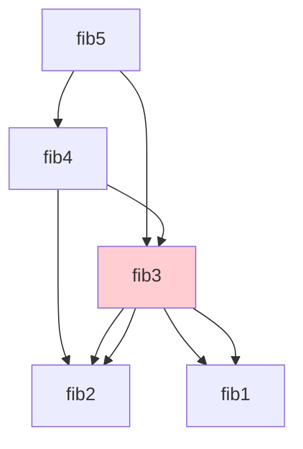

# บทที่ 12 ไดนามิกโปรแกรมมิง (Dynamic Programming)

## วัตถุประสงค์การเรียนรู้
เมื่อเรียนจบบทนี้ นักศึกษาจะสามารถ
1. อธิบายแนวคิดไดนามิกโปรแกรมมิงและเงื่อนไขทับซ้อนของปัญหาย่อย (Overlapping Subproblems)
2. อธิบายคุณสมบัติโครงสร้างทบทวนที่เหมาะสมที่สุด (Optimal Substructure)
3. แยกแยะวิธีบนลงล่าง (Top-down / Memoization) กับล่างขึ้นบน (Bottom-up)
4. เขียนโปรแกรมแก้ปัญหาด้วยไดนามิกโปรแกรมมิง เช่น ฟีโบนักชี กระเป๋าเดินทาง LCS
5. เปรียบเทียบประสิทธิภาพก่อนและหลังใช้ไดนามิกโปรแกรมมิง

## การประเมิน
| รายการ | น้ำหนัก | หมายเหตุ |
|:---|:---:|:---|
| งานเขียนโปรแกรมแก้ปัญหาด้วยไดนามิกโปรแกรมมิง | 20% | โค้ดภาษา C/Python/Java |
| แบบทดสอบท้ายบท | 10% | ข้อควบคุมเลือกตอบและปฏิบัติการ |
| การนำเสนอแนวทางการแก้ปัญหาซับซ้อน | 10% | นำเสนอแนวทางแก้ปัญหา |

---

## 12.1 แนวคิดไดนามิกโปรแกรมมิง

ไดนามิกโปรแกรมมิง (Dynamic Programming, DP) คือเทคนิคการแก้ปัญหาซับซ้อนโดยแบ่งออกเป็นปัญหาย่อย แก้แต่ละปัญหาย่อยเพียงครั้งเดียว แล้วเก็บผลลัพธ์ไว้ใช้ซ้ำ (ไม่แก้ซ้ำ)

```mermaid
graph TD
    A[ปัญหาใหญ่] --> B[แบ่งเป็นปัญหาย่อย]
    B --> C[แก้ปัญหาย่อยแต่ละอัน]
    C --> D[เก็บผลลัพธ์ไว้ (Memoization/Tabulation)]
    D --> E[นำผลลัพธ์มารวมกัน]
    E --> F[คำตอบของปัญหาใหญ่]
    
    style A fill:#E3F2FD
    style D fill:#FFF9C4
    style F fill:#C8E6C9
```

### เงื่อนไขสำคัญสองข้อ

1. **ปัญหาย่อยทับซ้อน (Overlapping Subproblems)** – ปัญหาย่อยเดียวกันถูกแก้ซ้ำหลายครั้ง
2. **โครงสร้างทบทวนที่เหมาะสมที่สุด (Optimal Substructure)** – คำตอบที่ดีที่สุดของปัญหาใหญ่เกิดจากคำตอบที่ดีที่สุดของปัญหาย่อย

---

## 12.2 ตัวอย่างฟีโบนักชี: ก่อนและหลังใช้ DP

### แบบเรียกซ้ำธรรมดา (แก้ซ้ำหลายครั้ง)
```python
def fib(n):
    if n <= 1:
        return n
    return fib(n-1) + fib(n-2)
```
เรียก fib(5) จะเรียก fib(3) ซ้ำหลายครั้ง → ซับซ้อน O(2ⁿ)



### แบบบนลงล่าง (Top-down / Memoization)
```python
memo = {}

def fib(n):
    if n in memo:
        return memo[n]
    if n <= 1:
        return n
    memo[n] = fib(n-1) + fib(n-2)
    return memo[n]
```
เก็บผลลัพธ์ที่คำนวณแล้วใน dictionary → ซับซ้อน O(n)

### แบบล่างขึ้นบน (Bottom-up / Tabulation)
```python
def fib(n):
    if n <= 1:
        return n
    dp = [0] * (n + 1)
    dp[1] = 1
    for i in range(2, n + 1):
        dp[i] = dp[i-1] + dp[i-2]
    return dp[n]
```
สร้างตารางจากเล็กไปใหญ่ → ซับซ้อน O(n) พื้นที่ O(n)

---

## 12.3 ปัญหากระเป๋าเดินทาง 0/1 (0/1 Knapsack)

ไม่สามารถหยิบของบางส่วนได้ ต้องหยิบทั้งชิ้นหรือไม่หยิบเลย

```mermaid
graph TD
    A[พิจารณาสิ่งของชิ้นที่ i] --> B{ใส่หรือไม่ใส่}
    B -->|ใส่| C[ค่าของชิ้นที่ i + DP(เหลือที่วาง, ชิ้นถัดไป)]
    B -->|ไม่ใส่| D[DP(ความจุเดิม, ชิ้นถัดไป)]
    C --> E[เลือกค่าที่มากกว่า]
    D --> E
```

### ตัวอย่างโค้ด (ภาษา Python)
```python
def knapsack(weights, values, capacity):
    n = len(weights)
    dp = [[0] * (capacity + 1) for _ in range(n + 1)]
    
    for i in range(1, n + 1):
        for w in range(capacity + 1):
            if weights[i-1] <= w:
                dp[i][w] = max(
                    dp[i-1][w],                              # ไม่ใส่ชิ้นที่ i
                    values[i-1] + dp[i-1][w - weights[i-1]]  # ใส่ชิ้นที่ i
                )
            else:
                dp[i][w] = dp[i-1][w]
    
    return dp[n][capacity]


# การใช้งาน
weights = [10, 20, 30]
values = [60, 100, 120]
capacity = 50
print(knapsack(weights, values, capacity))  # 220
```

ความซับซ้อน: เวลา O(n × capacity), พื้นที่ O(n × capacity)

---

## 12.4 ปัญหาลำดับส่วนยาวร่วม (Longest Common Subsequence, LCS)

หาความยาวของลำดับส่วนยาวร่วมมากที่สุดระหว่างสองสตริง โดยไม่ต้องติดกันแต่ต้องเรียงลำดับเหมือนกัน

ตัวอย่าง: "ABCBDAB" และ "BDCABA" → LCS คือ "BCBA" หรือ "BDAB" ยาว 4

```mermaid
graph TD
    A["A B C B D A B"] -->|เปรียบเทียบทีละตัว| B["B D C A B A"]
    B --> C[ถ้าเท่ากัน dp[i-1][j-1] + 1]
    C --> D[ถ้าไม่เท่ากัน max(dp[i-1][j], dp[i][j-1])]
```

### ตัวอย่างโค้ด (ภาษา Python)
```python
def lcs(X, Y):
    m = len(X)
    n = len(Y)
    dp = [[0] * (n + 1) for _ in range(m + 1)]
    
    for i in range(1, m + 1):
        for j in range(1, n + 1):
            if X[i-1] == Y[j-1]:
                dp[i][j] = dp[i-1][j-1] + 1
            else:
                dp[i][j] = max(dp[i-1][j], dp[i][j-1])
    
    return dp[m][n]


# การใช้งาน
X = "ABCBDAB"
Y = "BDCABA"
print(lcs(X, Y))  # 4
```

ความซับซ้อน: เวลา O(m × n), พื้นที่ O(m × n)

---

## 12.5 การเปรียบเทียบการเรียกซ้ำธรรมดากับไดนามิกโปรแกรมมิง

| ปัญหา | เรียกซ้ำธรรมดา | ไดนามิกโปรแกรมมิง |
|:---|:---:|:---:|
| ฟีโบนักชี (n=40) | O(2ⁿ) ประมาณ 2⁴⁰ ครั้ง | O(n) = 40 ครั้ง |
| กระเป๋าเดินทาง 0/1 | O(2ⁿ) | O(n × W) |
| LCS | O(2^(m+n)) | O(m × n) |

---

## 12.6 แยกแยะไดนามิกโปรแกรมมิงกับการแบ่งและพิชิต

| ด้าน | ไดนามิกโปรแกรมมิง | แบ่งและพิชิต |
|:---|:---|:---|
| ปัญหาย่อย | ทับซ้อนกัน (แก้ซ้ำหลายครั้ง) | ไม่ทับซ้อนกัน (แยกขาดจากกัน) |
| การเก็บผล | เก็บผลลัพธ์ปัญหาย่อยไว้ใช้ซ้ำ | ไม่ต้องเก็บผล แก้อิสระต่อกัน |
| ตัวอย่าง | ฟีโบนักชี กระเป๋าเดินทาง LCS | เมอร์จ์ซอร์ต ควิกซอร์ต |

---

## แบบฝึกหัด

### ข้อที่ 1
จงเขียนฟังก์ชันคำนวณฟีโบนักชีโดยใช้ไดนามิกโปรแกรมมิงทั้งสองวิธี

**คำตอบ:** ดูโค้ดในหัวข้อ 12.2

### ข้อที่ 2
จงแก้ปัญหากระเป๋าเดินทาง 0/1 โดยใช้ไดนามิกโปรแกรมมิง

**คำตอบ:** ดูโค้ดในหัวข้อ 12.3

### ข้อที่ 3
จงเปรียบเทียบเวลาการทำงานของการเรียกซ้ำธรรมดากับไดนามิกโปรแกรมมิงสำหรับฟีโบนักชี

**คำตอบ:**
- การเรียกซ้ำธรรมดา: O(2ⁿ) เมื่อ n=40 ประมาณ 1 ล้านล้านครั้ง
- ไดนามิกโปรแกรมมิง: O(n) เมื่อ n=40 แค่ 40 ครั้ง
- แตกต่างกันหลายล้านเท่า

---

## แบบปฏิบัติการข้อสอบ

### ข้อควบคุมเลือกตอบ (จำนวน 8 ข้อ)

**ข้อ 1.** ไดนามิกโปรแกรมมิงต้องการเงื่อนไขใดบ้าง
- ก. ปัญหาย่อยทับซ้อนเท่านั้น
- ข. โครงสร้างทบทวนที่เหมาะสมที่สุดเท่านั้น
- ค. ทั้งสองข้อ
- ง. ไม่ต้องการเงื่อนไขใด

**ตอบ: ค**

**ข้อ 2.** วิธีบนลงล่างในไดนามิกโปรแกรมมิงเรียกอีกชื่อว่าอะไร
- ก. Tabulation
- ข. Memoization
- ค. Divide and Conquer
- ง. Greedy

**ตอบ: ข**

**ข้อ 3.** วิธีล่างขึ้นบนในไดนามิกโปรแกรมมิงเรียกอีกชื่อว่าอะไร
- ก. Tabulation
- ข. Memoization
- ค. Divide and Conquer
- ง. Greedy

**ตอบ: ก**

**ข้อ 4.** ฟีโบนักชีแบบเรียกซ้ำธรรมดามีความซับซ้อนเท่าใด
- ก. O(n)
- ข. O(2ⁿ)
- ค. O(n²)
- ง. O(log n)

**ตอบ: ข**

**ข้อ 5.** ปัญหากระเป๋าเดินทาง 0/1 แตกต่างจากแบบทศนิยมตรงที่
- ก. 0/1 หยิบบางส่วนได้ แบบทศนิยมหยิบไม่ได้
- ข. 0/1 ต้องหยิบทั้งชิ้นหรือไม่หยิบเลย แบบทศนิยมหยิบบางส่วนได้
- ค. 0/1 ใช้ไดนามิกโปรแกรมมิงไม่ได้
- ง. แบบทศนิยมใช้ความซับซ้อนสูงกว่า

**ตอบ: ข**

**ข้อ 6.** LCS ย่อมาจากอะไร
- ก. Longest Common Subsequence
- ข. Longest Continuous Substring
- ค. Lowest Common Subsequence
- ง. Longest Common Substring

**ตอบ: ก**

**ข้อ 7.** ความซับซ้อนของ LCS สำหรับสตริงสองอันยาว m และ n คือ
- ก. O(m + n)
- ข. O(m × n)
- ค. O(m log n)
- ง. O(2^(m+n))

**ตอบ: ข**

**ข้อ 8.** ข้อใดไม่ใช่ตัวอย่างของไดนามิกโปรแกรมมิง
- ก. ฟีโบนักชี
- ข. กระเป๋าเดินทาง 0/1
- ค. เมอร์จ์ซอร์ต
- ง. LCS

**ตอบ: ค**

### ข้อปฏิบัติการ (จำนวน 2 ข้อ)

**ข้อ 9.** จงเขียนโค้ดภาษา C หรือ Python แก้ปัญหาฟีโบนักชีด้วยไดนามิกโปรแกรมมิงทั้งแบบบนลงล่างและล่างขึ้นบน แล้ววัดเวลาเปรียบเทียบกับแบบเรียกซ้ำธรรมดา

**ข้อ 10.** จงเขียนโค้ดแก้ปัญหา LCS สำหรับสตริงสองอันที่ป้อนจากผู้ใช้

---

## ภาคผนก

### ภาคผนก 12.1 โค้ดตัวอย่างไดนามิกโปรแกรมมิงทุกตัวอย่าง

**ภาษา C – กระเป๋าเดินทาง 0/1:**
```c
int knapsack(int weights[], int values[], int n, int capacity) {
    int dp[n + 1][capacity + 1];
    
    for (int i = 0; i <= n; i++) {
        for (int w = 0; w <= capacity; w++) {
            if (i == 0 || w == 0)
                dp[i][w] = 0;
            else if (weights[i-1] <= w)
                dp[i][w] = fmax(dp[i-1][w], values[i-1] + dp[i-1][w - weights[i-1]]);
            else
                dp[i][w] = dp[i-1][w];
        }
    }
    return dp[n][capacity];
}
```

### ภาคผนก 12.2 ตารางเปรียบเทียบประสิทธิภาพก่อนและหลังใช้ไดนามิกโปรแกรมมิง

| ปัญหา | ก่อนใช้ DP (เรียกซ้ำธรรมดา) | หลังใช้ DP | อัตราส่วน (n=40) |
|:---|:---:|:---:|:---:|
| ฟีโบนักชี | O(2ⁿ) | O(n) | ~2⁴⁰ / 40 |
| กระเป๋าเดินทาง 0/1 | O(2ⁿ) | O(n×W) | แตกต่างมาก |
| LCS | O(2^(m+n)) | O(m×n) | แตกต่างมาก |

---

## อ้างอิง

- เอกสารประกอบการสอน บทที่ 12 ไดนามิกโปรแกรมมิง
- Cormen, T. H., et al. *Introduction to Algorithms*. Chapters on Dynamic Programming, MIT Press.
