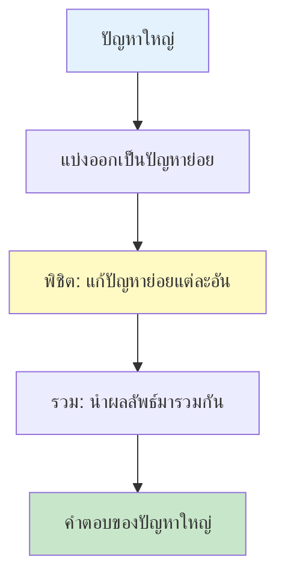

# บทที่ 13 การแบ่งและพิชิต (Divide and Conquer)

## วัตถุประสงค์การเรียนรู้
เมื่อเรียนจบบทนี้ นักศึกษาจะสามารถ
1. อธิบายแนวคิดการแบ่งและพิชิต (Divide and Conquer)
2. อธิบายอัลกอริทึมตัวอย่าง เช่น เมอร์จ์ซอร์ต ควิกซอร์ต การคูณเมทริกซ์ของสตรัสเซน
3. วิเคราะห์ความซับซ้อนโดยใช้ทฤษฎีบทมาสเตอร์ (Master Theorem)
4. แยกแยะการแบ่งและพิชิตกับไดนามิกโปรแกรมมิง
5. เขียนโปรแกรมแก้ปัญหาด้วยวิธีการแบ่งและพิชิตได้อย่างถูกต้อง

## การประเมิน
| รายการ | น้ำหนัก | หมายเหตุ |
|:---|:---:|:---|
| งานเขียนโปรแกรมแก้ปัญหาด้วยการแบ่งและพิชิต | 15% | โค้ดภาษา C/Python/Java |
| แบบทดสอบท้ายบท | 10% | ข้อควบคุมเลือกตอบและอัตนัย |
| การเข้าร่วมกิจกรรมเปรียบเทียบวิธีแก้ปัญหา | 5% | กิจกรรมกลุ่ม |

---

## 13.1 แนวคิดการแบ่งและพิชิต

การแบ่งและพิชิต (Divide and Conquer) คือกลยุทธ์การแก้ปัญหาที่แบ่งปัญหาใหญ่ออกเป็นปัญหาย่อยหลายๆ ปัญหา แก้แต่ละปัญหาย่อยแยกกัน แล้วนำผลลัพธ์มารวมกัน



### สามขั้นตอนหลัก

1. **แบ่ง (Divide)** – แบ่งปัญหาออกเป็นปัญหาย่อยที่มีโครงสร้างเดียวกันแต่ขนาดเล็กลง
2. **พิชิต (Conquer)** – แก้ปัญหาย่อยแต่ละอัน (มักใช้การเรียกซ้ำ)
3. **รวม (Combine)** – นำคำตอบของปัญหาย่อยมารวมเป็นคำตอบของปัญหาใหญ่

---

## 13.2 ตัวอย่างอัลกอริทึมแบ่งและพิชิต

### 1. เมอร์จ์ซอร์ต (Merge Sort)
แบ่งอาเรย์ออกเป็นสองส่วน เรียงแต่ละส่วนแล้วควบรวมกลับเข้าด้วยกัน

```
[38, 27, 43, 3, 9, 82, 10]
   แบ่ง → [38, 27, 43, 3] [9, 82, 10]
   เรียง → [3, 27, 38, 43] [9, 10, 82]
   ควบรวม → [3, 9, 10, 27, 38, 43, 82]
```

### 2. ควิกซอร์ต (Quick Sort)
เลือกปิโวต แบ่งอาเรย์ออกเป็นส่วนที่น้อยกว่าและมากกว่าปิโวต แล้วเรียงซ้ำ

```
[10, 80, 30, 90, 40, 50, 70] (pivot = 70)
   แบ่ง → [10, 30, 40, 50] [70] [80, 90]
   เรียงซ้ำแต่ละส่วน
```

### 3. การค้นหาค่าสูงสุดและต่ำสุด
แบ่งอาเรย์ออกเป็นสองส่วน หาค่าสูงสุดและต่ำสุดในแต่ละส่วน แล้วเปรียบเทียบกัน

### 4. การคูณเมทริกซ์ของสตรัสเซน (Strassen's Matrix Multiplication)
คูณเมทริกซ์ 2×2 โดยใช้การคูณ 7 ครั้งแทนที่จะเป็น 8 ครั้ง ลดความซับซ้อนจาก O(n³) เป็น O(n^2.81)

---

## 13.3 ทฤษฎีบทมาสเตอร์ (Master Theorem)

ใช้วิเคราะห์ความซับซ้อนของอัลกอริทึมแบ่งและพิชิตที่มีรูปแบบ:

```
T(n) = a · T(n/b) + f(n)
```

เมื่อ:
- a = จำนวนปัญหาย่อย
- n/b = ขนาดของแต่ละปัญหาย่อย
- f(n) = เวลาในการแบ่งและรวม

### กรณีของทฤษฎีบทมาสเตอร์

| กรณี | เงื่อนไข | ผลลัพธ์ T(n) |
|:---|:---|:---|
| กรณี 1 | f(n) = O(n^(log_b a - ε)) | T(n) = Θ(n^(log_b a)) |
| กรณี 2 | f(n) = Θ(n^(log_b a)) | T(n) = Θ(n^(log_b a) · log n) |
| กรณี 3 | f(n) = Ω(n^(log_b a + ε)) | T(n) = Θ(f(n)) |

### ตัวอย่างการใช้ทฤษฎีบทมาสเตอร์

**เมอร์จ์ซอร์ต:** T(n) = 2T(n/2) + O(n)
- a = 2, b = 2, log₂2 = 1, f(n) = O(n)
- f(n) = Θ(n¹) → กรณี 2
- T(n) = Θ(n log n)

**ควิกซอร์ต (กรณีดีที่สุด):** T(n) = 2T(n/2) + O(n)
- ผลลัพธ์เดียวกับเมอร์จ์ซอร์ต → T(n) = Θ(n log n)

**การคูณเมทริกซ์แบบธรรมดา:** T(n) = 8T(n/2) + O(n²)
- a = 8, b = 2, log₂8 = 3, f(n) = O(n²)
- f(n) = O(n^(3-1)) → กรณี 1 (ε = 1)
- T(n) = Θ(n³)

**สตรัสเซน:** T(n) = 7T(n/2) + O(n²)
- a = 7, b = 2, log₂7 ≈ 2.81, f(n) = O(n²)
- f(n) = O(n^(2.81-0.81)) → กรณี 1 (ε = 0.81)
- T(n) = Θ(n^2.81)

---

## 13.4 ความแตกต่างระหว่างการแบ่งและพิชิตกับไดนามิกโปรแกรมมิง

| ด้าน | การแบ่งและพิชิต | ไดนามิกโปรแกรมมิง |
|:---|:---|:---|
| ปัญหาย่อย | ไม่ทับซ้อนกัน | ทับซ้อนกัน |
| การแก้ปัญหาย่อย | แก้อิสระต่อกัน | เก็บผลลัพธ์ไว้ใช้ซ้ำ |
| การใช้การเรียกซ้ำ | ใช้บ่อย | ใช้บ่อย (แบบบนลงล่าง) |
| ตัวอย่าง | เมอร์จ์ซอร์ต ควิกซอร์ต | ฟีโบนักชี กระเป๋าเดินทาง LCS |

---

## แบบฝึกหัด

### ข้อที่ 1
จงอธิบายขั้นตอนของเมอร์จ์ซอร์ตด้วยการแบ่งและพิชิต

**คำตอบ:**
1. **แบ่ง:** แบ่งอาเรย์ออกเป็นสองส่วนเท่าๆ กัน
2. **พิชิต:** เรียงแต่ละส่วนโดยใช้เมอร์จ์ซอร์ตแบบเรียกซ้ำ
3. **รวม:** ควบรวมสองส่วนที่เรียงแล้วเข้าด้วยกันเป็นอาเรย์เดียวที่เรียงลำดับ

### ข้อที่ 2
จงใช้ทฤษฎีบทมาสเตอร์วิเคราะห์ความซับซ้อนของเมอร์จ์ซอร์ต

**คำตอบ:**
T(n) = 2T(n/2) + O(n)
- a = 2, b = 2, log₂2 = 1
- f(n) = O(n) = Θ(n¹)
- เข้าข่ายกรณี 2 ของทฤษฎีบทมาสเตอร์
- T(n) = Θ(n log n)

### ข้อที่ 3
จงเปรียบเทียบการแบ่งและพิชิตกับไดนามิกโปรแกรมมิงในกรณีแก้ปัญหาเดียวกัน

**คำตอบ:** ดูตารางในหัวข้อ 13.4

---

## แบบปฏิบัติการข้อสอบ

### ข้อควบคุมเลือกตอบ (จำนวน 6 ข้อ)

**ข้อ 1.** การแบ่งและพิชิตมีกี่ขั้นตอนหลัก
- ก. 2
- ข. 3
- ค. 4
- ง. 5

**ตอบ: ข** (แบ่ง พิชิต รวม)

**ข้อ 2.** ทฤษฎีบทมาสเตอร์ใช้สำหรับอะไร
- ก. วิเคราะห์ความซับซ้อนของอัลกอริทึมแบ่งและพิชิต
- ข. วิเคราะห์ความซับซ้อนของอัลกอริทึมเชิงละม่วน
- ค. วิเคราะห์ความซับซ้อนของอัลกอริทึมค้นหา
- ง. วิเคราะห์ความซับซ้อนของอัลกอริทึมเรียงลำดับทุกชนิด

**ตอบ: ก**

**ข้อ 3.** เมอร์จ์ซอร์ตมีความซับซ้อนเท่าใดในทุกกรณี
- ก. O(n)
- ข. O(n log n)
- ค. O(n²)
- ง. O(log n)

**ตอบ: ข**

**ข้อ 4.** ข้อใดไม่ใช่ตัวอย่างของอัลกอริทึมแบ่งและพิชิต
- ก. เมอร์จ์ซอร์ต
- ข. ควิกซอร์ต
- ค. สตรัสเซน
- ง. ฟีโบนักชีแบบไดนามิกโปรแกรมมิง

**ตอบ: ง**

**ข้อ 5.** ในทฤษฎีบทมาสเตอร์ T(n) = aT(n/b) + f(n) ตัวแปร a หมายถึงอะไร
- ก. ขนาดของปัญหาย่อย
- ข. จำนวนปัญหาย่อย
- ค. เวลาในการแบ่งและรวม
- ง. ขนาดของปัญหาเดิม

**ตอบ: ข**

**ข้อ 6.** ความแตกต่างหลักระหว่างการแบ่งและพิชิตกับไดนามิกโปรแกรมมิงคือ
- ก. การแบ่งและพิชิตใช้การเรียกซ้ำ ไดนามิกโปรแกรมมิงไม่ใช้
- ข. การแบ่งและพิชิตมีปัญหาย่อยทับซ้อน ไดนามิกโปรแกรมมิงไม่มี
- ค. การแบ่งและพิชิตไม่มีปัญหาย่อยทับซ้อน ไดนามิกโปรแกรมมิงมี
- ง. ไม่มีความแตกต่าง

**ตอบ: ค**

### ข้ออัตนัย (จำนวน 2 ข้อ)

**ข้อ 7.** จงเขียนโค้ดภาษา C หรือ Python แก้ปัญหาหาค่าสูงสุดและต่ำสุดในอาเรย์โดยใช้วิธีการแบ่งและพิชิต

**ข้อ 8.** จงใช้ทฤษฎีบทมาสเตอร์วิเคราะห์ความซับซ้อนของควิกซอร์ตในกรณีที่ดีที่สุด

---

## ภาคผนก

### ภาคผนก 13.1 โค้ดตัวอย่างอัลกอริทึมแบ่งและพิชิตทุกตัว

**ภาษา Python – ค้นหาค่าสูงสุดและต่ำสุดแบบแบ่งและพิชิต:**
```python
def find_min_max(arr, low, high):
    # กรณีมีสมาชิกตัวเดียว
    if low == high:
        return arr[low], arr[low]
    
    # กรณีมีสมาชิกสองตัว
    if high == low + 1:
        if arr[low] < arr[high]:
            return arr[low], arr[high]
        else:
            return arr[high], arr[low]
    
    # แบ่งออกเป็นสองส่วน
    mid = (low + high) // 2
    min1, max1 = find_min_max(arr, low, mid)
    min2, max2 = find_min_max(arr, mid + 1, high)
    
    # รวมผลลัพธ์
    return min(min1, min2), max(max1, max2)


# การใช้งาน
arr = [1000, 11, 445, 1, 330, 3000]
min_val, max_val = find_min_max(arr, 0, len(arr) - 1)
print(f"ค่าน้อยที่สุด: {min_val}, ค่ามากที่สุด: {max_val}")
```

### ภาคผนก 13.2 ตัวอย่างการใช้ทฤษฎีบทมาสเตอร์กับความสัมพันธ์ซ้ำต่างๆ

| อัลกอริทึม | ความสัมพันธ์ซ้ำ | log_b a | กรณี | ความซับซ้อน |
|:---|:---|:---:|:---:|:---:|
| เมอร์จ์ซอร์ต | T(n) = 2T(n/2) + O(n) | 1 | กรณี 2 | Θ(n log n) |
| ควิกซอร์ต (ดีที่สุด) | T(n) = 2T(n/2) + O(n) | 1 | กรณี 2 | Θ(n log n) |
| สตรัสเซน | T(n) = 7T(n/2) + O(n²) | 2.81 | กรณี 1 | Θ(n^2.81) |
| ค้นหาแบบไบนารี | T(n) = T(n/2) + O(1) | 0 | กรณี 2 | Θ(log n) |

---

## อ้างอิง

- เอกสารประกอบการสอน บทที่ 13 การแบ่งและพิชิต
- Cormen, T. H., et al. *Introduction to Algorithms*. Chapter on Divide and Conquer, MIT Press.
