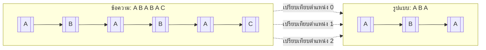
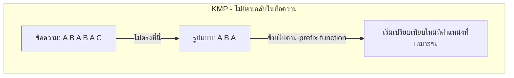
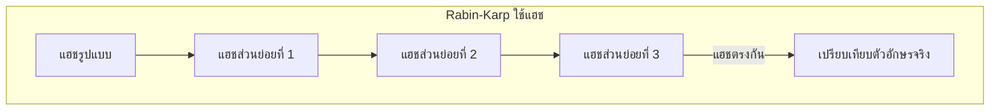
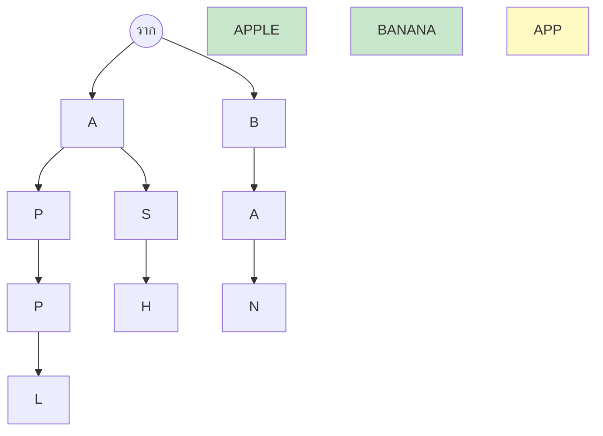

# บทที่ 14 อัลกอริทึมสตริง (String Algorithm)

## วัตถุประสงค์การเรียนรู้
เมื่อเรียนจบบทนี้ นักศึกษาจะสามารถ
1. อธิบายอัลกอริทึมค้นหาข้อความแบบเบื้องต้น (Brute Force)
2. อธิบายอัลกอริทึมค้นหาข้อความขั้นสูง เช่น KMP, Boyer-Moore, Rabin-Karp
3. อธิบายโครงสร้างข้อมูลสำหรับสตริง เช่น ทรีอา (Trie), ทรีอาหลัง (Suffix Tree)
4. เปรียบเทียบประสิทธิภาพของอัลกอริทึมค้นหาข้อความแต่ละชนิด
5. เขียนโปรแกรมค้นหาและจัดการข้อความได้อย่างถูกต้อง

## การประเมิน
| รายการ | น้ำหนัก | หมายเหตุ |
|:---|:---:|:---|
| งานเขียนโปรแกรมค้นหาข้อความ | 15% | โค้ดภาษา C/Python/Java |
| แบบทดสอบท้ายบท | 10% | ข้อควบคุมเลือกตอบและปฏิบัติการ |
| การเข้าร่วมกิจกรรมเปรียบเทียบอัลกอริทึมค้นหาข้อความ | 5% | กิจกรรมกลุ่ม |

---

## 14.1 อัลกอริทึมค้นหาข้อความแบบเบื้องต้น (Brute Force)

### แนวคิด
เปรียบเทียบรูปแบบ (pattern) กับข้อความ (text) ทีละตำแหน่ง ตั้งแต่ตำแหน่งแรกจนถึงตำแหน่งสุดท้ายที่เป็นไปได้



### ตัวอย่างโค้ด (ภาษา Python)
```python
def brute_force_search(text, pattern):
    n = len(text)
    m = len(pattern)
    
    for i in range(n - m + 1):
        match = True
        for j in range(m):
            if text[i + j] != pattern[j]:
                match = False
                break
        if match:
            return i  # พบที่ดัชนี i
    
    return -1  # ไม่พบ


# การใช้งาน
text = "ABABAC"
pattern = "ABA"
print(brute_force_search(text, pattern))  # 0 (พบที่ตำแหน่ง 0)
```

ความซับซ้อน: Best O(n), Worst O(n × m)

---

## 14.2 อัลกอริทึมค้นหาข้อความของ Knut-Morris-Pratt (KMP)

### แนวคิด
เมื่อเกิดการไม่ตรงกัน KMP จะไม่ย้อนกลับในข้อความ แต่ใช้ข้อมูลจากรูปแบบเองเพื่อข้ามไปข้างหน้า โดยสร้างตาราง "prefix function" (failure function) ล่วงหน้า



### ตัวอย่างโค้ด (ภาษา Python)
```python
def compute_lps(pattern):
    """สร้างตาราง longest proper prefix which is also suffix"""
    m = len(pattern)
    lps = [0] * m
    length = 0
    i = 1
    
    while i < m:
        if pattern[i] == pattern[length]:
            length += 1
            lps[i] = length
            i += 1
        else:
            if length != 0:
                length = lps[length - 1]
            else:
                lps[i] = 0
                i += 1
    return lps


def kmp_search(text, pattern):
    n = len(text)
    m = len(pattern)
    lps = compute_lps(pattern)
    
    i = j = 0
    while i < n:
        if pattern[j] == text[i]:
            i += 1
            j += 1
        
        if j == m:
            return i - j  # พบที่ดัชนี i-j
            j = lps[j - 1]
        elif i < n and pattern[j] != text[i]:
            if j != 0:
                j = lps[j - 1]
            else:
                i += 1
    
    return -1


# การใช้งาน
text = "ABABAC"
pattern = "ABA"
print(kmp_search(text, pattern))  # 0
```

ความซับซ้อน: O(n + m) สร้างลפס O(m) ค้นหา O(n)

---

## 14.3 อัลกอริทึมค้นหาข้อความของ Boyer-Moore

### แนวคิด
เปรียบเทียบจากท้ายรูปแบบไปหาหัว เมื่อพบตัวอักษรที่ไม่ตรงกัน จะข้มไปหลายตำแหน่งในครั้งเดียว โดยใช้กฎสองกฎ:
1. **Bad Character Rule** – ข้ามตามตัวอักษรในข้อความที่ไม่ตรงกัน
2. **Good Suffix Rule** – ข้ามตามคำต่อท้ายที่ตรงกันแล้ว

ความซับซ้อน: Best O(n/m), Worst O(n × m) แต่เร็วมากในทางปฏิบัติ โดยเฉพาะกับตัวอักษรเซตใหญ่

---

## 14.4 อัลกอริทึมค้นหาข้อความของ Rabin-Karp

### แนวคิด
ใช้การแฮช (hashing) เปรียบเทียบรหัสแฮชของรูปแบบกับรหัสแฮชของส่วนย่อยในข้อความ ถ้ารหัสแฮชตรงกันจึงเปรียบเทียบตัวอักษรจริง



สามารถคำนวณแฮชส่วนย่อยถัดไปจากแฮชปัจจุบันได้ในเวลา O(1) (rolling hash)

ความซับซ้อน: Average O(n + m), Worst O(n × m)

---

## 14.5 โครงสร้างข้อมูลสำหรับสตริง

### ทรีอา (Trie)

ต้นไม้ที่ใช้เก็บสตริง แต่ละขอบแทนตัวอักษรหนึ่งตัว เหมาะสำหรับการค้นหาคำนำหน้า (prefix)



### ตัวอย่างโค้ดทรีอา (ภาษา Python)
```python
class TrieNode:
    def __init__(self):
        self.children = {}
        self.is_end_of_word = False


class Trie:
    def __init__(self):
        self.root = TrieNode()
    
    def insert(self, word):
        node = self.root
        for char in word:
            if char not in node.children:
                node.children[char] = TrieNode()
            node = node.children[char]
        node.is_end_of_word = True
    
    def search(self, word):
        node = self.root
        for char in word:
            if char not in node.children:
                return False
            node = node.children[char]
        return node.is_end_of_word
    
    def starts_with(self, prefix):
        node = self.root
        for char in prefix:
            if char not in node.children:
                return False
            node = node.children[char]
        return True


# การใช้งาน
trie = Trie()
trie.insert("apple")
trie.insert("app")
trie.insert("banana")
print(trie.search("app"))        # True
print(trie.search("appl"))       # False
print(trie.starts_with("app"))   # True
```

---

## 14.6 การเปรียบเทียบประสิทธิภาพการค้นหาข้อความ

| อัลกอริทึม | Best | Average | Worst | หมายเหตุ |
|:---|:---:|:---:|:---:|:---|
| Brute Force | O(n) | O(n × m) | O(n × m) | ง่ายที่สุด ช้าที่สุด |
| KMP | O(n + m) | O(n + m) | O(n + m) | ไม่ย้อนกลับในข้อความ |
| Boyer-Moore | O(n/m) | O(n/m) | O(n × m) | เร็วมากในทางปฏิบัติ |
| Rabin-Karp | O(n + m) | O(n + m) | O(n × m) | ใช้แฮช เหมาะค้นหาหลายรูปแบบ |

---

## แบบฝึกหัด

### ข้อที่ 1
จงเขียนอัลกอริทึมค้นหาข้อความแบบเบื้องต้น

**คำตอบ:** ดูโค้ดในหัวข้อ 14.1 ฟังก์ชัน `brute_force_search`

### ข้อที่ 2
จงอธิบายข้อดีของ KMP เมื่อเทียบกับการค้นหาแบบเบื้องต้น

**คำตอบ:** KMP ไม่ย้อนกลับในข้อความเมื่อเกิดการไม่ตรงกัน แต่ใช้ตาราง prefix function เพื่อข้ามไปข้างหน้า ทำให้ความซับซ้อนคงที่ O(n + m) แข็งแกร่งกว่า brute force ที่อาจเป็น O(n × m)

### ข้อที่ 3
จงเปรียบเทียบ Boyer-Moore กับ Rabin-Karp ในด้านประสิทธิภาพ

**คำตอบ:**
- Boyer-Moore: เร็วมากเมื่อตัวอักษรเซตใหญ่ เปรียบเทียบจากท้ายรูปแบบ กรณีดีที่สุด O(n/m)
- Rabin-Karp: ใช้แฮช เหมาะเมื่อต้องการค้นหาหลายรูปแบบพร้อมกัน กรณีเฉลี่ย O(n + m)
- Boyer-Moore มักเร็วกว่าสำหรับการค้นหารูปแบบเดียวในข้อความยาว

---

## แบบปฏิบัติการข้อสอบ

### ข้อควบคุมเลือกตอบ (จำนวน 8 ข้อ)

**ข้อ 1.** อัลกอริทึมค้นหาข้อความแบบใดง่ายที่สุดแต่ช้าที่สุด
- ก. KMP
- ข. Brute Force
- ค. Boyer-Moore
- ง. Rabin-Karp

**ตอบ: ข**

**ข้อ 2.** KMP แตกต่างจาก Brute Force ตรงที่
- ก. KMP ไม่ย้อนกลับในข้อความเมื่อไม่ตรงกัน
- ข. KMP ใช้แฮช
- ค. KMP เปรียบเทียบจากท้ายรูปแบบ
- ง. KMP ช้ากว่า Brute Force เสมอ

**ตอบ: ก**

**ข้อ 3.** Boyer-Moore เปรียบเทียบรูปแบบกับข้อความจากทิศทางใด
- ก. จากหัวไปท้าย
- ข. จากท้ายไปหัว
- ค. จากกลางออกทั้งสองด้าน
- ง. แบบสุ่ม

**ตอบ: ข**

**ข้อ 4.** Rabin-Karp ใช้อะไรในการเปรียบเทียบรูปแบบกับข้อความ
- ก. ตัวชี้
- ข. การแฮช (hashing)
- ค. ลิสต์การเชื่อมต่อ
- ง. สแตก

**ตอบ: ข**

**ข้อ 5.** ทรีอา (Trie) เหมาะสำหรับการค้นหาอะไร
- ก. คำนำหน้า (prefix)
- ข. คำต่อท้าย (suffix)
- ค. คำกลาง
- ง. คำทั้งหมด

**ตอบ: ก**

**ข้อ 6.** ความซับซ้อนแย่ที่สุดของ Brute Force คือ
- ก. O(n)
- ข. O(n × m)
- ค. O(n + m)
- ง. O(log n)

**ตอบ: ข**

**ข้อ 7.** ความซับซ้อนของ KMP ในทุกกรณีคือ
- ก. O(n)
- ข. O(n × m)
- ค. O(n + m)
- ง. O(n²)

**ตอบ: ค**

**ข้อ 8.** ข้อใดไม่ใช่อัลกอริทึมค้นหาข้อความ
- ก. KMP
- ข. Boyer-Moore
- ค. Rabin-Karp
- ง. เมอร์จ์ซอร์ต

**ตอบ: ง**

### ข้อปฏิบัติการ (จำนวน 2 ข้อ)

**ข้อ 9.** จงเขียนโค้ดภาษา C หรือ Python ค้นหาข้อความโดยใช้ brute force และ KMP แล้วเปรียบเทียบจำนวนครั้งที่เปรียบเทียบ

**ข้อ 10.** จงเขียนโค้ดสร้างทรีอาและรองรับการแทรก ค้นหา และตรวจสอบคำนำหน้า

---

## ภาคผนก

### ภาคผนก 14.1 โค้ดตัวอย่างอัลกอริทึมค้นหาข้อความทุกชนิด

**ภาษา Java – Brute Force:**
```java
public class BruteForce {
    static int search(String text, String pattern) {
        int n = text.length();
        int m = pattern.length();
        
        for (int i = 0; i <= n - m; i++) {
            int j;
            for (j = 0; j < m; j++) {
                if (text.charAt(i + j) != pattern.charAt(j))
                    break;
            }
            if (j == m)
                return i;
        }
        return -1;
    }
}
```

### ภาคผนก 14.2 ตัวอย่างการประยุกต์ใช้ค้นหาข้อความในเครื่องมือแก้ไขข้อความ

เครื่องมือแก้ไขข้อความเช่น Notepad, VS Code ใช้อัลกอริทึมค้นหาข้อความในฟีเจอร์ "Find" (ค้นหา) และ "Find and Replace" (ค้นหาและแทนที่) โดยอาจใช้ KMP หรือ Boyer-Moore สำหรับข้อความยาวๆ

---

## อ้างอิง

- เอกสารประกอบการสอน บทที่ 14 อัลกอริทึมสตริง
- คู่มืออัลกอริทึมสตริงสำหรับนักศึกษา
