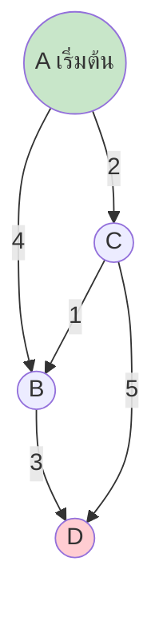
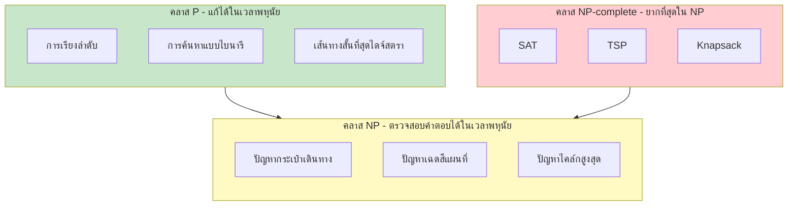

# บทที่ 15 อัลกอริทึมขั้นสูงและหัวข้อพิเศษ

## วัตถุประสงค์การเรียนรู้
เมื่อเรียนจบบทนี้ นักศึกษาจะสามารถ
1. อธิบายอัลกอริทึมขั้นสูง เช่น เส้นทางที่สั้นที่สุดของไดจ์สตรา ฟลอยด์-วอแชลล์
2. อธิบายความซับซ้อนเชิงคำนวการและคลาส P, NP, NP-complete
3. อธิบายแนวคิดการประมาณผลและอัลกอริทึมสุ่ม
4. สังเคราะห์ความรู้จากทุกบทเพื่อออกแบบระบบที่ใช้โครงสร้างข้อมูลและอัลกอริทึม
5. เขียนโปรแกรมแก้ปัญหาขั้นสูงได้อย่างถูกต้องและเหมาะสม

## การประเมิน
| รายการ | น้ำหนัก | หมายเหตุ |
|:---|:---:|:---|
| โครงงานปลายทาง (Final Project) | 20% | ออกแบบและเขียนโปรแกรมแก้ปัญหาจริง |
| แบบทดสอบท้ายบท | 10% | ข้อควบคุมเลือกตอบและปฏิบัติการ |
| การนำเสนอโครงงาน | 10% | นำเสนอโครงงานปลายทาง |

---

## 15.1 อัลกอริทึมเส้นทางที่สั้นที่สุด

### อัลกอริทึมไดจ์สตรา (Dijkstra's Algorithm)

หาเส้นทางที่สั้นที่สุดจากจุดเริ่มต้นไปยังทุกจุดในกราฟที่มีน้ำหนักไม่ติดลบ



**ขั้นตอน:**
1. กำหนดระยะห่างจากจุดเริ่มต้นเป็น 0 จุดอื่นเป็น อนันต์
2. เลือกจุดที่ยังไม่ visit และมีระยะห่างน้อยที่สุด
3. อัปเดตระยะห่างของจุดข้างเคียง
4. ทำซ้ำจนครบทุกจุด

### ตัวอย่างโค้ดไดจ์สตรา (ภาษา Python)
```python
import heapq

def dijkstra(graph, start):
    distances = {node: float('infinity') for node in graph}
    distances[start] = 0
    pq = [(0, start)]
    
    while pq:
        current_distance, current_node = heapq.heappop(pq)
        
        if current_distance > distances[current_node]:
            continue
        
        for neighbor, weight in graph[current_node].items():
            distance = current_distance + weight
            
            if distance < distances[neighbor]:
                distances[neighbor] = distance
                heapq.heappush(pq, (distance, neighbor))
    
    return distances


# การใช้งาน
graph = {
    'A': {'B': 4, 'C': 2},
    'B': {'C': 1, 'D': 3},
    'C': {'B': 1, 'D': 5},
    'D': {}
}
print(dijkstra(graph, 'A'))
# {'A': 0, 'B': 3, 'C': 2, 'D': 6}
```

ความซับซ้อน: O((V + E) log V) เมื่อใช้ priority queue

### อัลกอริทึมฟลอยด์-วอแชลล์ (Floyd-Warshall)

หาเส้นทางที่สั้นที่สุดระหว่างทุกคู่ของจุดยอด (All-Pairs Shortest Path) ใช้ไดนามิกโปรแกรมมิง

ความซับซ้อน: O(V³)

---

## 15.2 ความซับซ้อนเชิงคำนวการและคลาส P, NP, NP-complete



### คลาส P (Polynomial time)
ปัญหาที่แก้ได้ในเวลาพหุนัย เช่น การเรียงลำดับ การค้นหา

### คลาส NP (Nondeterministic Polynomial time)
ปัญหาที่ถ้ามีคำตอบแล้วสามารถตรวจสอบว่าถูกต้องในเวลาพหุนัย

### คลาส NP-complete
ปัญหาที่ยากที่สุดในคลาส NP ถ้าแก้ปัญหาใดปัญหาหนึ่งใน NP-complete ได้ในเวลาพหุนัย ปัญหาใน NP ทั้งหมดก็จะแก้ได้ในเวลาพหุนัยเช่นกัน

ตัวอย่าง NP-complete: ปัญหากระเป๋าเดินทาง (TSP), ปัญหาเฉดสีแผนที่, ปัญหาความพอพอ (SAT)

### คำถาม P vs NP
ยังไม่มีผู้ใดพิสูจน์ว่า P = NP หรือ P ≠ NP เป็นหนึ่งในปัญหามิลเลนเนียมของสถาบันคณิตศาสตร์เคลย์

---

## 15.3 อัลกอริทึมประมาณผลและอัลกอริทึมสุ่ม

สำหรับปัญหาที่ยากเกินไป (NP-hard) อาจใช้การประมาณผลที่ให้คำตอบใกล้เคียงกับคำตอบที่ดีที่สุดภายในเวลาที่ยอมรับได้

ตัวอย่าง: อัลกอริทึมประมาณผลสำหรับ TSP ให้เส้นทางที่ยาวไม่เกินสองเท่าของเส้นทางที่สั้นที่สุด

---

## 15.4 อัลกอริทึมสำหรับสายเครือข่าย

### อัลกอริทึมฟูล์คูลสัน-เฟิร์กเกอร์สัน (Ford-Fulkerson)

หาปริมาณการไหลสูงสุด (Maximum Flow) ในเครือข่ายจากจุดต้นทางไปจุดปลายทาง

---

## 15.5 การสังเคราะห์ความรู้และการออกแบบระบบ

นักศึกษาควรสามารถเลือกใช้โครงสร้างข้อมูลและอัลกอริทึมที่เหมาะสมกับปัญหา เช่น:

| ปัญหา | โครงสร้างข้อมูลที่แนะนำ | อัลกอริทึมที่แนะนำ |
|:---|:---|:---|
| ค้นหาข้อมูลบ่อย | ตารางแฮช | ฟังก์ชันแฮช |
| เรียงลำดับข้อมูล | อาเรย์ | เมอร์จ์ซอร์ต ควิกซอร์ต |
| หาเส้นทางสั้นที่สุด | กราฟ + คิว priority | ไดจ์สตรา |
| บีบอัดข้อมูล | ต้นไม้ฮัฟฟ์แมน | ฮัฟฟ์แมนคoding |
| จัดการงานตามลำดับความสำคัญ | ฮีป (Heap) | ฮีปซอร์ต |

---

## 15.6 หัวข้อพิเศษตามความสนใจของนักศึกษา

- อัลกอริทึมบล็อกเชน
- อัลกอริทึมในปัญญาประดิษฐ์
- อัลกอริทึมการเข้ารหัสลับ
- อัลกอริทิธมสำหรับข้อมูลขนาดใหญ่ (Big Data)

---

## แบบฝึกหัด

### ข้อที่ 1
จงเขียนอัลกอริทึมไดจ์สตราเพื่อหาเส้นทางที่สั้นที่สุดในกราฟที่กำหนด

**คำตอบ:** ดูโค้ดในหัวข้อ 15.1

### ข้อที่ 2
จงอธิบายความแตกต่างระหว่างคลาส P กับคลาส NP

**คำตอบ:**
- คลาส P: ปัญหาที่แก้ได้ในเวลาพหุนัย
- คลาส NP: ปัญหาที่ตรวจสอบคำตอบได้ในเวลาพหุนัย (ถ้ามีคำตอบแล้ว)

### ข้อที่ 3
จงออกแบบระบบเบื้องต้นโดยเลือกใช้โครงสร้างข้อมูลและอัลกอริทึมที่เหมาะสม

**คำตอบ:** ตัวอย่าง เช่น ระบบเครือข่ายสังคมใช้กราฟในการแสดงความสัมพันธ์ ระบบค้นหาใช้ตารางแฮชในการจัดเก็บข้อมูลผู้ใช้

---

## แบบปฏิบัติการข้อสอบ

### ข้อควบคุมเลือกตอบ (จำนวน 8 ข้อ)

**ข้อ 1.** อัลกอริทึมไดจ์สตราใช้สำหรับหาอะไร
- ก. ต้นไม้ครอบคลุมน้ำหนักน้อยที่สุด
- ข. เส้นทางที่สั้นที่สุดจากจุดหนึ่งไปทุกจุด
- ค. การเรียงลำดับข้อมูล
- ง. การบีบอัดข้อมูล

**ตอบ: ข**

**ข้อ 2.** คลาส P หมายถึงปัญหาที่
- ก. ตรวจสอบคำตอบได้ในเวลาพหุนัย
- ข. แก้ได้ในเวลาพหุนัย
- ค. ไม่สามารถแก้ได้
- ง. แก้ได้ด้วยอัลกอริทึมสุ่มเท่านั้น

**ตอบ: ข**

**ข้อ 3.** ปัญหาใดเป็นตัวอย่างของ NP-complete
- ก. การเรียงลำดับข้อมูล
- ข. ปัญหากระเป๋าเดินทาง (TSP)
- ค. การค้นหาแบบไบนารี
- ง. การหาค่ามากที่สุดในอาเรย์

**ตอบ: ข**

**ข้อ 4.** อัลกอริทึมฟลอยด์-วอแชลล์หาอะไร
- ก. เส้นทางสั้นที่สุดจากจุดเดียว
- ข. เส้นทางสั้นที่สุดระหว่างทุกคู่จุด
- ค. ต้นไม้ครอบคลุมน้ำหนักน้อยที่สุด
- ง. การไหลสูงสุดในเครือข่าย

**ตอบ: ข**

**ข้อ 5.** อัลกอริทึมประมาณผลใช้สำหรับอะไร
- ก. ปัญหาที่แก้ได้ง่าย
- ข. ปัญหาที่ยากเกินไป (NP-hard) ต้องการคำตอบใกล้เคียง
- ค. ปัญหาการเรียงลำดับ
- ง. ปัญหาการค้นหา

**ตอบ: ข**

**ข้อ 6.** ความซับซ้อนของฟลอยด์-วอแชลล์คือ
- ก. O(V)
- ข. O(V²)
- ค. O(V³)
- ง. O(2ᵛ)

**ตอบ: ค**

**ข้อ 7.** อัลกอริทึมฟูล์คูลสัน-เฟิร์กเกอร์สันใช้สำหรับหาอะไร
- ก. เส้นทางที่สั้นที่สุด
- ข. การไหลสูงสุดในเครือข่าย
- ค. การบีบอัดข้อมูล
- ง. การเรียงลำดับ

**ตอบ: ข**

**ข้อ 8.** คำถาม P vs NP ยังไม่มีคำตอบหรือไม่
- ก. มีคำตอบแล้วว่า P = NP
- ข. มีคำตอบแล้วว่า P ≠ NP
- ค. ยังไม่มีคำตอบ
- ง. ไม่เกี่ยวข้องกับวิทยาการคอมพิวเตอร์

**ตอบ: ค**

### ข้อปฏิบัติการ (จำนวน 3 ข้อ)

**ข้อ 9.** จงเขียนโค้ดภาษา C หรือ Python ใช้ไดจ์สตราหาเส้นทางที่สั้นที่สุดในกราฟที่ป้อนจากผู้ใช้

**ข้อ 10.** จงออกแบบระบบฐานข้อมูลพนักงานโดยเลือกใช้โครงสร้างข้อมูลและอัลกอริทึมที่เหมาะสม อธิบายเหตุผลที่เลือก

**ข้อ 11.** จงเขียนโปรแกรมแก้ปัญหาขั้นสูงจากสถานการณ์ที่กำหนด เช่น ระบบเส้นทางรถไฟฟ้า ระบบเครือข่ายสังคม

---

## ภาคผนก

### ภาคผนก 15.1 โค้ดตัวอย่างอัลกอริทึมขั้นสูงทุกตัว

**ภาษา C – ฟลอยด์-วอแชลล์:**
```c
void floyd_warshall(int graph[V][V], int V) {
    int dist[V][V];
    
    for (int i = 0; i < V; i++)
        for (int j = 0; j < V; j++)
            dist[i][j] = graph[i][j];
    
    for (int k = 0; k < V; k++) {
        for (int i = 0; i < V; i++) {
            for (int j = 0; j < V; j++) {
                if (dist[i][k] + dist[k][j] < dist[i][j])
                    dist[i][j] = dist[i][k] + dist[k][j];
            }
        }
    }
}
```

### ภาคผนก 15.2 แนวทางการทำโครงงานปลายทางและเกณฑ์การประเมิน

**ขั้นตอนการทำโครงงาน:**
1. เลือกปัญหาที่สนใจจากชีวิตจริง
2. วิเคราะห์และออกแบบโครงสร้างข้อมูลที่เหมาะสม
3. เลือกอัลกอริทึมที่ใช้แก้ปัญหา
4. เขียนโปรแกรมและทดสอบ
5. นำเสนอผลงาน

**เกณฑ์การประเมิน:**
- ความเหมาะสมของโครงสร้างข้อมูลและอัลกอริทึม (40%)
- ความถูกต้องของโปรแกรม (30%)
- การนำเสนอและเอกสารประกอบ (20%)
- ความคิดสร้างสรรค์ (10%)

---

## อ้างอิง

- เอกสารประกอบการสอน บทที่ 15 อัลกอริทึมขั้นสูงและหัวข้อพิเศษ
- Cormen, T. H., et al. *Introduction to Algorithms*. Chapters on Advanced Algorithms, MIT Press.
